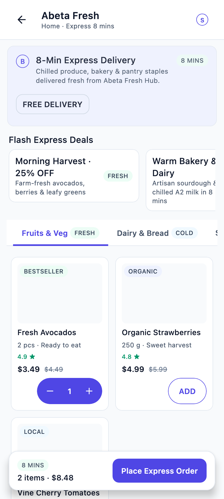
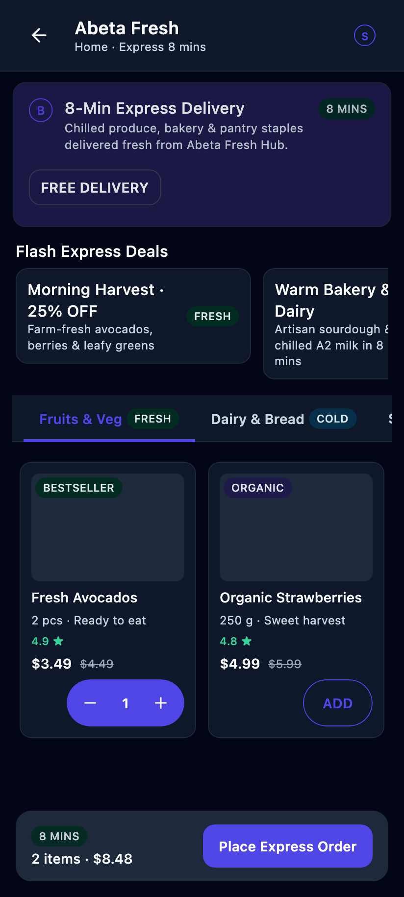
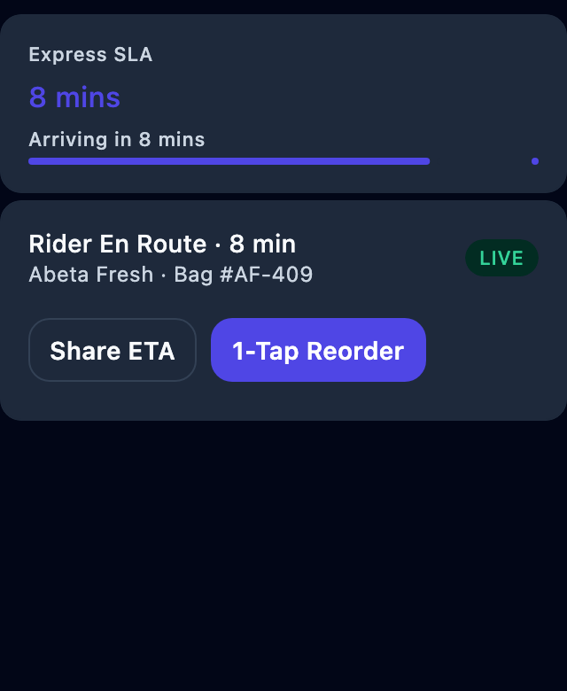
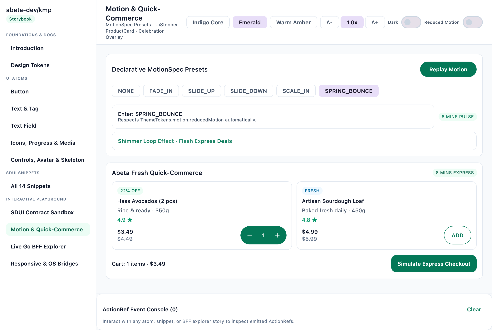
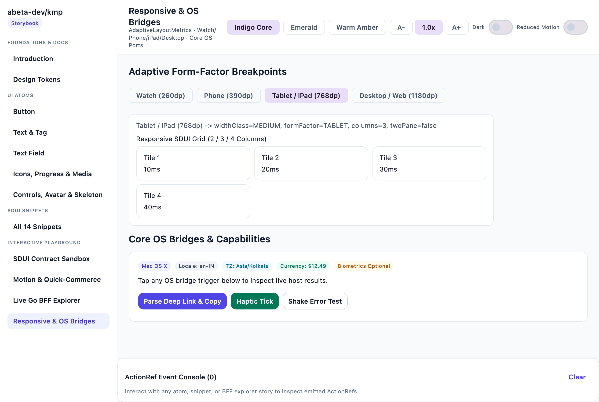
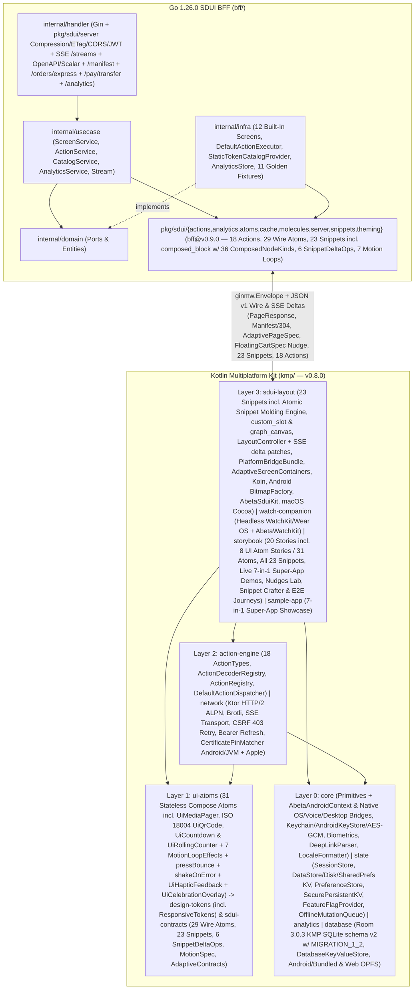

# abeta-dev/kmp

[](https://abeta-dev.github.io/kmp/)
[](https://abeta-dev.github.io/kmp/storybook/)
[](https://github.com/abeta-dev/kmp/actions/workflows/kmp-ci.yml)
[](https://github.com/abeta-dev/kmp/actions/workflows/bff-ci.yml)
[](https://github.com/abeta-dev/kmp/actions/workflows/quality-security.yml)
[](https://github.com/abeta-dev/kmp/actions/workflows/pages.yml)
[](LICENSE)

**Abeta KMP Kit (`dev.abeta.kmp`)** is an open-source, Server-Driven UI (SDUI) monorepo pairing a layered **Kotlin Multiplatform + Compose Multiplatform UI, Wearable & SDUI Kit (`kmp/`)** (**11 publishable library modules** plus `kmp-bom` and `dependencyManagement`) with a **Go 1.26.0 Clean Architecture SDUI Backend-for-Frontend (`bff/`)**.

Designed around **Clean Architecture**, the **Uncle Bob Dependency Rule**, **SOLID principles**, and strict **Atomic / Action decoupling**, the repository shares a 1:1 versioned JSON wire contract (`v1` — **29 Wire Atoms** incl. `MediaPagerAtom`, `CountdownAtom` w/ `expires_at_epoch_ms`, `StepperAtom`, and 12 `ExtendedAtoms`, **31 Stateless Compose UI Atoms** incl. ISO/IEC 18004 `UiQrCode`, **23 Canonical Snippet Types** adding `nudge_bar`, `marquee_strip`, `order_tracker`, **`composed_block` Atomic Snippet Molding Engine** with **36 `ComposedNodeKind`s**, `custom_slot`, and `graph_canvas`, **18 Built-in Action Types**, **6 `SnippetDeltaOp`s** for SSE live streaming, declarative **`MotionSpec` (7 Ambient `MotionLoopEffect`s) / `FeedbackEffect`**, **`FloatingCartSpec` Free-Delivery Threshold Nudge**, and **responsive `AdaptivePageSpec`**) between the Go BFF (`bff@v0.9.0`) and KMP client modules (`v0.8.0`, shipping native Android `.aar` targets via AGP `9.5.3` across all 11 publishable libraries)—powering a **7-in-1 Super-App Showcase Launcher** (**Abeta Fresh**, **Abeta Bites**, **Abeta Pulse**, **Abeta Mart**, **Abeta Spark**, **Abeta Trade**, **Abeta Pay**) and a **20-story End-to-End Storybook** (featuring **Live 7-in-1 Super-App Demos**, a complete **31-Atom Gallery**, **All 23 Snippets**, **Animation & Nudges Lab**, **Atomic Snippet Crafter**, **Voice & Desktop OS Bridges**, and **End-to-End App Journeys**)—managed through a published **Gradle BOM (`io.github.abeta-dev:bom:0.8.0`)**, **Gradle Version Catalog (`io.github.abeta-dev:dependencies:0.8.0`)**, and **Binary Compatibility Validator (`apiCheck`)**.

> **Live Portal & Interactive WasmJS Storybook**: Explore [**abeta-dev.github.io/kmp**](https://abeta-dev.github.io/kmp/) · [**Launch Live Compose WasmJS Storybook →**](https://abeta-dev.github.io/kmp/storybook/) · [**Dokka v2 API Reference**](https://abeta-dev.github.io/kmp/api/core/).
> **AI / LLM Documentation (`llmstxt.org`)**: Ingest [`llms.txt`](llms.txt) (concise documentation & skill index) or [`llms-full.txt`](llms-full.txt) (self-contained full technical reference).
> **Abeta SDUI Platform (3-Repo Ecosystem)**: **Abeta KMP Kit** (`Abeta-dev/kmp`, this repo) · [**Abeta Layout Engine**](https://github.com/Abeta-dev/layout-engine) ([`llms.txt`](https://raw.githubusercontent.com/Abeta-dev/layout-engine/main/llms.txt)) · [**Abeta SDUI BFF**](https://github.com/Abeta-dev/sdui-bff) ([`llms.txt`](https://raw.githubusercontent.com/Abeta-dev/sdui-bff/main/llms.txt)).

---

## Visual Showcase (Live Compose Multiplatform Renders)

Pixel-accurate Retina captures rendered directly from `kmp/sample-app` and `kmp/storybook` (full 19-screen gallery across the **7-in-1 Super-App Showcase** & core screens, with regeneration commands in [docs/demo-screenshots.md](docs/demo-screenshots.md)):

| Abeta Fresh Express — Desktop Split-Pane (`store-home`) | Interactive Storybook — All 23 Snippets (Dark Mode) |
| :---: | :---: |
|  |  |

| Phone Light (`412dp` 2-Col Grid) | Phone Dark (`412dp`) | Watch Glance (`watch-status`) |
| :---: | :---: | :---: |
|  |  |  |

| Storybook — Motion & Quick-Commerce | Storybook — Responsive Breakpoints & OS Bridges |
| :---: | :---: |
|  |  |

---

## Architecture Overview

Every module belongs to a single architectural layer. Dependencies strictly point **inward** toward pure abstractions and wire contracts—never outward toward frameworks, transports, or concrete handlers.



---

## Module Matrix

### Supported Multiplatform Targets & Host Glue (`kmp/`)

- **Headless / Contract Publishable Modules** (`core`, `state`, `analytics`, `database`, `sdui-contracts`, `action-engine`, `network`, `watch-companion`): native **`android` `.aar`** (`com.android.kotlin.multiplatform.library` `9.5.3`, `compileSdk = 37`, `minSdk = 24`), `jvm`, `iosArm64`, `iosSimulatorArm64`, `macosArm64`, `watchosArm64`, `watchosSimulatorArm64`, `watchosDeviceArm64`, `wasmJs`.
- **Compose UI Publishable Modules** (`design-tokens`, `ui-atoms`, `sdui-layout`): native **`android` `.aar`** (`compileSdk = 37`, `minSdk = 24`), `jvm`, `iosArm64`, `iosSimulatorArm64`, `macosArm64`, `wasmJs`.
- **`storybook`**: `jvm`, `iosArm64`, `iosSimulatorArm64`, `macosArm64`, `wasmJs`.
- **`sample-app`**: JVM Desktop & `--headless` CLI.
- **Native Android `.aar` Support & Drop-in Reference Host Glue (`kmp/platforms/`)**:
  - All **11 publishable KMP modules** ship native `io.github.abeta-dev:<module>-android:0.8.0` `.aar` artifacts with built-in `androidMain` actuals (Clipboard, ExternalLauncher, Haptics, Connectivity, `AndroidKeyStore` `SecureKeyValueStore`, `SharedPreferences`, Room 3 Android builder, OkHttp SPKI pinning, `BitmapFactory`). Call `AbetaAndroidContext.initialize(applicationContext)` once at startup.
  - `kmp/platforms/android/AndroidPlatformBridgeFactory.kt`, `AbetaAndroidHostActivity.kt` & `AndroidDatabaseFactory.kt` — Android `ComponentActivity` / `FragmentActivity` host templates (`BiometricPrompt`, `ActivityResultContracts`, push token hook, deep links, `SduiScreen`, and Room 3 Android helpers).
  - `kmp/platforms/wearos/WearCompanionHostActivity.kt` & `WearSduiRenderer.kt` — Android Wear OS `ComponentActivity` wiring `:watch-companion`'s `WatchCompanionController` + Android-native bridges into modular Wear Compose Material (`WearSduiScreen`, `WearGlanceContent`, `WearTileSnapshotMapper`).
  - `kmp/platforms/apple/AbetaAppleHosts.swift` & `kmp/platforms/apple/Sources/{AbetaSduiSwiftUI,AbetaWatchSwiftUI}/` — SwiftUI hosts & importable SwiftPM source targets (`AbetaSduiKit` / `AbetaSduiSwiftUI` for iOS 15+, `AbetaWatchKit` / `AbetaWatchSwiftUI` for watchOS 9+, macOS `launchMacOsSduiWindow`) packaged into 4-product `Abeta-dev/kmp-spm` (`0.8.0`) directly by `scripts/package_xcframeworks.sh`.
  - `kmp/platforms/web/README.md` — Browser COOP/COEP Cross-Origin Isolation header guide for Room 3 `wasmJs` OPFS Web Worker persistence.

### KMP Modules (`kmp/`)

| Layer | Module | Maven Coordinate | Responsibility |
| :--- | :--- | :--- | :--- |
| **Catalog** | `dependencyManagement` | `io.github.abeta-dev:dependencies:0.8.0` | Centralized Gradle Version Catalog (`libs.versions.toml` & `internal.versions.toml`) |
| **Platform** | `kmp-bom` | `io.github.abeta-dev:bom:0.8.0` | Java Platform BOM aligning all **11 publishable `io.github.abeta-dev:*` modules** (incl. native `-android` `.aar` targets; Kotlin package `dev.abeta.kmp.*`) + `dependencies` (**13 Maven Central artifacts**) |
| **Layer 0** | `core` | `io.github.abeta-dev:core:0.8.0` | `AppResult`, `AppError`, `DispatcherProvider`, `Clock`, `AppLogger`/`RedactingAppLogger`, `KeyValueStore`/`ObservableKeyValueStore`, `UuidGenerator`, `BackoffPolicy`, `SingleFlight`, `Debouncer`, `ClickBackpressureGuard`, `SensitiveDataRedactor`, `FieldValidators`, `AbetaAndroidContext`, `PlatformInfo`, `PlatformCapabilities`, native `androidMain` actuals, `HapticEngine`, `ClipboardPort`, `ExternalLauncherPort`, `SharePort`, `ConnectivityMonitor`, `PermissionPort`, `LocationPort` (`wasmJs` Geolocation), `FilePickerPort` (`jvm` AWT, `macos` AppKit `NSOpenPanel`, `wasmJs` `<input type="file">`), `PushNotificationPort`, `AudioCapturePort` (`jvm` 16 kHz PCM w/ live RMS), `SpeechToTextPort`, `DesktopSystemPort` (native `macosMain` AppKit & `jvm`), `LocaleFormatter`, `DeepLinkParser`, `SecureKeyValueStore` (`AndroidKeyStore`, `AppleKeychain` w/ `NSLock`, JVM file AES-256-GCM, WasmJS `sessionStorage`), `BiometricAuthenticator` (`LAContext` on Apple) |
| **Layer 0** | `state` | `io.github.abeta-dev:state:0.8.0` | Thread-safe reactive `SessionStore` (`PersistentSessionStore`, `SessionLifecycleManager`), `DataStoreKeyValueStore` (`androidx.datastore:datastore-preferences-core:1.3.0`), `createDiskKeyValueStore`, native `androidMain` `SharedPreferences`/DataStore/file actuals, observable & schema-versioned `PreferenceStore`, `createSecurePersistentKeyValueStore(namespace)`, `FeatureFlagProvider`, and `OfflineMutationQueue` |
| **Layer 0** | `analytics` | `io.github.abeta-dev:analytics:0.8.0` | `AnalyticsEvent`, `AnalyticsTracker`, `CompositeAnalyticsTracker`, `LoggerAnalyticsTracker`, `RecordingAnalyticsTracker`, `SanitizingAnalyticsTracker`, `DeduplicatingAnalyticsTracker`, `EnrichingAnalyticsTracker`, `BufferedAnalyticsTracker` |
| **Layer 0** | `database` | `io.github.abeta-dev:database:0.8.0` | Room 3 (`3.0.3`) KMP local SQLite database (`AbetaDatabase` schema **v2** w/ `MIGRATION_1_2`, `AbetaLocalDatabase`, `DatabaseKeyValueStore` opt-in `ObservableKeyValueStore` adapter for `CachedScreenRepository`, `OfflineMutationQueue`, & `PersistentSessionStore`, native `androidMain` Room 3 builder, `cached_screens` incl. `pageVersion`/`appVersion`, `offline_mutations`, `key_value_records`, `sqlite-bundled:2.7.1` on Android/JVM/Apple, `sqlite-web:2.7.1` OPFS Web Worker on WasmJS, KSP `2.3.14` schema exports `1.json` & `2.json` under `kmp/database/schemas/`; see [docs/local-database-room3.md](docs/local-database-room3.md)) |
| **Layer 1** | `design-tokens` | `io.github.abeta-dev:design-tokens:0.8.0` | Owns all design tokens: `ColorTokens`, `DesignPalette`, `SpacingTokens`, `CornerRadiusTokens`, `StrokeWidthTokens`, `TypographyTokens`, `ElevationTokens`, `MotionTokens`, `OpacityTokens`, `SizingTokens`, `ThemePreset`, `ColorAccessibility`, `DesignTheme`, `ThemeTokens`, and `ResponsiveTokens.kt` (`WindowWidthClass`, `WindowHeightClass`, `DeviceFormFactor`, `AdaptiveLayoutMetrics`, `resolveAdaptiveLayoutMetrics`, `LocalAdaptiveLayoutMetrics`, `ProvideAdaptiveLayoutMetrics`) exposed via `ThemeTokens.adaptiveMetrics` |
| **Layer 1** | `sdui-contracts` | `io.github.abeta-dev:sdui-contracts:0.8.0` | Pure `@Serializable` wire DTOs (`PageResponse` with `page_version`, `app_version`, `etag`, `stream_spec`, `PaginationSpec`, `pullToRefresh`, `floatingCart` / `FloatingCartSpec` with free-delivery threshold nudge fields, and `adaptiveLayout` / `AdaptivePageSpec`, `ScreenManifestResponse` w/ `sdui_schema_version`, `SnippetEnvelope` with `sticky` & `motion`, **23 `SnippetTypes`** incl. `product_card`, `swipe_deck`, `search_bar`, `chip_group`, `nudge_bar`, `marquee_strip`, `order_tracker`, **`composed_block`** + **36 `ComposedNodeKind`s**, `custom_slot`, and `graph_canvas`, **29 Wire Atoms** incl. `StepperAtom`, `CountdownAtom` w/ `expires_at_epoch_ms`, `MediaPagerAtom`, & 12 `ExtendedAtoms.kt` primitives, **6 `SnippetDeltaOp`s** / `SnippetDeltaPatch`, `AdaptiveContracts.kt`, `MotionContracts.kt` + `AtomEnums.kt` with **7 Ambient `MotionLoopEffect`s**, `FeedbackEffect`, `OsPermissionKind`, `ScreenLayoutMode`, `OverlayPresentation`, `TabItemSpec.title: String`, `LayoutConfig`, `ColorTokenRef`, `TypographyTokenRef`, `ActionRef`, `ValidationRuleContract`, `TrackingContract`, `SduiJson`) |
| **Layer 1** | `ui-atoms` | `io.github.abeta-dev:ui-atoms:0.8.0` | **31 stateless Compose Multiplatform atoms** (`UiText`, `UiIcon`, `UiTag`, `UiButton`, `UiImage`, `UiTextField`, `UiDivider`, `UiSpacer`, `UiProgress`, `UiSurfaceCard`, `UiSwitch`, `UiCheckbox`, `UiSlider`, `UiAvatar`, `UiSkeleton`, animated `UiStepper`, live urgency `UiCountdown`, odometer `UiRollingCounter`, `UiMediaPager`, plus 12 extended atoms: `UiRadioGroup`, `UiSelect`, `UiOtpInput`, `UiChip`, `UiSegmentedControl`, `UiRating`, `UiPrice`, `UiBadge`, `UiAlertBanner`, `UiStatTile`, `UiKeyValueRow`, real ISO/IEC 18004 `UiQrCode`), `UiCelebrationOverlay`, `UiHapticFeedback.kt`, `MotionModifier.kt` + `MotionLoopModifiers.kt` (`applyMotionSpec`, **7 Ambient `MotionLoopEffect`s**, `Modifier.pressBounce`, `Modifier.shakeOnError`) honoring `ThemeTokens.motion.reducedMotion`, `UiImageRenderer`/`LocalImageRenderer`, `LayoutConfigModifier`, `TokenResolvers`, `compose.uiTest` semantic tests |
| **Layer 2** | `action-engine` | `io.github.abeta-dev:action-engine:0.8.0` | OCP `ActionTypes` (**18 built-in types** incl. `open_url`, `share`, `request_permission`, `biometric_auth`, `trigger_feedback`), `ActionPayloadDecoder`, `ActionDecoderRegistry`, `ActionHandler`, `ActionOutcome`, `ApiCallExecutor`, `ActionRegistry`, `DefaultActionDispatcher` (depth & dispatch-budget guarded), `ActionValidator` |
| **Layer 2** | `network` | `io.github.abeta-dev:network:0.8.0` | DIP-compliant Ktor 3.6.1 client (`HttpTransport`, `KtorHttpTransport`, `HttpClientFactory`, `NetworkConfig` w/ `appVersion` -> `X-Client-App-Version`) with HTTP/2 ALPN, Brotli (`br`) decompression, conditional `If-None-Match`/`304`, `SseTransport`/`KtorSseTransport` (`Last-Event-ID` reconnect), `CsrfTokenProvider` + single `403` retry, bearer refresh (`AuthTokenProvider`), and validated `sha256/` `CertificatePinMatcher` for Android/JVM OkHttp and Apple Darwin `NSURLSession` across iOS, macOS, and watchOS |
| **Layer 3** | `sdui-layout` | `io.github.abeta-dev:sdui-layout:0.8.0` | SDUI orchestrator (`LayoutController` with `observeConnectivity`, `handleDeepLink`, `isOffline`, `applyDeltaPatch`/`observeStream`, `errorShakeSequence`, `dismissFeedback()`, `SduiLayoutViewModel` + `SavedState`), `PlatformBridgeBundle.createPlatformDefault()`, `PlatformBridgeOutcomeExecutor`, `AdaptiveScreenContainers.kt`, **23 snippet renderers** via `BuiltInSnippetModule` (incl. `NudgeBar`, `MarqueeStrip`, `OrderTracker`, **`ComposedBlock`** w/ **36 `ComposedNodeKind`s**, `CustomSlot` + `CustomSlotRegistry`, and `GraphCanvas`), `FloatingCartDockHost` (free-delivery threshold nudge) + `PageCartCalculator`, `UiCelebrationOverlay`, rich SDUI `ModalBottomSheet` & `AlertDialog`, `PullToRefreshBox`, `SkeletonScreenPlaceholder`, `loadMore()`, `CachedScreenRepository` (`VERSION_GATED`, `If-None-Match`/`304`, `/manifest`), `RemoteBffAnalyticsTracker`, `OfflineActionCoordinator`, `KtorImageRenderer` (w/ native Android `BitmapFactory`), `createSduiKoinModule` (Room-free by default; opt-in Room 3 via `DatabaseKeyValueStore`), `SduiHostedRoot`, iOS `createSduiViewController` + `AbetaSduiKit.xcframework`, macOS `launchMacOsSduiWindow`, `SduiScreenComposeTest` |
| **Layer 3** | `watch-companion` | `io.github.abeta-dev:watch-companion:0.8.0` | Headless wearable SDUI companion module (`WatchGlanceModels.kt`, `WatchScreenMapper`, `RemoteWatchPageSource` w/ ETag/304 & offline cache, `WatchRemoteApiCallExecutor`, `WatchCompanionController`, `createWatchCompanionModule`, `createAppleWatchCompanionHost`) assembling `AbetaWatchKit.xcframework` (`watchosArm64`, `watchosSimulatorArm64`, `watchosDeviceArm64`) and native Android/Wear OS `.aar` artifacts |
| **Explorer** | `storybook` | *(Unpublished Explorer)* | Interactive Compose Multiplatform Storybook (**20 stories across 5 categories**: `LIVE_DEMOS`, `FOUNDATIONS`, `ATOMS` — 8 stories covering all **31** atoms, `SNIPPETS` — `"All 23 Snippets"`, `PLAYGROUND`, featuring **Live 7-in-1 Super-App Demos** `super-app-demos` w/ zero-backend offline parity & `?story=<id>&app=<screenId>` deep linking, `ResponsiveAndBridgesStory` w/ `Voice & Desktop OS Bridges`, `DiscoveryAndSearchStory`, **Animation & Nudges Lab** `animation-nudges`, **Atomic Snippet Crafter** `snippet-crafter`, **End-to-End App Journeys** `e2e-journeys`, and `LiveBffStory`), Desktop JVM, WasmJS Browser, macOS `launchStorybookMacOsWindow`, `StorybookViewController` + `AbetaStorybookKit.xcframework`, `StorybookComposeTest` |
| **App** | `sample-app` | *(Unpublished Demo)* | Runnable Compose Desktop & `--headless` / `--verticals` CLI demo featuring the **7-in-1 Super-App Showcase Launcher** (**Abeta Fresh**, **Abeta Bites**, **Abeta Pulse**, **Abeta Mart**, **Abeta Spark**, **Abeta Trade**, **Abeta Pay**) alongside core reference screens (`home`, `store-home`, `catalog`, `profile`, `form-demo`, `containers`, `watch-status`), `PlatformBridgeBundle` + `observeConnectivity`, `OfflineApiCallExecutor`, and `--bff-url` |

### Go BFF (`bff/`)

| Package | Responsibility |
| :--- | :--- |
| `cmd/bff` | Application entrypoint (`go run ./cmd/bff`), env config (`go-libs/env`, `APP_VERSION`, fail-closed `CORS_ALLOWED_ORIGINS`, `TRUSTED_PROXIES`, 32+ char `JWT_SECRET`), `http.Server.Protocols` (`HTTP/1.1`, `h2c`, TLS 1.2+ HTTP/2), graceful shutdown (`go-libs/shutdown`) |
| `internal/domain` | Pure Go ports (`ScreenRepository`, `ActionExecutor`, `TokenCatalogProvider`, `AnalyticsStore`) and domain models (zero Gin/HTTP imports, enforced by `arch_test.go`) |
| `internal/usecase` | `ScreenService`, `ActionService` (including declarative `ValidationRule` enforcement), `CatalogService`, `AnalyticsService`, and `BuildStreamPatches` (`stream.go`) |
| `internal/handler` | Gin router (`NewRouter` in `router.go`) wiring `pkg/sdui/server` middlewares (`CompressionMiddleware`, `ETagMiddleware`, fail-closed `CORSMiddleware`, per-router `JWTAuthMiddleware`), OpenAPI 3.1 (`GET /openapi.json`) & Scalar UI (`GET /docs`), `GET /healthz`, `GET /readyz`, `GET /metrics`, `GET /api/v1/screens`, `GET /api/v1/manifest`, `GET /api/v1/screens/manifest`, `GET /api/v1/screens/:screenId`, `GET /api/v1/streams/:streamId` (SSE w/ `Last-Event-ID` & `204` catch-up), `POST /api/v1/actions/execute`, `POST /api/v1/orders/express`, `POST /api/v1/pay/transfer`, `GET /api/v1/catalog/tokens`, `POST /api/v1/analytics/events`, and `GET /api/v1/analytics/summary` |
| `internal/infra` | Concrete adapters: `InMemoryScreenRepository` (**12 built-in screens**: `home`, `catalog`, `containers`, `profile`, `form-demo`, `fresh-home`, `store-home`, `watch-status`, `pay-home`, `pay-transfer`, `pay-cards`, `pay-receipt`; full 7-vertical showcase screens also live in `kmp/sample-app`, `kmp/storybook`, and sibling `Abeta-dev/sdui-bff`), `DefaultActionExecutor` (all **18 actions**, express orders & P2P transfers), `StaticTokenCatalogProvider`, `InMemoryAnalyticsStore`, plus **11 golden parity fixtures** (`home_screen.json`, `form_screen.json`, `action_batch.json`, `containers_screen.json`, `store_home.json`, `interactive_screen.json`, `nudges_and_composed_screen.json`, `extended_atoms_screen.json`, `express_molecules_and_analytics_screen.json`, `streaming_and_versioned_screen.json`, `spatial_custom_and_graph_screen.json`) |
| `pkg/sdui/*` (`8` exportable packages, `bff@v0.9.0`) | `actions` (**18 Action Types**), `analytics` (event ingestion & summary types), `atoms` (**29 Wire Atoms** incl. `MediaPagerAtom`, `CountdownAtom.ExpiresAtEpochMs`, & 12 `extended_atoms.go`, `MotionSpec` w/ **7 Ambient `MotionLoopEffect`s**), `cache` (`UpstreamCachedScreenRepository` w/ `singleflight`, prefix/tag/all invalidation, O(1) `BuildManifest`), `molecules` (express quick-commerce builders), `server` (fail-closed `CORSMiddleware`, `private, no-cache` `ETagMiddleware` honoring `page.ETag` & version headers, pooled `CompressionMiddleware`, per-router `JWTAuthMiddleware`, `HTTPUpstreamFetcher`, `StreamProvider`), `snippets` (**23 Snippet Types** incl. `composed_block` w/ **36 `ComposedNodeKind`s**, `custom_slot`, `graph_canvas`, **6 `SnippetDeltaOp`s**, `EnsureComponentIDs`, `ScreenManifestResponse`, `FloatingCartSpec` nudges, `AdaptivePageSpec`), and `theming` |

---

## Gradle BOM Quick Start

Consumers align all `io.github.abeta-dev` Maven Central modules (Kotlin package namespace `dev.abeta.kmp.*`, including native `-android` `.aar` libraries via AGP `9.5.3`) through the published BOM (`io.github.abeta-dev:bom:0.8.0`) and optional version catalog (`io.github.abeta-dev:dependencies:0.8.0`) — downloadable anonymously with **zero credentials required** via **Maven Central** (stable) or **Cloudsmith Open Source** (snapshots & mirrors).

```kotlin
// settings.gradle.kts
dependencyResolutionManagement {
    repositories {
        mavenCentral()
        google()
        // Optional — anonymous public snapshots / mirror via Cloudsmith Open Source:
        // maven("https://dl.cloudsmith.io/public/abeta-dev/kmp/maven/")
    }
    versionCatalogs {
        create("abetaKmp") {
            from("io.github.abeta-dev:dependencies:0.8.0")
        }
    }
}
```

```kotlin
// build.gradle.kts (commonMain)
dependencies {
    implementation(platform("io.github.abeta-dev:bom:0.8.0"))
    implementation("io.github.abeta-dev:database") // Optional Room 3 KMP local SQLite DB + DatabaseKeyValueStore
    implementation("io.github.abeta-dev:design-tokens")
    implementation("io.github.abeta-dev:sdui-contracts")
    implementation("io.github.abeta-dev:ui-atoms")
    implementation("io.github.abeta-dev:action-engine")
    implementation("io.github.abeta-dev:network")
    implementation("io.github.abeta-dev:sdui-layout")
    // Optional headless wearable companion:
    // implementation("io.github.abeta-dev:watch-companion")
}
```

Inside this monorepo, `abeta.kmpLocalBuild=true` (set in `kmp/gradle.properties`) automatically substitutes `io.github.abeta-dev:*` module coordinates with local Gradle project references. Pass `-Pabeta.kmpLocalBuild=false` to resolve against published artifacts instead. See [docs/gradle-bom-guide.md](docs/gradle-bom-guide.md) and [docs/publishing-and-hosting.md](docs/publishing-and-hosting.md) for Maven Central, Cloudsmith Open Source, SwiftPM XCFrameworks, and Go BFF (`proxy.golang.org`) publishing details.

---

## Quick Start

### Prerequisites

- **JDK 21** (Gradle 9.7.0 wrapper included under `kmp/`)
- **Android SDK 37** (`ANDROID_HOME`, `compileSdk = 37`, `minSdk = 24`) for building native `-android` `.aar` targets across all 11 publishable KMP modules
- **Go 1.26.0** (for `bff/`)

### Run the Go SDUI BFF

```bash
cd bff
go vet ./...
go test -race -cover ./...
go run ./cmd/bff
# Interactive API docs at http://localhost:8080/docs (OpenAPI 3.1 at /openapi.json)
```

### Build, Verify, Docs & Run Showcase (`kmp/`)

```bash
cd kmp

# Format, static analysis, ABI apiCheck, unit, golden & compose.uiTest suites
./gradlew check

# Binary Compatibility Validator baseline regeneration (when public APIs change)
./gradlew apiDump

# Dokka v2 HTML API documentation (single module or all modules)
./gradlew :core:dokkaGenerateHtml
./gradlew dokkaGenerateHtml

# Headless smoke verification (covers home, form-demo, containers, and store-home + celebration)
./gradlew :sample-app:run --args="--headless"

# Launch Desktop Showcase connected to a running BFF
./gradlew :sample-app:run --args="--bff-url http://localhost:8080"

# Launch Interactive Storybook (Desktop JVM or WasmJS Browser)
./gradlew :storybook:run
./gradlew :storybook:wasmJsBrowserDevelopmentRun

# Package Apple XCFrameworks (macOS)
./gradlew :sdui-layout:assembleAbetaSduiKitXCFramework \
  :watch-companion:assembleAbetaWatchKitXCFramework \
  :storybook:assembleAbetaStorybookKitXCFramework
```

### Run Full Monorepo Verification

```bash
./scripts/generate_codegraph.py --check
./scripts/verify_all.sh
```

---

## AI Grounding & CodeGraph

Every IDE and AI coding agent entrypoint enforces a deterministic 6-step **Mandatory Grounding Before Generation** protocol so engineering decisions stay anchored to verified contracts and `file:line` symbol locations:

```text
AGENTS.md → docs/architecture.md → docs/flows/*.md → docs/patterns/*.md → docs/codegraph/INDEX.md & symbols.json (./scripts/generate_codegraph.py --query <symbol>) → Source Reads Only for Verification
```

- **End-to-End Runtime Flows**: [docs/flows/README.md](docs/flows/README.md) (screen load/cache/manifest, action dispatch & offline sync, SSE delta streaming, wearable & Apple/Android hosts)
- **Canonical Implementation Patterns**: [docs/patterns/README.md](docs/patterns/README.md) (atoms/snippets, OCP actions & OS bridges, Go BFF `pkg/sdui/{cache,server}`, KMP HMPP/ABI/Room 3)
- **Deterministic CodeGraph Symbol Index**: [docs/codegraph/INDEX.md](docs/codegraph/INDEX.md) · [docs/codegraph/README.md](docs/codegraph/README.md) · Query any Kotlin, Go, or Swift public symbol in milliseconds via `./scripts/generate_codegraph.py --query <symbol>` (CI-checked with `--check`).

---

## Documentation, Wikis, Skills, Code Owners & Multi-IDE Support

- **AI / LLM Context & Abeta SDUI Platform**:
  - [`llms.txt`](llms.txt) — `llmstxt.org`-compliant documentation, skill, and Code Owner index
  - [`llms-full.txt`](llms-full.txt) — Self-contained technical reference for LLM/AI ingestion (architecture, 11 KMP modules, Wire Protocol `v1`, installation, showcase & commands)
  - Sibling repositories: [`Abeta-dev/layout-engine`](https://github.com/Abeta-dev/layout-engine) ([`llms.txt`](https://raw.githubusercontent.com/Abeta-dev/layout-engine/main/llms.txt)) | [`Abeta-dev/sdui-bff`](https://github.com/Abeta-dev/sdui-bff) ([`llms.txt`](https://raw.githubusercontent.com/Abeta-dev/sdui-bff/main/llms.txt))
- **Technical Documentation (`docs/`)**:
  - [Architecture & Dependency Rule](docs/architecture.md)
  - [Atomic & Action Separation](docs/atomic-and-action-separation.md)
  - [Gradle BOM & Version Catalog Guide](docs/gradle-bom-guide.md)
  - [Multiplatform Local Database Guide (Room 3 + SQLite)](docs/local-database-room3.md)
  - [Open Package Hosting & Release Publishing Guide](docs/publishing-and-hosting.md)
  - [SDUI Wire Protocol (`v1`)](docs/sdui-wire-protocol.md)
  - [Go BFF Integration Guide](docs/bff-integration.md)
  - [Per-Module Code Owners & CI/CD Governance](docs/module-owners-and-cicd.md)
  - [Demo & Storybook Visual Showcase (Screenshots)](docs/demo-screenshots.md)
  - [IDE & Multi-Model AI Setup (Claude, Gemini, Antigravity, Cursor, Android Studio, Copilot)](docs/ide-and-ai-setup.md)
- **GitHub Wiki Pages (`wiki/`)**:
  - [Wiki Home](wiki/Home.md) | [Sidebar](wiki/_Sidebar.md)
- **Agent Skills (`skills/` — 10 Skills)**:
  - [abeta-kmp-kit](skills/abeta-kmp-kit/SKILL.md) — Umbrella workflow router
  - [abeta-kmp-usage](skills/abeta-kmp-usage/SKILL.md) — Repo onboarding, Gradle BOM & OCP extensions
  - [abeta-kmp-demo](skills/abeta-kmp-demo/SKILL.md) — 7-in-1 Super-App Showcase Demo & 20-story End-to-End Storybook reference guide
  - [abeta-kmp-platforms](skills/abeta-kmp-platforms/SKILL.md) — Android, Wear OS, iOS/iPadOS, watchOS, macOS, Desktop & WasmJS hosts & OS bridges
  - [abeta-kmp-atomic](skills/abeta-kmp-atomic/SKILL.md) — Tokens, responsive/wire DTOs & stateless Compose atoms
  - [abeta-kmp-actions](skills/abeta-kmp-actions/SKILL.md) — OCP action decoders, handlers, OS bridge outcomes & registry
  - [abeta-kmp-bff](skills/abeta-kmp-bff/SKILL.md) — Go BFF screens, snippets & golden parity
  - [abeta-kmp-architecture](skills/abeta-kmp-architecture/SKILL.md) — SOLID, Dependency Rule & BOM enforcement
  - [abeta-kmp-module-review](skills/abeta-kmp-module-review/SKILL.md) — Per-module Code Owner PR reviews
  - [abeta-kmp-cicd](skills/abeta-kmp-cicd/SKILL.md) — CI/CD workflows, automated PR owner gates & SemVer releases
- **Agent Personas & Per-Module Code Owners (`agents/` + `.github/CODEOWNERS`)**:
  - Core personas: [kmp-architect](agents/kmp-architect.md) | [atomic-designer](agents/atomic-designer.md) | [action-engine-engineer](agents/action-engine-engineer.md) | [bff-go-engineer](agents/bff-go-engineer.md) | [solid-reviewer](agents/solid-reviewer.md)
  - **17 Per-Module Code Owner Agents**: [`agents/owners/`](agents/owners/) paired with [`.github/CODEOWNERS`](.github/CODEOWNERS) and enforced in CI by [`module-owner-architecture-review.yml`](.github/workflows/module-owner-architecture-review.yml)
- **Multi-IDE & Multi-Model Configs**:
  - `AGENTS.md` | `CLAUDE.md` + `.claude/` | `GEMINI.md` + `.gemini/` + `.agent/` | `.cursor/rules/` | `.junie/guidelines.md` + `.aiignore` (Android Studio / JetBrains) | `.github/copilot-instructions.md` + `.github/instructions/`
- **Community & Governance**:
  - [Contributing](CONTRIBUTING.md) | [Code of Conduct](CODE_OF_CONDUCT.md) | [Security Policy](SECURITY.md) | [Changelog](CHANGELOG.md) | [License](LICENSE)
