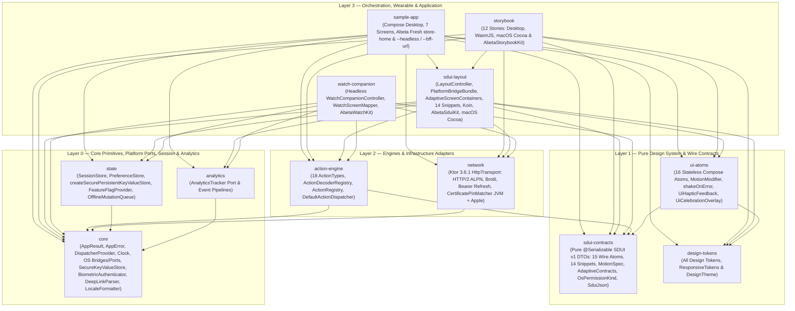
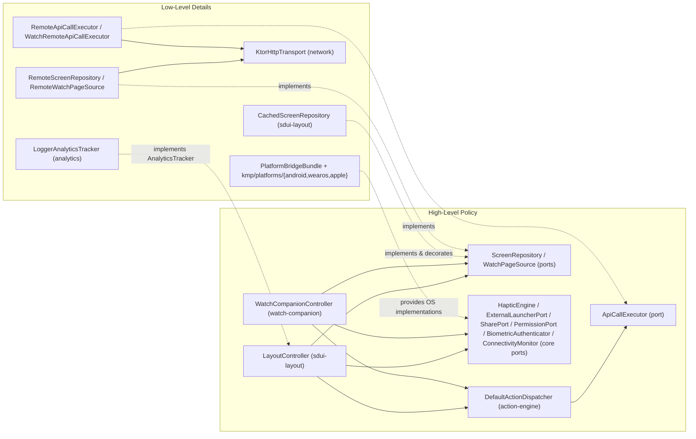

# Architecture & Uncle Bob Dependency Rule

`abeta-dev/kmp` is engineered around **Clean Architecture** and the **Uncle Bob Dependency Rule**: source code dependencies must point **only inward** toward higher-level policies, pure domain abstractions, and wire contracts. Inner layers know nothing about outer layers, UI frameworks, HTTP transports, or concrete action handlers.

---

## Layered Dependency Graph

---

## Supported Multiplatform Targets & Reference Host Glue

- **Headless / Contract Publishable Modules** (`core`, `state`, `analytics`, `sdui-contracts`, `action-engine`, `network`, `watch-companion`):
  - `jvm` (Java 21 toolchain)
  - `iosArm64`
  - `iosSimulatorArm64`
  - `macosArm64`
  - `watchosArm64`
  - `watchosSimulatorArm64`
  - `watchosDeviceArm64`
  - `wasmJs` (browser runtime)
- **Compose UI Modules** (`design-tokens`, `ui-atoms`, `sdui-layout`) and **`storybook`**:
  - `jvm`, `iosArm64`, `iosSimulatorArm64`, `macosArm64`, `wasmJs`
- **`sample-app`**: `jvm` (Compose Desktop UI & `--headless` CLI).
- **Apple XCFrameworks**:
  - `sdui-layout` exports `AbetaSduiKit.xcframework` (`iosArm64`, `iosSimulatorArm64`).
  - `watch-companion` exports `AbetaWatchKit.xcframework` (`watchosArm64`, `watchosSimulatorArm64`, `watchosDeviceArm64`).
  - `storybook` exports `AbetaStorybookKit.xcframework` (`iosArm64`, `iosSimulatorArm64`).
- **Drop-in Host Glue (`kmp/platforms/`)**:
  - `kmp/platforms/android/AndroidPlatformBridgeFactory.kt` — Android `ComponentActivity` / `FragmentActivity` bridge implementations (`VibrationEffect`, `ClipboardManager`, `Intent.ACTION_VIEW`, chooser share, `ConnectivityManager`, AES-GCM `AndroidKeyStore`, `BiometricPrompt`, `ActivityResultContracts`, push token hook, deep links, `SduiScreen`).
  - `kmp/platforms/wearos/WearCompanionHostActivity.kt` — Wear OS `ComponentActivity` hosting `:watch-companion`'s `WatchCompanionController` + `WatchGlancePage` in Wear Compose Material.
  - `kmp/platforms/apple/AbetaAppleHosts.swift` — SwiftUI hosts for iOS/iPadOS (`AbetaSduiKit`), macOS (`launchMacOsSduiWindow`), and watchOS (`AbetaWatchKit` `createAppleWatchCompanionHost`).
  - `kmp/platforms/README.md` — Note that Android & Wear OS Gradle templates require an Android app module with `ANDROID_HOME` / Android SDK configured.

---

## Layer Breakdown & Package Boundaries

All KMP artifacts share the Maven group `dev.abeta.kmp` and base package `dev.abeta.kmp.<module>`.

### Layer 0 — Core Primitives, OS Ports, Session & Analytics

| Module | Package | Allowed Project Dependencies | Key Types |
| :--- | :--- | :--- | :--- |
| `core` | `dev.abeta.kmp.core` | None | `AppResult` (+ combinators), `AppError` (`ErrorCategory`, `isRetryable`, `NetworkError`, `OfflineError`, `TimeoutError`, `RateLimitError`, `ForbiddenError`, `ConflictError`, `NotFoundError`, `UnauthorizedError`, `ValidationError`, `SerializationError`), `DispatcherProvider`, `Clock` (`MutableClock`, `ElapsedTimer`), `AppLogger` (`RedactingAppLogger`, `CompositeAppLogger`), `KeyValueStore` (`ObservableKeyValueStore`, `NamespacedKeyValueStore`), `UuidGenerator`, `BackoffPolicy`, `SingleFlight`, `Debouncer`, `ClickBackpressureGuard`, `SensitiveDataRedactor`, `FieldValidators`, `PlatformInfo` (`PlatformKind.{WATCHOS, WEAR_OS, LINUX_NATIVE, WINDOWS_NATIVE}`), `PlatformCapabilities` / `currentPlatformCapabilities()`, `HapticEngine` / `HapticStyle`, `ClipboardPort`, `ExternalLauncherPort`, `SharePort` / `ShareRequest`, `ConnectivityMonitor` / `ConnectivityStatus`, `PermissionPort`, `LocationPort`, `FilePickerPort`, `PushNotificationPort`, `LocaleFormatter` (`formatCurrencyCents`, `currentLocaleTag`), `DeepLinkParser` / `DeepLinkTarget`, `SecureKeyValueStore` (`AppleKeychain` `SecItem*` w/ fallback, JVM AES-256-GCM + `Preferences`, WasmJS `sessionStorage`), `BiometricAuthenticator` (`LAContext` on Apple) |
| `state` | `dev.abeta.kmp.state` | `core` | `SessionStore` (`InMemorySessionStore`, `PersistentSessionStore`, `SessionLifecycleManager`), reactive & schema-versioned `PreferenceStore` (`multiplatform-settings`), `createSecurePersistentKeyValueStore(namespace)` (`SettingsKeyValueStore.kt`), `FeatureFlagProvider` (`PersistentFeatureFlagStore`, `LayeredFeatureFlagProvider`), `OfflineMutationQueue` |
| `analytics` | `dev.abeta.kmp.analytics` | `core` | `AnalyticsEvent`, `AnalyticsTracker`, `CompositeAnalyticsTracker`, `LoggerAnalyticsTracker`, `RecordingAnalyticsTracker`, `SanitizingAnalyticsTracker`, `DeduplicatingAnalyticsTracker`, `EnrichingAnalyticsTracker`, `BufferedAnalyticsTracker` |

**Purpose**: Layer 0 defines cross-cutting core primitives and OS capability ports (`core`), reactive session/preference/secure-store/feature-flag/sync state (`state`), and pure outbound analytics ports & pipelines (`analytics`). `state` intentionally does **not** hold design tokens—all design tokens live in `design-tokens`.

### Layer 1 — Design Tokens, Contracts & Stateless Atoms

| Module | Package | Allowed Project Dependencies | Forbidden Dependencies |
| :--- | :--- | :--- | :--- |
| `design-tokens` | `dev.abeta.kmp.tokens` | None | `core`, `sdui-contracts`, `ui-atoms`, `action-engine`, `network`, `sdui-layout` |
| `sdui-contracts` | `dev.abeta.kmp.contracts` | None | `core`, Compose UI, Ktor, `action-engine`, `network`, `sdui-layout` |
| `ui-atoms` | `dev.abeta.kmp.atoms` | `design-tokens`, `sdui-contracts` | `core`, `action-engine`, `network`, `sdui-layout`, Ktor, concrete analytics |

**Purpose**:
- `design-tokens` owns **all** design tokens (`ColorTokens`, `DesignPalette`, `SpacingTokens`, `CornerRadiusTokens`, `StrokeWidthTokens`, `TypographyTokens`, `ElevationTokens`, `MotionTokens`, `OpacityTokens`, `SizingTokens`, `ThemePreset`, `ColorAccessibility`, `DesignTheme`, `ThemeTokens`, and `ResponsiveTokens.kt`: `WindowWidthClass`, `WindowHeightClass`, `DeviceFormFactor`, `AdaptiveLayoutMetrics`, `resolveAdaptiveLayoutMetrics`, `LocalAdaptiveLayoutMetrics`, `ProvideAdaptiveLayoutMetrics`, exposed via `ThemeTokens.adaptiveMetrics`).
- `sdui-contracts` holds pure `@Serializable` SDUI v1 wire schemas (`PageResponse` with `PaginationSpec`, `pullToRefresh`, `floatingCart` / `FloatingCartSpec`, and `adaptiveLayout` / `AdaptivePageSpec`; `SnippetEnvelope` with optional `motion`; **14 `SnippetTypes`** incl. `product_card` / `ProductCardSnippetData`, `CarouselSnippetData.itemWidthByWidth`, `GridSnippetData.columnsByWidth`; `ToolbarSpec`; `BottomBarSpec` with optional `motion`; **15 Wire Atoms** incl. `StepperAtom`, `SwitchAtom`, `CheckboxAtom`, `SliderAtom`, `AvatarAtom`, `SkeletonAtom` with `SkeletonKind`; `AdaptiveContracts.kt` (`ResponsiveColumnsSpec`, `ResponsiveIntSpec`, `AdaptivePageSpec`); `MotionContracts.kt` + `AtomEnums.kt` (`MotionSpec`, `MotionTransition`, `MotionDurationToken`, `MotionLoopEffect`, `FeedbackEffect`, `OsPermissionKind`, `ScreenLayoutMode`, `OverlayPresentation`); `LayoutConfig`; `ColorTokenRef`; `TypographyTokenRef`; `ActionRef`; `ValidationRuleContract`; `TrackingContract`; `SduiJson`; `TabItemSpec.title: String`) with **zero UI framework dependencies**.
- `ui-atoms` renders **16 stateless Compose Multiplatform atoms** (`UiText`, `UiIcon`, `UiTag`, `UiButton`, `UiImage`, `UiTextField`, `UiDivider`, `UiSpacer`, `UiProgress`, `UiSurfaceCard`, `UiSwitch`, `UiCheckbox`, `UiSlider`, `UiAvatar`, `UiSkeleton`, and animated `UiStepper` morphing `ADD` <-> `- qty +` with haptic hooks), `UiCelebrationOverlay` (`UiCelebrationBurst.kt`), `UiHapticFeedback.kt` (`UiHapticKind`, `LocalUiHapticFeedback`, `rememberComposeHapticFallback`), `MotionModifier.kt` (`applyMotionSpec`, `Modifier.shakeOnError`, `resolveMotionDurationMs`, `resolveMotionDelayMs`, `resolveEnterTransition`, `resolveExitTransition`) honoring `ThemeTokens.motion.reducedMotion`, `TokenResolvers`, `LayoutConfigModifier`, and `UiImageRenderer` / `LocalImageRenderer`, emitting pure `ActionRef` intents via lambda callbacks, and verified via `compose.uiTest` semantic tests (`UiAtomsComposeTest`).

### Layer 2 — Isolated Engines & Infrastructure

| Module | Package | Allowed Project Dependencies | Forbidden Dependencies |
| :--- | :--- | :--- | :--- |
| `action-engine` | `dev.abeta.kmp.actions` | `core`, `sdui-contracts` | `ui-atoms`, `network`, `sdui-layout`, `watch-companion`, `sample-app`, `storybook`, Compose UI |
| `network` | `dev.abeta.kmp.network` | `core` | `design-tokens`, `sdui-contracts`, `ui-atoms`, `action-engine`, `sdui-layout`, `watch-companion`, `sample-app`, `storybook` |

**Purpose**:
- `action-engine` decouples action validation, decoding, and execution using the Open/Closed Principle (**18 built-in `ActionTypes`** adding `open_url` (`OpenUrlPayload`), `share` (`SharePayload`), `request_permission` (`RequestPermissionPayload`), `biometric_auth` (`BiometricAuthPayload`) alongside `trigger_feedback` (`TriggerFeedbackPayload`), plus `ActionOutcome.{OpenUrlRequested, ShareRequested, PermissionRequested, BiometricAuthRequested, FeedbackTriggered, OverlayRequested}`, `ActionPayloadDecoder`, `ActionDecoderRegistry`, `BuiltInActionDecoders`, `ActionHandler`, `ActionRegistry`, `BuiltInActionHandlers`, `ActionDispatcher`, `DefaultActionDispatcher`, `ActionValidator`). For `call_api` actions, `action-engine` defines the narrow `ApiCallExecutor` port (`fun interface`) without importing Ktor or `network`.
- `network` implements `HttpTransport` / `KtorHttpTransport` (`HttpClientFactory`, `NetworkConfig`, `NetworkPorts`) using Ktor `3.6.1` with HTTP/2 ALPN (`ktor-client-okhttp` on JVM, `Darwin` on Apple, `Js` on Wasm), Brotli (`br`) decompression (`BrotliContentEncoder` via `org.brotli:dec` on JVM), bearer token auth & refresh (`AuthTokenProvider`), and shared SPKI/certificate pinning via `CertificatePinMatcher` (`NetworkConfig.certificatePins`) across JVM/OkHttp (`CertificatePinner`) and Apple Darwin `NSURLSession` (`PlatformHttpEngine.apple.kt`) on iOS, macOS, and watchOS. `action-engine` and `network` do **not** depend on each other; `sdui-layout` and `watch-companion` bridge them via `RemoteApiCallExecutor` / `WatchRemoteApiCallExecutor`.

### Layer 3 — SDUI Orchestration, Wearable Companion & Composition

| Module | Package | Allowed Project Dependencies |
| :--- | :--- | :--- |
| `sdui-layout` | `dev.abeta.kmp.layout` | `core`, `state`, `analytics`, `design-tokens`, `sdui-contracts`, `ui-atoms`, `action-engine`, `network` |
| `watch-companion` | `dev.abeta.kmp.watch` | `core`, `state`, `analytics`, `sdui-contracts`, `action-engine`, `network` (headless — zero Compose UI) |
| `storybook` | `dev.abeta.kmp.storybook` | Standalone interactive Compose Multiplatform explorer (**17 stories across 5 categories**: `LIVE_DEMOS`, `FOUNDATIONS`, `ATOMS`, `SNIPPETS`, `PLAYGROUND`, featuring **Live 6-in-1 Super-App Demos** `super-app-demos` with zero-backend offline BFF parity & `?story=&app=` URL routing, `"All 21 Snippets"`, `MotionAndStoreStory`, `ResponsiveAndBridgesStory`, `DiscoveryAndSearchStory`, `AnimationNudgesStory`, `SnippetCrafterStory`, `EndToEndJourneysStory`, Built-in Demo + Remote BFF toggle in `LiveBffStory`), responsive `CompactStoryStrip`/`StorySidebar` shell, `fontScale` controls, Desktop JVM, WasmJS, macOS `launchStorybookMacOsWindow`, `StorybookViewController` + `AbetaStorybookKit.xcframework`, `StorybookComposeTest` |
| `sample-app` | `dev.abeta.kmp.sample` | Host composition root (`SampleApp`, `Main`, `SampleContainer`, `SampleScreens`, `SampleContainersScreen`, `SampleStoreScreen.kt` + `SampleStoreCatalog.kt` with responsive `columnsByWidth` & `adaptiveLayout`, `SampleWatchScreen` for `"watch-status"`, `PlatformBridgeBundle` + `observeConnectivity`, `OfflineApiCallExecutor` handling `POST /api/v1/orders/express`, `CachedScreenRepository`, `OfflineActionCoordinator`, `KtorImageRenderer`, `SampleContainer.DEFAULT_SCREENS` covering **7 screens**: `home`, `store-home`, `catalog`, `profile`, `form-demo`, `containers`, `watch-status`, plus `--headless` / `--bff-url`) |

**Purpose**:
- `sdui-layout` coordinates:
  - **Screen fetching & caching**: `ScreenRepository`, `RemoteScreenRepository` (`BffEnvelope<PageResponse>`), and `CachedScreenRepository` (`CACHE_FIRST`, `NETWORK_FIRST`, `STALE_WHILE_REVALIDATE` backed by `KeyValueStore` + `SingleFlight`).
  - **14 snippet renderers, adaptive viewports & motion**: `SnippetRegistry`, `BuiltInSnippetModule`, `ContainerSnippetRenderers.kt` (`carousel` with `itemWidthByWidth`, `grid` with `columnsByWidth`, `tabs` with `AnimatedContent`, `accordion` with animated chevron), `ProductCardSnippetRenderer.kt`, `AdaptiveScreenContainers.kt` (`AdaptiveReadyViewport`, `SplitPaneBody`, `OfflineStatusBanner`), `SnippetLazyList` `animateItem()`, recursive form/product seeding via `collectAllEnvelopes`, and `MotionSpec` stagger delays via `LocalMotionStaggerIndex`.
  - **OS bridge orchestration, cart dock, celebration & overlays**: `LayoutController` (`observeConnectivity`, `handleDeepLink`, `isOffline`, `errorShakeSequence`, `errorShakeTargetId`, `dismissFeedback()`), `PlatformBridgeBundle` + `PlatformBridgeOutcomeExecutor` (routing `OpenUrlRequested`, `ShareRequested`, `PermissionRequested`, `BiometricAuthRequested`, `ClipboardCopyRequested` to Layer 0 OS ports and bridging `HapticEngine` to `LocalUiHapticFeedback`), `SduiScreen` (`PullToRefreshBox`, `SkeletonScreenPlaceholder`, `loadMore()`), `FloatingCartDockHost` (`FloatingCartDock.kt` + `PageCartCalculator.kt`), `UiCelebrationOverlay`, and `OverlayHost` (`AlertDialog` and `ModalBottomSheet`).
  - **Media, offline replay, DI & Apple/Cocoa hosts**: `KtorImageRenderer`, `OfflineActionCoordinator`, `createSduiKoinModule` (`platformBridges`, `certificatePins`), `SduiHostRoot.kt` (`SduiHostedRoot`), iOS `createSduiViewController` + `AbetaSduiKit.xcframework`, macOS native Cocoa `launchMacOsSduiWindow` (`SduiMacOsWindow.kt`), and `SduiScreenComposeTest`.
- `watch-companion` coordinates headless wearable SDUI rendering & 1-tap actions across `watchosArm64`, `watchosSimulatorArm64`, `watchosDeviceArm64` (`AbetaWatchKit.xcframework`, `createAppleWatchCompanionHost`), and Wear OS JVM hosts (`WearCompanionHostActivity.kt`) using `WatchGlanceModels.kt`, `WatchScreenMapper`, `RemoteWatchPageSource`, `WatchRemoteApiCallExecutor`, `WatchCompanionController`, and `createWatchCompanionModule` without pulling Compose UI into watch targets.

---

## Dependency Inversion Across Key Boundaries

1. **`sdui-layout` -> `ScreenRepository` (Port) <- `CachedScreenRepository` / `RemoteScreenRepository` -> `HttpTransport` (`network`)**: `LayoutController` depends only on the `ScreenRepository` port.
2. **`action-engine` -> `ApiCallExecutor` (Port) <- `RemoteApiCallExecutor` / `WatchRemoteApiCallExecutor` -> `HttpTransport` (`network`)**: `action-engine` never imports Ktor or `network`.
3. **`ui-atoms` -> `(ActionRef) -> Unit` & `LocalUiHapticFeedback` <- `sdui-layout` -> `ActionDispatcher` & `HapticEngine`**: Atoms never know what an action or haptic implementation *does*, keeping Layer 1 free of `core`, `action-engine`, and `network`.
4. **`ui-atoms` -> `UiImageRenderer` (`LocalImageRenderer`) <- `KtorImageRenderer` (`sdui-layout`)**: Image fetching and decoding stay outside Layer 1.

---

## Enforcing Boundaries in CI & Reviews

1. **Gradle project dependencies**: Module `build.gradle.kts` files explicitly declare only allowed layer dependencies; Gradle prevents accidental imports from unreferenced modules at compile time.
2. **Binary Compatibility Validator (`apiCheck` / `apiDump`)**: Enforces public ABI stability across all **10 publishable KMP library modules** via `.api` files under `kmp/<module>/api/<module>.api` (including `kmp/watch-companion/api/watch-companion.api`).
3. **Dokka v2 HTML Documentation (`dokkaGenerateHtml`)**: Generates API documentation per module (e.g., `:core:dokkaGenerateHtml`) or across all subprojects (`dokkaGenerateHtml`).
4. **Go Architecture Test**: `bff/internal/domain/arch_test.go` verifies `internal/domain` never imports HTTP, Gin, or infrastructure packages.
5. **Compose UI Semantic Tests & Quality Checks**: `UiAtomsComposeTest`, `SduiScreenComposeTest`, `StorybookComposeTest`, Detekt, and Spotless are enforced via `./gradlew check`.
6. **SOLID Review Checklist**: See [skills/abeta-kmp-architecture/SKILL.md](../skills/abeta-kmp-architecture/SKILL.md) and [agents/solid-reviewer.md](../agents/solid-reviewer.md).
