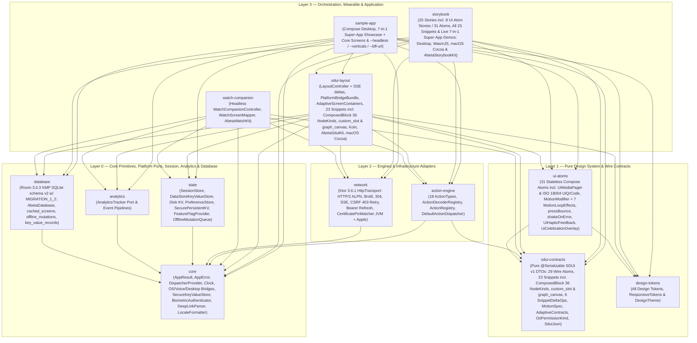
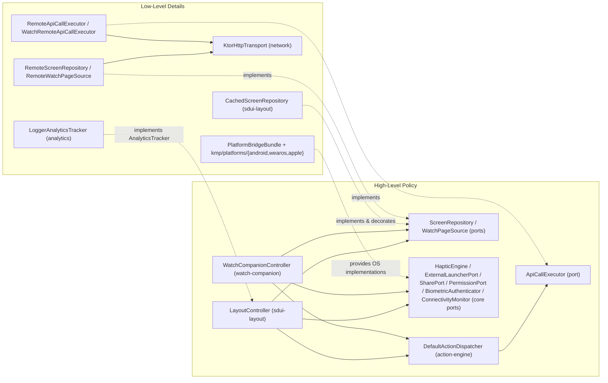

# Architecture & Uncle Bob Dependency Rule

`abeta-dev/kmp` is engineered around **Clean Architecture** and the **Uncle Bob Dependency Rule**: source code dependencies must point **only inward** toward higher-level policies, pure domain abstractions, and wire contracts. Inner layers know nothing about outer layers, UI frameworks, HTTP transports, or concrete action handlers.

---

## Layered Dependency Graph

---

## Supported Multiplatform Targets & Reference Host Glue

- **Headless / Contract Publishable Modules** (`core`, `state`, `analytics`, `database`, `sdui-contracts`, `action-engine`, `network`, `watch-companion`):
  - `jvm` (Java 21 toolchain)
  - `iosArm64`
  - `iosSimulatorArm64`
  - `macosArm64`
  - `watchosArm64`
  - `watchosSimulatorArm64`
  - `watchosDeviceArm64`
  - `wasmJs` (browser runtime)
- **Compose UI Modules** (`design-tokens`, `ui-atoms`, `sdui-layout`) and **`storybook`**:
  - `jvm`, `iosArm64`, `iosSimulatorArm64`, `macosArm64`, `wasmJs`
- **`sample-app`**: `jvm` (Compose Desktop UI & `--headless` CLI).
- **Apple XCFrameworks**:
  - `sdui-layout` exports `AbetaSduiKit.xcframework` (`iosArm64`, `iosSimulatorArm64`).
  - `watch-companion` exports `AbetaWatchKit.xcframework` (`watchosArm64`, `watchosSimulatorArm64`, `watchosDeviceArm64`).
  - `storybook` exports `AbetaStorybookKit.xcframework` (`iosArm64`, `iosSimulatorArm64`).
- **Drop-in Host Glue (`kmp/platforms/`)**:
  - `kmp/platforms/android/{AndroidPlatformBridgeFactory,AbetaAndroidHostActivity,AndroidDatabaseFactory}.kt` — Android `ComponentActivity` / `FragmentActivity` bridge implementations plus Room 3 Android database factory (`MIGRATION_1_2`).
  - `kmp/platforms/wearos/{WearCompanionHostActivity,WearSduiRenderer}.kt` — Wear OS `ComponentActivity` hosting `:watch-companion`'s `WatchCompanionController` with Android-native bridges in Wear Compose Material.
  - `kmp/platforms/apple/AbetaAppleHosts.swift` & `Sources/{AbetaSduiSwiftUI,AbetaWatchSwiftUI}/` — 4-product SwiftPM package (`Abeta-dev/kmp-spm` `0.7.0`: `AbetaSduiKit`, `AbetaWatchKit`, `AbetaSduiSwiftUI`, `AbetaWatchSwiftUI`), plus macOS Cocoa (`launchMacOsSduiWindow`).
  - `kmp/platforms/web/README.md` — Browser COOP/COEP headers for Room 3 `wasmJs` OPFS Web Worker SQLite persistence.
  - `kmp/platforms/README.md` — Note that published Maven Central artifacts target `jvm`, `ios*`, `macosArm64`, `watchos*`, and `wasmJs` (with guarded JVM AWT/file fallbacks), while Android & Wear OS templates require an Android app module with `ANDROID_HOME` / Android SDK configured.

---

## Layer Breakdown & Package Boundaries

All **11 publishable KMP library modules** (plus `bom` and `dependencies` = **13 Maven Central artifacts**) publish to Maven Central under `io.github.abeta-dev` (**`0.7.0`**) while keeping the Kotlin package namespace `dev.abeta.kmp.<module>`.

### Layer 0 — Core Primitives, OS Ports, Session, Analytics & Local Database

| Module | Package | Allowed Project Dependencies | Key Types |
| :--- | :--- | :--- | :--- |
| `core` | `dev.abeta.kmp.core` | None | `AppResult`, `AppError` (`ErrorCategory`, `isRetryable`, `NetworkError`, `OfflineError`, `TimeoutError`, `RateLimitError`, etc.), `DispatcherProvider`, `Clock`, `AppLogger` (`RedactingAppLogger`, `CompositeAppLogger`), `KeyValueStore`, `UuidGenerator`, `BackoffPolicy`, `SingleFlight`, `Debouncer`, `ClickBackpressureGuard`, `SensitiveDataRedactor`, `FieldValidators`, `PlatformInfo`, `PlatformCapabilities`, `HapticEngine`, `ClipboardPort`, `ExternalLauncherPort`, `SharePort`, `ConnectivityMonitor`, `PermissionPort`, `LocationPort`, `FilePickerPort`, `PushNotificationPort`, `AudioCapturePort`, `SpeechToTextPort`, `DesktopSystemPort`, `LocaleFormatter`, `DeepLinkParser`, `SecureKeyValueStore` (`AppleKeychain` w/ `NSLock`, JVM `0600`/`0700` file-backed AES-256-GCM, WasmJS `sessionStorage`), `BiometricAuthenticator` (`LAContext`) |
| `state` | `dev.abeta.kmp.state` | `core` | Thread-safe `SessionStore` (`InMemorySessionStore`, `PersistentSessionStore`, `SessionLifecycleManager`), `DataStoreKeyValueStore`, `createDiskKeyValueStore`, reactive & schema-versioned `PreferenceStore` (`multiplatform-settings`), `createSecurePersistentKeyValueStore(namespace)`, `FeatureFlagProvider`, `OfflineMutationQueue` |
| `analytics` | `dev.abeta.kmp.analytics` | `core` | `AnalyticsEvent`, `AnalyticsTracker`, `CompositeAnalyticsTracker`, `LoggerAnalyticsTracker`, `RecordingAnalyticsTracker`, `SanitizingAnalyticsTracker`, `DeduplicatingAnalyticsTracker`, `EnrichingAnalyticsTracker`, `BufferedAnalyticsTracker` |
| `database` | `dev.abeta.kmp.database` | `core` | Room 3 (`3.0.3`) KMP local SQLite database (`AbetaDatabase` schema **v2** w/ `MIGRATION_1_2`, `AbetaLocalDatabase`, `cached_screens` incl. `pageVersion`/`appVersion`, `offline_mutations`, `key_value_records`, `sqlite-bundled:2.7.1`, `sqlite-web:2.7.1` OPFS Web Worker, KSP `2.3.14` schema exports `1.json` & `2.json` under `kmp/database/schemas/`; see [Local Database Guide](local-database-room3.md)) |

**Purpose**: Layer 0 defines cross-cutting core primitives and OS/Voice/Desktop capability ports (`core`), reactive session/DataStore/disk/preference/secure-store/feature-flag/sync state (`state`), pure outbound analytics ports & pipelines (`analytics`), and multiplatform Room 3 SQLite persistence (`database`). `state` intentionally does **not** hold design tokens—all design tokens live in `design-tokens`.

### Layer 1 — Design Tokens, Contracts & Stateless Atoms

| Module | Package | Allowed Project Dependencies | Forbidden Dependencies |
| :--- | :--- | :--- | :--- |
| `design-tokens` | `dev.abeta.kmp.tokens` | None | `core`, `state`, `analytics`, `database`, `sdui-contracts`, `ui-atoms`, `action-engine`, `network`, `sdui-layout` |
| `sdui-contracts` | `dev.abeta.kmp.contracts` | None | `core`, `database`, Compose UI, Ktor, `action-engine`, `network`, `sdui-layout` |
| `ui-atoms` | `dev.abeta.kmp.atoms` | `design-tokens`, `sdui-contracts` | `core`, `state`, `analytics`, `database`, `action-engine`, `network`, `sdui-layout`, Ktor, concrete analytics |

**Purpose**:
- `design-tokens` owns **all** design tokens (`ColorTokens`, `DesignPalette`, `SpacingTokens`, `CornerRadiusTokens`, `StrokeWidthTokens`, `TypographyTokens`, `ElevationTokens`, `MotionTokens`, `OpacityTokens`, `SizingTokens`, `ThemePreset`, `ColorAccessibility`, `DesignTheme`, `ThemeTokens`, and `ResponsiveTokens.kt`: `WindowWidthClass`, `WindowHeightClass`, `DeviceFormFactor`, `AdaptiveLayoutMetrics`, `resolveAdaptiveLayoutMetrics`, `LocalAdaptiveLayoutMetrics`, `ProvideAdaptiveLayoutMetrics`, exposed via `ThemeTokens.adaptiveMetrics`).
- `sdui-contracts` holds pure `@Serializable` SDUI v1 wire schemas (`PageResponse` with `page_version`, `app_version`, `etag`, `stream_spec`, `PaginationSpec`, `pullToRefresh`, `floatingCart` / `FloatingCartSpec` with free-delivery threshold nudges, and `adaptiveLayout` / `AdaptivePageSpec`; `ScreenManifestResponse` w/ `sdui_schema_version`; `SnippetEnvelope` with `sticky` & `motion`; **23 `SnippetTypes`** incl. `product_card`, `swipe_deck`, `search_bar`, `chip_group`, `nudge_bar`, `marquee_strip`, `order_tracker`, **`composed_block`** with **36 `ComposedNodeKind`s**, `custom_slot`, and `graph_canvas`; **29 Wire Atoms** incl. `StepperAtom`, `CountdownAtom` w/ `expires_at_epoch_ms`, `MediaPagerAtom`, and 12 `ExtendedAtoms.kt` primitives; **6 `SnippetDeltaOp`s** (`append_text`, `patch_snippet_data`, `replace_snippet`, `insert_snippet`, `remove_snippet`, `update_page_meta`); `AdaptiveContracts.kt`; `MotionContracts.kt` + `AtomEnums.kt` with **7 Ambient `MotionLoopEffect`s**, `FeedbackEffect`, `OsPermissionKind`, `ScreenLayoutMode`, `OverlayPresentation`; `LayoutConfig`; `ColorTokenRef`; `TypographyTokenRef`; `ActionRef`; `ValidationRuleContract`; `TrackingContract`; `SduiJson`; `TabItemSpec.title: String`) with **zero UI framework dependencies**.
- `ui-atoms` renders **31 stateless Compose Multiplatform atoms** (`UiText`, `UiIcon`, `UiTag`, `UiButton`, `UiImage`, `UiTextField`, `UiDivider`, `UiSpacer`, `UiProgress`, `UiSurfaceCard`, `UiSwitch`, `UiCheckbox`, `UiSlider`, `UiAvatar`, `UiSkeleton`, animated `UiStepper`, live urgency `UiCountdown`, odometer `UiRollingCounter`, `UiMediaPager`, plus 12 extended atoms `UiRadioGroup`, `UiSelect`, `UiOtpInput`, `UiChip`, `UiSegmentedControl`, `UiRating`, `UiPrice`, `UiBadge`, `UiAlertBanner`, `UiStatTile`, `UiKeyValueRow`, real ISO/IEC 18004 `UiQrCode`), `UiCelebrationOverlay`, `UiHapticFeedback.kt`, `MotionModifier.kt` + `MotionLoopModifiers.kt` (`applyMotionSpec`, **7 Ambient `MotionLoopEffect`s**, `Modifier.pressBounce`, `Modifier.shakeOnError`) honoring `ThemeTokens.motion.reducedMotion`, `TokenResolvers`, `LayoutConfigModifier`, and `UiImageRenderer` / `LocalImageRenderer`, emitting pure `ActionRef` intents via lambda callbacks.

### Layer 2 — Isolated Engines & Infrastructure

| Module | Package | Allowed Project Dependencies | Forbidden Dependencies |
| :--- | :--- | :--- | :--- |
| `action-engine` | `dev.abeta.kmp.actions` | `core`, `sdui-contracts` | `ui-atoms`, `network`, `sdui-layout`, `watch-companion`, `sample-app`, `storybook`, Compose UI |
| `network` | `dev.abeta.kmp.network` | `core` | `design-tokens`, `sdui-contracts`, `ui-atoms`, `action-engine`, `sdui-layout`, `watch-companion`, `sample-app`, `storybook` |

**Purpose**:
- `action-engine` decouples action validation, decoding, and execution using the Open/Closed Principle (**18 built-in `ActionTypes`**, `ActionPayloadDecoder`, `ActionDecoderRegistry`, `BuiltInActionDecoders`, `ActionHandler`, `ActionRegistry`, `BuiltInActionHandlers`, `ActionDispatcher`, depth & dispatch-budget guarded `DefaultActionDispatcher`, `ActionValidator`). For `call_api` actions, `action-engine` defines the narrow `ApiCallExecutor` port (`fun interface`) without importing Ktor or `network`.
- `network` implements `HttpTransport` / `KtorHttpTransport` (`HttpClientFactory`, `NetworkConfig` w/ `appVersion` -> `X-Client-App-Version`, `NetworkPorts`) using Ktor `3.6.1` with HTTP/2 ALPN, Brotli (`br`) decompression, conditional `If-None-Match`/`304`, `SseTransport`/`KtorSseTransport` (`Last-Event-ID` reconnect), `CsrfTokenProvider` + single `403` retry, bearer token auth & refresh (`AuthTokenProvider`), and validated `sha256/` SPKI/certificate pinning via `CertificatePinMatcher` across JVM/OkHttp and Apple Darwin `NSURLSession` on iOS, macOS, and watchOS.

### Layer 3 — SDUI Orchestration, Wearable Companion & Composition

| Module | Package | Allowed Project Dependencies |
| :--- | :--- | :--- |
| `sdui-layout` | `dev.abeta.kmp.layout` | `core`, `state`, `analytics`, `database`, `design-tokens`, `sdui-contracts`, `ui-atoms`, `action-engine`, `network` |
| `watch-companion` | `dev.abeta.kmp.watch` | `core`, `state`, `analytics`, `database`, `sdui-contracts`, `action-engine`, `network` (headless — zero Compose UI) |
| `storybook` | `dev.abeta.kmp.storybook` | Standalone interactive Compose Multiplatform explorer (**20 stories across 5 categories**: `LIVE_DEMOS`, `FOUNDATIONS`, `ATOMS` — 8 stories covering all **31** atoms, `SNIPPETS` — `"All 23 Snippets"`, `PLAYGROUND`, featuring **Live 7-in-1 Super-App Demos**, `MotionAndStoreStory`, `ResponsiveAndBridgesStory` w/ `Voice & Desktop OS Bridges`, `DiscoveryAndSearchStory`, `AnimationNudgesStory`, `SnippetCrafterStory`, `EndToEndJourneysStory`, `LiveBffStory`), Desktop JVM, WasmJS, macOS `launchStorybookMacOsWindow`, `StorybookViewController` + `AbetaStorybookKit.xcframework` |
| `sample-app` | `dev.abeta.kmp.sample` | Host composition root (**7-in-1 Super-App Showcase Launcher** across **Abeta Fresh**, **Abeta Bites**, **Abeta Pulse**, **Abeta Mart**, **Abeta Spark**, **Abeta Trade**, **Abeta Pay** plus core reference screens & `watch-status`, `--headless` / `--verticals` / `--bff-url`) |

**Purpose**:
- `sdui-layout` coordinates:
  - **Screen fetching, versioning & caching**: `ScreenRepository`, `RemoteScreenRepository` (`BffEnvelope<PageResponse>`), `RemoteScreenManifestRepository`, and `CachedScreenRepository` (`CACHE_FIRST`, `NETWORK_FIRST`, `STALE_WHILE_REVALIDATE`, `VERSION_GATED` with `If-None-Match`/`304`, `/manifest` handshake, and `appVersion`/`sduiSchemaVersion` validation).
  - **23 snippet renderers, adaptive viewports & motion**: `SnippetRegistry`, `BuiltInSnippetModule`, `ContainerSnippetRenderers.kt`, `ProductCardSnippetRenderer.kt`, interactive snippets (`swipe_deck`, `search_bar`, `chip_group`), express & molding renderers (`NudgeBar`, `MarqueeStrip`, `OrderTracker`, **`ComposedBlock`** Atomic Snippet Molding Engine with **36 `ComposedNodeKind`s**), **`CustomSlotSnippetRenderer`** + `CustomSlotRegistry`, **`GraphCanvasSnippetRenderer`**, `AdaptiveScreenContainers.kt`, sticky headers, and `MotionSpec` stagger delays.
  - **Live SSE deltas, OS bridges, cart dock, celebration & overlays**: `LayoutController` (`observeConnectivity`, `handleDeepLink`, `isOffline`, `applyDeltaPatch`/`observeStream`, `errorShakeSequence`, `dismissFeedback()`), `SduiLayoutViewModel` (`SavedState`), `PlatformBridgeBundle` + `PlatformBridgeOutcomeExecutor`, `SduiScreen` (`PullToRefreshBox`, `SkeletonScreenPlaceholder`, `loadMore()`), `FloatingCartDockHost`, `UiCelebrationOverlay`, and `OverlayHost` (`AlertDialog` and rich SDUI `ModalBottomSheet`).
  - **Analytics, media, offline replay, DI & Apple/Cocoa hosts**: `RemoteBffAnalyticsTracker`, `KtorImageRenderer`, `OfflineActionCoordinator`, `createSduiKoinModule`, `SduiHostedRoot`, iOS `createSduiViewController` + `AbetaSduiKit.xcframework`, macOS native Cocoa `launchMacOsSduiWindow`, and `SduiScreenComposeTest`.
- `watch-companion` coordinates headless wearable SDUI rendering & 1-tap actions across `watchosArm64`, `watchosSimulatorArm64`, `watchosDeviceArm64` (`AbetaWatchKit.xcframework`, `AbetaWatchSwiftUI`, `createAppleWatchCompanionHost`), and Wear OS JVM hosts (`WearCompanionHostActivity.kt` + `WearSduiRenderer.kt`) using `WatchGlanceModels.kt`, `WatchScreenMapper`, `RemoteWatchPageSource` (ETag/304 + offline cache), `WatchRemoteApiCallExecutor`, `WatchCompanionController`, and `createWatchCompanionModule` without pulling Compose UI into watch targets.

---

## Dependency Inversion Across Key Boundaries

1. **`sdui-layout` -> `ScreenRepository` (Port) <- `CachedScreenRepository` / `RemoteScreenRepository` -> `HttpTransport` (`network`)**: `LayoutController` depends only on the `ScreenRepository` port.
2. **`action-engine` -> `ApiCallExecutor` (Port) <- `RemoteApiCallExecutor` / `WatchRemoteApiCallExecutor` -> `HttpTransport` (`network`)**: `action-engine` never imports Ktor or `network`.
3. **`ui-atoms` -> `(ActionRef) -> Unit` & `LocalUiHapticFeedback` <- `sdui-layout` -> `ActionDispatcher` & `HapticEngine`**: Atoms never know what an action or haptic implementation *does*, keeping Layer 1 free of `core`, `action-engine`, and `network`.
4. **`ui-atoms` -> `UiImageRenderer` (`LocalImageRenderer`) <- `KtorImageRenderer` (`sdui-layout`)**: Image fetching and decoding stay outside Layer 1.

---

## Enforcing Boundaries in CI & Reviews

1. **Gradle project dependencies**: Module `build.gradle.kts` files explicitly declare only allowed layer dependencies; Gradle prevents accidental imports from unreferenced modules at compile time.
2. **Binary Compatibility Validator (`apiCheck` / `apiDump`)**: Enforces public ABI stability across all **11 publishable KMP library modules** via `.api` files under `kmp/<module>/api/<module>.api` (including `kmp/database/api/database.api` and `kmp/watch-companion/api/watch-companion.api`).
3. **Dokka v2 HTML Documentation (`dokkaGenerateHtml`)**: Generates API documentation per module (e.g., `:core:dokkaGenerateHtml`) or across all subprojects (`dokkaGenerateHtml`).
4. **Go Architecture Test**: `bff/internal/domain/arch_test.go` verifies `internal/domain` never imports HTTP, Gin, or infrastructure packages.
5. **Compose UI Semantic Tests & Quality Checks**: `UiAtomsComposeTest`, `ExtendedAtomsComposeTest`, `SduiScreenComposeTest`, `StorybookComposeTest`, Detekt, and Spotless are enforced via `./gradlew check`.
6. **SOLID Review Checklist**: See [skills/abeta-kmp-architecture/SKILL.md](../skills/abeta-kmp-architecture/SKILL.md) and [agents/solid-reviewer.md](../agents/solid-reviewer.md).
