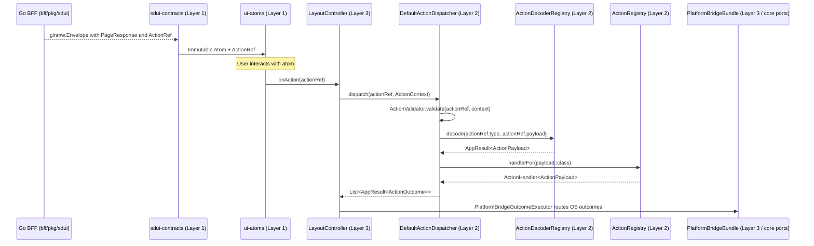

# Atomic & Action Separation

One of the defining architectural principles of `abeta-dev/kmp` is **strict separation between UI Atoms (Layer 1) and Action Execution (Layer 2)**.

In naive SDUI codebases, UI components import navigation controllers, OS permission/biometric prompts, analytics SDKs, HTTP clients, or a giant `when (action.type)` block. That violates the **Single Responsibility Principle (SRP)**, **Open/Closed Principle (OCP)**, and **Dependency Inversion Principle (DIP)**—making atoms impossible to preview in isolation, brittle to test, and tightly coupled to app-specific side effects.

`abeta-dev/kmp` eliminates this coupling completely.

---

## The Separation Boundary



---

## Layer 1: What Design & UI Atom Modules Know (and What They Never Know)

### `design-tokens`
- Owns all immutable design tokens: `ColorTokens`, `DesignPalette`, `SpacingTokens`, `CornerRadiusTokens`, `StrokeWidthTokens`, `TypographyTokens`, `ElevationTokens`, `MotionTokens`, `OpacityTokens`, `SizingTokens`, `ThemePreset`, `ColorAccessibility`, `DesignTheme`, `ThemeTokens`, and `ResponsiveTokens.kt` (`WindowWidthClass`, `WindowHeightClass`, `DeviceFormFactor`, `AdaptiveLayoutMetrics`, `resolveAdaptiveLayoutMetrics`, `LocalAdaptiveLayoutMetrics`, `ProvideAdaptiveLayoutMetrics`, exposed via `ThemeTokens.adaptiveMetrics`).
- Zero knowledge of `core`, SDUI JSON, actions, or networking.

### `sdui-contracts`
- Pure `@Serializable` wire contracts matching `bff/pkg/sdui` (`bff@v0.9.0`) 1:1 (**29 Wire Atoms** incl. `MediaPagerAtom`, `CountdownAtom` w/ `expires_at_epoch_ms`, & 12 `ExtendedAtoms.kt` primitives, **23 Canonical Snippet Types** incl. `composed_block` with **36 `ComposedNodeKind`s**, `custom_slot`, & `graph_canvas`, **6 `SnippetDeltaOp`s**, `FloatingCartSpec` free-delivery threshold nudges, `AdaptivePageSpec`, and declarative `MotionSpec` with **7 Ambient `MotionLoopEffect`s** / `FeedbackEffect`).
- Contains `ActionRef`, `ValidationRuleContract`, `TrackingContract`, `OsPermissionKind`, `ScreenLayoutMode`, `AdaptiveContracts.kt` (`ResponsiveColumnsSpec`, `ResponsiveIntSpec`, `AdaptivePageSpec`), `OverlayPresentation` (`DIALOG` / `BOTTOM_SHEET`), and `MotionContracts.kt` + `AtomEnums.kt` (`MotionSpec`, `MotionTransition`, `MotionDurationToken`, `MotionLoopEffect`, `FeedbackEffect`):
  - `ActionRef` is **pure data**: `id: String?`, `type: String`, `payload: JsonObject`, `validations: List<ValidationRuleContract>`, `tracking: TrackingContract?`, and `secondaryActions: List<ActionRef>` (`@SerialName("secondary_actions")`).
  - Atoms embed `ActionRef` on gesture fields such as `on_click`, `on_change`, `on_value_change`, `on_submit`, `on_increment`, `on_decrement`, `on_complete`, `on_remove`, `on_rate`, `on_action`, `on_dismiss`, `on_page_click`, and `on_expire`.
- **No executable interfaces**, no `suspend fun execute()`, and no `ActionHandler` or `core` references.

### `ui-atoms`
- **31 stateless Compose Multiplatform `@Composable` atoms**: `UiText`, `UiIcon`, `UiTag`, `UiButton`, `UiImage`, `UiTextField`, `UiDivider`, `UiSpacer`, `UiProgress`, `UiSurfaceCard`, `UiSwitch`, `UiCheckbox`, `UiSlider`, `UiAvatar`, `UiSkeleton`, animated `UiStepper` (morphing cleanly between `ADD` and `- qty +` with haptic hooks), live urgency `UiCountdown`, odometer `UiRollingCounter`, `UiMediaPager`, plus 12 extended atoms (`UiRadioGroup`, `UiSelect`, `UiOtpInput`, `UiChip`, `UiSegmentedControl`, `UiRating`, `UiPrice`, `UiBadge`, `UiAlertBanner`, `UiStatTile`, `UiKeyValueRow`, real ISO/IEC 18004 `UiQrCode`), plus `UiCelebrationOverlay` (`UiCelebrationBurst.kt`), `UiHapticFeedback.kt` (`UiHapticKind`, `LocalUiHapticFeedback`, `rememberComposeHapticFallback`), and `MotionModifier.kt` + `MotionLoopModifiers.kt` (`applyMotionSpec`, **7 Ambient `MotionLoopEffect`s**, `Modifier.pressBounce`, `Modifier.shakeOnError`, `resolveMotionDurationMs`, `resolveMotionDelayMs`, `resolveEnterTransition`, `resolveExitTransition`) honoring `ThemeTokens.motion.reducedMotion`.
- Accepts:
  1. Immutable contract state from `sdui-contracts` (including optional `motion: MotionSpec?` on `ButtonAtom` and `TagAtom`)
  2. Tokens and responsive metrics resolved via `TokenResolvers` and `DesignTheme` / `ThemeTokens` (`design-tokens`)
  3. Pure callbacks (`onAction: (ActionRef) -> Unit`, plus controlled UI callbacks like `onValueChange` / `onCheckedChange` / `onQuantityChange`), optional `LocalUiHapticFeedback` (adapted from `HapticEngine` at Layer 3), and optional `LocalImageRenderer` (`UiImageRenderer`) supplied by Layer 3 (`KtorImageRenderer`)
- **Strictly forbidden in `ui-atoms`**:
  - Importing `dev.abeta.kmp.core.*`
  - Importing `dev.abeta.kmp.actions.*`
  - Importing `dev.abeta.kmp.network.*`
  - Importing `io.ktor.*` or navigation libraries
  - Holding mutable business state or launching network coroutines inside atoms

---

## Layer 2: Open/Closed Action Engine (`action-engine`)

The `action-engine` module follows the **Open/Closed Principle (OCP)**: adding a new action type requires **zero edits** to `design-tokens`, `sdui-contracts`, `ui-atoms`, `DefaultActionDispatcher`, or `sdui-layout`.

### Core Abstractions

1. **`ActionPayload` (Open Marker Interface) & `BuiltInActionPayload`**:
   `ActionPayload` is a non-sealed marker interface so feature modules can define custom `@Serializable` payload classes outside `action-engine`. All **18 standard BFF payloads** (including `TriggerFeedbackPayload`, `OpenUrlPayload`, `SharePayload`, `RequestPermissionPayload`, and `BiometricAuthPayload`) implement `BuiltInActionPayload`.
2. **`ActionPayloadDecoder<out P : ActionPayload>` & `ActionDecoderRegistry`**:
   Maps wire `action.type` strings to decoders (`kotlinxActionDecoder<P>()`), returning `AppResult<ActionPayload>` (or `NotFoundError` when unregistered).
3. **`ActionValidator` / `DefaultActionValidator`**:
   Evaluates declarative `ActionRef.validations` (`ValidationRuleContract`) against `ActionContext` before decoding or invoking handlers.
4. **`ActionHandler<in P : ActionPayload>` & `ActionRegistry`**:
   Maps `KClass<out ActionPayload>` to typed handlers returning `AppResult<ActionOutcome>` (such as `NavigationRequested`, `BackRequested`, `OverlayRequested` with `OverlayPresentation.DIALOG` | `OverlayPresentation.BOTTOM_SHEET`, `OverlayDismissed`, `ToastRequested`, `RefreshRequested`, `ClipboardCopyRequested`, `OpenUrlRequested`, `ShareRequested`, `PermissionRequested`, `BiometricAuthRequested`, `SnippetsUpdated`, `TrackingRequested`, `StateMutated`, `FeedbackTriggered`, `ApiCallResult`, `Handled`).
5. **`ApiCallExecutor` Port**:
   `fun interface` inside `action-engine` that allows `sdui-layout` (`RemoteApiCallExecutor`) and `watch-companion` (`WatchRemoteApiCallExecutor`) to execute `CallApiPayload` via `network` without `action-engine` ever importing `network` or Ktor.
6. **`ActionDispatcher` / `DefaultActionDispatcher`**:
   - Guards recursion depth (`DEFAULT_MAX_DEPTH = 16`).
   - Validates `ActionRef.validations`.
   - Decodes `ActionRef.payload` via `ActionDecoderRegistry`.
   - Executes the registered `ActionHandler` (or expands `BatchPayload` sequentially or in parallel).
   - Dispatches follow-up actions (`ApiCallResult.followUpActions`, `CallApiPayload.onError`) and `ActionRef.secondaryActions`.

At Layer 3 (`sdui-layout`), `LayoutController` delegates OS bridge outcomes (`ClipboardCopyRequested`, `OpenUrlRequested`, `ShareRequested`, `PermissionRequested`, `BiometricAuthRequested`) to `PlatformBridgeOutcomeExecutor` backed by `PlatformBridgeBundle`, maps `OverlayRequested` to `OverlayHost` (`AlertDialog` or `ModalBottomSheet` in `SduiOverlays.kt`), maps `FeedbackTriggered` to `FloatingCartDockHost` (`cart_bounce` spring), `UiCelebrationOverlay` (`FeedbackEffect.CELEBRATION`), error shake (`errorShakeSequence` / `errorShakeTargetId` driving `Modifier.shakeOnError`), and `HapticEngine` (`FeedbackEffect.toHapticStyle()`), delegates offline/transient `call_api` failures to `OfflineActionCoordinator` (`OfflineMutationQueue`), and passes `KtorImageRenderer` via `LocalImageRenderer`.

Headless wearable apps (`watch-companion`) reuse the exact same `DefaultActionDispatcher`, `BuiltInActionDecoders`, and `BuiltInActionHandlers` inside `WatchCompanionController` without pulling Compose UI.

---

## Anti-Pattern vs. Clean Pattern

### Anti-Pattern (Violates SRP, OCP, and Dependency Rule)

```kotlin
// BAD: inside ui-atoms!
@Composable
fun UiButton(
    atom: ButtonAtom,
    navController: NavController, // Coupling to navigation framework!
    httpClient: HttpClient,       // Coupling to Ktor!
) {
    Button(onClick = {
        when (atom.onClick?.type) { // Monolithic switch violates OCP!
            "navigate" -> navController.navigate(...)
            "call_api" -> CoroutineScope(...).launch { httpClient.post(...) }
        }
    }) { Text(atom.label) }
}
```

### Clean Pattern (Enforced in `abeta-dev/kmp`)

```kotlin
// GOOD: inside ui-atoms (Layer 1)
@Composable
fun UiButton(
    atom: ButtonAtom,
    onAction: (ActionRef) -> Unit,
    modifier: Modifier = Modifier,
) {
    Button(
        onClick = { atom.onClick?.let(onAction) },
        enabled = atom.enabled && !atom.loading,
        modifier = modifier,
    ) {
        Text(text = atom.label)
    }
}
```

```kotlin
// GOOD: registered cleanly via OCP builders in Layer 2 / Composition Root
val decoderRegistry =
    BuiltInActionDecoders.createDefaultRegistry().toBuilder()
        .register("custom_route", kotlinxActionDecoder<CustomRoutePayload>())
        .build()

val actionRegistry =
    BuiltInActionHandlers.createDefaultRegistry(apiExecutor).toBuilder()
        .register<CustomRoutePayload> { payload, _ ->
            AppResult.Success(ActionOutcome.ToastRequested("Opened ${payload.title}"))
        }
        .build()
```

---

## Adding a New Action Without Breaking Isolation

1. **BFF (`bff/pkg/sdui/actions`)**: Add the `ActionType` constant and typed payload struct; emit `ActionTrigger` in screens/snippets and add a test.
2. **KMP (`action-engine` or host feature module)**: Create `MyActionPayload : ActionPayload` (`@Serializable`), register its `ActionPayloadDecoder` in `ActionDecoderRegistry`, and register its `ActionHandler` in `ActionRegistry`.
3. **Zero changes** required in `design-tokens`, `sdui-contracts`, `ui-atoms`, or `DefaultActionDispatcher`.
