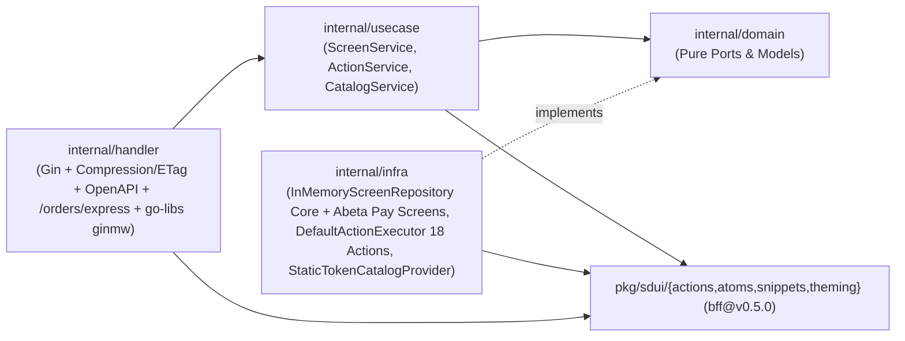

# Go BFF Integration Guide (`bff/`)

The `bff/` directory houses the **Go 1.26.0** SDUI Backend-for-Frontend (`github.com/abeta-dev/kmp/bff@v0.5.0`). It produces `v1` JSON payloads consumed directly by KMP `sdui-layout` (`RemoteScreenRepository`, `CachedScreenRepository`, `RemoteApiCallExecutor`), `watch-companion` (`RemoteWatchPageSource`, `WatchRemoteApiCallExecutor`), and `network` (`KtorHttpTransport`), built on **Clean Architecture**, **Gin `v1.12.0`**, and **`github.com/abeta-dev/go-libs@v0.4.0`**.

---

## Architecture & Directory Layout

```text
bff/
├── cmd/
│   └── bff/             # Entrypoint (main.go), env config, HTTP/1.1 + h2c + TLS HTTP/2 server, graceful shutdown
├── internal/
│   ├── domain/          # Pure ports (ScreenRepository, ActionExecutor, TokenCatalogProvider) & models
│   ├── usecase/         # ScreenService, ActionService (validation rules), CatalogService
│   ├── handler/         # Gin router (router.go), CompressionMiddleware (compression.go), ETagMiddleware (caching.go), OpenAPI 3.1 + Scalar docs (openapi.go)
│   └── infra/           # InMemoryScreenRepository, DefaultActionExecutor, StaticTokenCatalogProvider, 8 golden tests
├── pkg/
│   └── sdui/
│       ├── actions/     # ActionType (18 types incl. trigger_feedback, open_url, share, request_permission, biometric_auth), ActionTrigger, ValidationRule, OverlayPresentation, FeedbackEffect
│       ├── atoms/       # 28 Wire Atoms (incl. CountdownAtom & 12 extended_atoms.go primitives), MotionSpec & 7 MotionLoopEffects, LayoutConfig, token refs
│       ├── snippets/    # PageResponse (FloatingCartSpec threshold nudges, PaginationSpec, AdaptivePageSpec, ScreenLayoutMode, pull_to_refresh), SnippetEnvelope (with MotionSpec), 21 SnippetTypes (incl. product_card, swipe_deck, search_bar, chip_group, nudge_bar, marquee_strip, order_tracker, composed_block w/ 29 ComposedNodeKinds) & builders
│       └── theming/     # Semantic ColorToken, Typography, Spacing, CornerRadius specs
└── testdata/
    └── golden/          # 8 fixtures: home_screen.json, form_screen.json, action_batch.json, containers_screen.json, store_home.json, interactive_screen.json, nudges_and_composed_screen.json, extended_atoms_screen.json
```

### Dependency Flow



- `internal/domain` depends on **nothing** HTTP- or framework-related (enforced by `bff/internal/domain/arch_test.go`).
- `internal/usecase` orchestrates validation and business rules over `internal/domain` ports.
- `internal/infra` provides concrete adapters (`InMemoryScreenRepository` serving core screens `"catalog"`, `"containers"`, `"form-demo"`, `"home"`, `"profile"`, `"store-home"`, `"watch-status"` plus **Abeta Pay** fintech screens `"pay-home"`, `"pay-transfer"`, `"pay-cards"`, `"pay-receipt"` — with the full **7-in-1 Super-App Showcase** verticals also served via `Abeta-dev/sdui-bff` importing `bff@v0.5.0`; `DefaultActionExecutor` supporting all **18 action types** including `open_url`, `share`, `request_permission`, `biometric_auth`, `trigger_feedback`, and `POST /api/v1/orders/express` returning `celebration` + `show_toast` follow-ups; and `StaticTokenCatalogProvider`).
- `internal/handler` wires Gin (`router.go`) with **`github.com/abeta-dev/go-libs@v0.4.0`** and custom production middlewares (`CompressionMiddleware()`, `ETagMiddleware()`, OpenAPI 3.1 / Scalar UI) and delegates to `internal/usecase`.

---

## Production Transport, Middleware & `go-libs@v0.4.0` Features

From `bff/cmd/bff/main.go` and `bff/internal/handler/`:

1. **HTTP/1.1, `h2c`, and TLS HTTP/2 (`http.Server.Protocols`)**:
   - `buildServer()` enables `SetHTTP1(true)`, `SetUnencryptedHTTP2(true)` (`h2c`), and `SetHTTP2(true)`.
   - Providing both `TLS_CERT_FILE` and `TLS_KEY_FILE` starts `ListenAndServeTLS` with HTTP/2 ALPN (`validateConfig` rejects setting only one).
2. **Response Compression (`CompressionMiddleware()` in `compression.go`)**:
   - Negotiates `br` (via `github.com/andybalholm/brotli` `v1.3.0`) or `gzip` from `Accept-Encoding` quality weights (`q`), appends `Vary: Accept-Encoding`, weakens strong `ETag` values to `W/"..."` when compressed, and skips `/metrics`, `HEAD`, `1xx`/`204`/`304`, and pre-encoded responses.
   - Enabled by default (`COMPRESSION_ENABLED=true`).
3. **SHA-256 Conditional Caching (`ETagMiddleware()` in `caching.go`)**:
   - Computes SHA-256 `ETag` and `Cache-Control: public, max-age=30` on `GET /api/v1/screens`, `GET /api/v1/screens/:screenId`, and `GET /api/v1/catalog/tokens`, returning `304 Not Modified` when `If-None-Match` matches (strong, weak `W/`, comma-separated list, or `*`).
   - Enabled by default (`ETAG_ENABLED=true`).
4. **OpenAPI 3.1 & Scalar Documentation (`openapi.go`)**:
   - `GET /openapi.json` serves the generated OpenAPI `3.1.0` schema covering all `/healthz`, `/readyz`, `/metrics`, and `/api/v1/*` routes (including `POST /api/v1/orders/express` and `watch-status` screen descriptions) and component schemas (`PageResponse`, `FloatingCartSpec`, `PaginationSpec`, `AdaptivePageSpec`, `ResponsiveColumnsSpec`, `ResponsiveIntSpec`, `MotionSpec`, `SwitchAtom`, `CheckboxAtom`, `SliderAtom`, `AvatarAtom`, `SkeletonAtom`, `StepperAtom`, `ProductCardSnippetData`, `TriggerFeedbackPayload`, etc.).
   - `GET /docs` renders the interactive Scalar API Reference UI (`@scalar/api-reference`) with an explicit `Content-Security-Policy`. Both endpoints remain accessible without auth.
5. **Optional Global Rate Limiting (`ginmw.GlobalRateLimit()`)**:
   - Disabled by default (`RATE_LIMIT_ENABLED=false`); enable via `RATE_LIMIT_ENABLED=true`.
6. **Optional JWT Authentication (`ginmw.AuthMiddleware()`)**:
   - Disabled by default (`AUTH_REQUIRED=false`). When `AUTH_REQUIRED=true`, `validateConfig()` enforces a non-empty `JWT_SECRET`, configures `ginmw.SetJWTSecret(cfg.JWTSecret)`, and guards all `/api/v1/*` routes while keeping `/healthz`, `/readyz`, `/metrics`, `/openapi.json`, and `/docs` unauthenticated.
7. **`github.com/abeta-dev/go-libs@v0.4.0` Core Primitives**:
   - `go-libs/env`: Env configuration (`PORT`, `HTTP_ADDR`, `SERVICE_NAME`, `GIN_MODE`, `TOKEN_CATALOG_VERSION`, `CORS_ALLOWED_ORIGINS`, `HTTP_READ_TIMEOUT`, `HTTP_WRITE_TIMEOUT`, `HTTP_IDLE_TIMEOUT`, `SHUTDOWN_TIMEOUT`, `TLS_CERT_FILE`, `TLS_KEY_FILE`, `COMPRESSION_ENABLED`, `ETAG_ENABLED`, `RATE_LIMIT_ENABLED`, `AUTH_REQUIRED`, `JWT_SECRET`).
   - `go-libs/logger`: Structured `slog` logging.
   - `go-libs/shutdown`: Graceful multi-hook shutdown manager.
   - `go-libs/health`: Liveness (`/healthz`) and dependency-checked readiness (`/readyz`).
   - `go-libs/apperror`: Typed domain errors mapped to HTTP status codes and `ginmw.Envelope` error payloads.
   - `go-libs/ginmw`: Middleware chain (`RequestID`, `Recovery`, `Telemetry`, `Logger`, `SecurityHeaders`, `CORS`, `REDMetrics`, `LimitBodyDefault`), `/metrics`, and `ginmw.RespondSuccess` / `ginmw.RespondError*`.

---

## HTTP Endpoints (`bff/internal/handler/router.go`)

| Method | Path | Handler / Middleware | Response |
| :--- | :--- | :--- | :--- |
| `GET` | `/healthz` | `health.LivenessHandler` | `200 OK` |
| `GET` | `/readyz` | `healthSvc.Handler` (`screen_repository` check) | `200 OK` / `503` |
| `GET` | `/metrics` | `ginmw.MetricsEndpoint` | Prometheus text or `?format=json` RED metrics |
| `GET` | `/openapi.json` | `registerOpenAPIRoutes` | OpenAPI `3.1.0` JSON document |
| `GET` | `/docs` | `registerOpenAPIRoutes` | Scalar interactive API documentation HTML |
| `GET` | `/api/v1/screens` | `ETagMiddleware` + `listScreens` | `ginmw.Envelope` with `{"screens": ["catalog", "containers", "form-demo", "home", "pay-cards", "pay-home", "pay-receipt", "pay-transfer", "profile", "store-home", "watch-status"]}` (`304` on `If-None-Match`) |
| `GET` | `/api/v1/screens/:screenId` | `ETagMiddleware` + `getScreen` | `ginmw.Envelope` with `snippets.PageResponse` (`304` on `If-None-Match`) |
| `POST` | `/api/v1/actions/execute` | `executeAction` | `ginmw.Envelope` with `domain.ActionExecutionResult` |
| `POST` | `/api/v1/orders/express` | `placeExpressOrder` | `ginmw.Envelope` with `domain.ActionExecutionResult` returning `trigger_feedback` (`celebration`) + `show_toast` follow-ups |
| `GET` | `/api/v1/catalog/tokens` | `ETagMiddleware` + `getTokenCatalog` | `ginmw.Envelope` with `domain.TokenCatalog` (`304` on `If-None-Match`) |

---

## Golden Schema Parity Testing

Schema drift between Go and Kotlin is prevented by **8 shared fixtures** in `bff/testdata/golden/`:

1. `bff/internal/infra/golden_test.go`, `golden_nudges_test.go`, and `golden_extended_atoms_test.go` verify built-in screens, nudges, composed blocks, extended atoms, and batch triggers against `home_screen.json`, `form_screen.json`, `action_batch.json`, `containers_screen.json`, `store_home.json`, `interactive_screen.json`, `nudges_and_composed_screen.json`, and `extended_atoms_screen.json`.
2. `kmp/sdui-contracts/src/jvmTest/kotlin/dev/abeta/kmp/contracts/GoldenFixturesParityTest.kt` and `kmp/sdui-layout/src/jvmTest/kotlin/dev/abeta/kmp/layout/ui/SduiScreenComposeTest.kt` decode and validate those golden JSON fixtures using `SduiJson`.

---

## Local Verification & Run Commands

```bash
cd bff

# Static analysis
go vet ./...

# Race-detector & coverage tests
go test -race -cover ./...

# Run local BFF server (default :8080, h2c + Brotli/gzip + ETag + /docs)
go run ./cmd/bff
```

To point the KMP Desktop Showcase at the running BFF:

```bash
cd kmp
./gradlew :sample-app:run --args="--bff-url http://localhost:8080"
```
