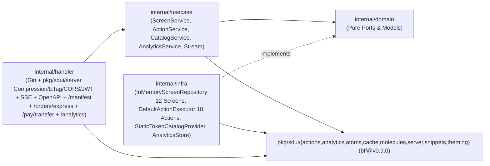

# Go BFF Integration Guide (`bff/`)

The `bff/` directory houses the **Go 1.26.0** SDUI Backend-for-Frontend (`github.com/abeta-dev/kmp/bff@v0.9.0`). It produces `v1` JSON payloads and SSE delta streams consumed directly by KMP `sdui-layout` (`RemoteScreenRepository`, `CachedScreenRepository`, `RemoteApiCallExecutor`, `RemoteBffAnalyticsTracker`), `watch-companion` (`RemoteWatchPageSource`, `WatchRemoteApiCallExecutor`), and `network` (`KtorHttpTransport`, `KtorSseTransport`), built on **Clean Architecture**, **Gin `v1.12.0`**, and **`github.com/abeta-dev/go-libs@v0.4.0`**.

---

## Architecture & Directory Layout

```text
bff/
├── cmd/
│   └── bff/             # Entrypoint (main.go), env config (APP_VERSION, fail-closed CORS, TRUSTED_PROXIES, 32+ char JWT_SECRET), HTTP/1.1 + h2c + TLS 1.2+ HTTP/2 server, graceful shutdown
├── internal/
│   ├── domain/          # Pure ports (ScreenRepository, ActionExecutor, TokenCatalogProvider, AnalyticsStore) & models
│   ├── usecase/         # ScreenService, ActionService (validation rules), CatalogService, AnalyticsService, stream delta builders
│   ├── handler/         # Gin router (router.go), stream SSE handler (stream.go), caching/compression wiring delegating to pkg/sdui/server, OpenAPI 3.1 + Scalar docs (openapi.go)
│   └── infra/           # InMemoryScreenRepository (12 built-in screens), DefaultActionExecutor (18 actions), StaticTokenCatalogProvider, InMemoryAnalyticsStore, 11 golden tests
├── pkg/
│   └── sdui/            # 8 exportable Go packages (bff@v0.9.0):
│       ├── actions/     # ActionType (18 types), ActionTrigger, ValidationRule, OverlayPresentation, FeedbackEffect
│       ├── analytics/   # Batch event ingestion & summary models
│       ├── atoms/       # 29 Wire Atoms (incl. MediaPagerAtom, CountdownAtom.ExpiresAtEpochMs, & 12 extended_atoms.go), MotionSpec & 7 MotionLoopEffects, LayoutConfig, token refs
│       ├── cache/       # UpstreamCachedScreenRepository (singleflight coalescing, bounded LRU + TTL, prefix/tag/all invalidation, O(1) BuildManifest)
│       ├── molecules/   # Server-side express quick-commerce recipes (ExpressProductTile, CategoryGridSection, CheckoutBillSummary, etc.)
│       ├── server/      # Reusable fail-closed CORSMiddleware, private/no-cache ETagMiddleware, sync.Pool CompressionMiddleware (br/gzip), per-router JWTAuthMiddleware, HTTPUpstreamFetcher, StreamProvider
│       ├── snippets/    # PageResponse (page_version, app_version, etag, stream_spec, FloatingCartSpec nudges, PaginationSpec, AdaptivePageSpec), 23 SnippetTypes (incl. composed_block w/ 36 ComposedNodeKinds, custom_slot, graph_canvas), 6 SnippetDeltaOps, ScreenManifestResponse, EnsureComponentIDs
│       └── theming/     # Semantic ColorToken, Typography, Spacing, CornerRadius specs
└── testdata/
    └── golden/          # 11 fixtures: home_screen.json, form_screen.json, action_batch.json, containers_screen.json, store_home.json, interactive_screen.json, nudges_and_composed_screen.json, extended_atoms_screen.json, express_molecules_and_analytics_screen.json, streaming_and_versioned_screen.json, spatial_custom_and_graph_screen.json
```

### Dependency Flow



- `internal/domain` depends on **nothing** HTTP- or framework-related (enforced by `bff/internal/domain/arch_test.go`).
- `internal/usecase` orchestrates validation, manifest versioning, analytics aggregation, SSE stream patches, and business rules over `internal/domain` ports.
- `internal/infra` provides concrete adapters: `InMemoryScreenRepository` serving **12 built-in screens** (`home`, `catalog`, `containers`, `profile`, `form-demo`, `fresh-home`, `store-home`, `watch-status`, `pay-home`, `pay-transfer`, `pay-cards`, `pay-receipt`) — while the full 7-in-1 Super-App vertical demos (`bites-home`, `pulse-home`, `mart-home`, `spark-deck`, `trade-home`) live in `kmp/sample-app`, `kmp/storybook`, and sibling `Abeta-dev/sdui-bff` importing `bff@v0.9.0`; `DefaultActionExecutor` supporting all **18 action types** plus `POST /api/v1/orders/express` and `POST /api/v1/pay/transfer`; `StaticTokenCatalogProvider`; and `InMemoryAnalyticsStore`.
- `internal/handler` wires Gin (`router.go`) with **`pkg/sdui/server`** and **`github.com/abeta-dev/go-libs@v0.4.0`** middlewares, SSE delta streaming (`stream.go`), and OpenAPI 3.1 / Scalar UI (`openapi.go`).

---

## Production Transport, Reusable `pkg/sdui/{cache,server}` & `go-libs@v0.4.0`

From `bff/cmd/bff/main.go`, `bff/pkg/sdui/cache`, and `bff/pkg/sdui/server`:

1. **HTTP/1.1, `h2c`, and TLS 1.2+ HTTP/2 (`http.Server.Protocols`)**:
   - `buildServer()` enables `SetHTTP1(true)`, `SetUnencryptedHTTP2(true)` (`h2c`), and `SetHTTP2(true)` with `MinVersion: tls.VersionTLS12` when `TLS_CERT_FILE` and `TLS_KEY_FILE` are provided (`validateConfig` rejects setting only one).
2. **Pooled Response Compression (`server.CompressionMiddleware()`)**:
   - Negotiates `br` (via `github.com/andybalholm/brotli` `v1.3.0`) or `gzip` from `Accept-Encoding` quality weights (`q`) using `sync.Pool` writers, appends `Vary: Accept-Encoding`, weakens strong `ETag` values to `W/"..."` when compressed, and automatically bypasses `text/event-stream` (SSE), `/metrics`, `HEAD`, `1xx`/`204`/`304`, and payloads exceeding `MaxBufferBytes` (`8 MiB`). Enabled by default (`COMPRESSION_ENABLED=true`).
3. **Version-Aware Conditional Caching (`server.ETagMiddleware()`)**:
   - Defaults to `Cache-Control: private, no-cache`, honors explicit `page.ETag` and `X-App-Version` / `X-Page-Version` / `X-Client-App-Version` headers, computes SHA-256 `ETag` when absent, and returns `304 Not Modified` on `If-None-Match` match on `GET /api/v1/screens`, `/api/v1/manifest`, `/api/v1/screens/manifest`, `/api/v1/screens/:screenId`, and `/api/v1/catalog/tokens` (`ETAG_ENABLED=true`).
4. **Fail-Closed CORS & Per-Router JWT Auth (`server.CORSMiddleware`, `server.JWTAuthMiddleware`)**:
   - `CORS_ALLOWED_ORIGINS` is empty by default (fail-closed — cross-origin requests are denied until explicit origins or subdomain wildcards are configured). `TRUSTED_PROXIES` also defaults to empty (trust none).
   - `AUTH_REQUIRED=false` by default; when `AUTH_REQUIRED=true`, `validateConfig()` enforces a `JWT_SECRET` of at least 32 characters and installs per-router immutable-key `server.JWTAuthMiddleware` across `/api/v1/*` without mutating global `ginmw` state, keeping `/healthz`, `/readyz`, `/metrics`, `/openapi.json`, and `/docs` accessible.
5. **Upstream Caching & Fetchers (`pkg/sdui/cache`, `server.HTTPUpstreamFetcher`)**:
   - `cache.UpstreamCachedScreenRepository` coalesces concurrent upstream fetches with `singleflight`, bounds memory via LRU + TTL, supports invalidation by screen ID, prefix, tag, or all, and computes O(1) `BuildManifest`.
6. **OpenAPI 3.1 & Scalar Documentation (`openapi.go`)**:
   - `GET /openapi.json` serves the generated OpenAPI `3.1.0` schema covering every live route and component schema; `GET /docs` renders the interactive Scalar API Reference UI with an explicit `Content-Security-Policy`.
7. **Optional Global Rate Limiting (`ginmw.GlobalRateLimit()`)**:
   - Disabled by default (`RATE_LIMIT_ENABLED=false`); enable via `RATE_LIMIT_ENABLED=true`.

---

## HTTP Endpoints (`bff/internal/handler/router.go`)

| Method | Path | Handler / Middleware | Response |
| :--- | :--- | :--- | :--- |
| `GET` | `/healthz` | `health.LivenessHandler` | `200 OK` |
| `GET` | `/readyz` | `healthSvc.Handler` (`screen_repository` check) | `200 OK` / `503` |
| `GET` | `/metrics` | `ginmw.MetricsEndpoint` | Prometheus text or `?format=json` RED metrics |
| `GET` | `/openapi.json` | `registerOpenAPIRoutes` | OpenAPI `3.1.0` JSON document |
| `GET` | `/docs` | `registerOpenAPIRoutes` | Scalar interactive API documentation HTML |
| `GET` | `/api/v1/screens` | `ETagMiddleware` + `listScreens` | `ginmw.Envelope` listing all **12 built-in screens** (`catalog`, `containers`, `form-demo`, `fresh-home`, `home`, `pay-cards`, `pay-home`, `pay-receipt`, `pay-transfer`, `profile`, `store-home`, `watch-status`) (`304` on `If-None-Match`) |
| `GET` | `/api/v1/manifest` | `ETagMiddleware` + `getScreenManifest` | `ginmw.Envelope` with `ScreenManifestResponse` (SHA-256 screen versions, `app_version`, `sdui_schema_version`) |
| `GET` | `/api/v1/screens/manifest` | `ETagMiddleware` + `getScreenManifest` | Canonical manifest path returning `ScreenManifestResponse` (`304` on `If-None-Match`) |
| `GET` | `/api/v1/screens/:screenId` | `ETagMiddleware` + `getScreen` | `ginmw.Envelope` with `snippets.PageResponse` (`304` on `If-None-Match`) |
| `GET` | `/api/v1/streams/:streamId` | `streamDeltas` (`StreamProvider`) | Uncompressed `text/event-stream` delivering `SnippetDeltaPatch` frames honoring `Last-Event-ID` (`204 No Content` when already caught up) |
| `POST` | `/api/v1/actions/execute` | `executeAction` | `ginmw.Envelope` with `domain.ActionExecutionResult` |
| `POST` | `/api/v1/orders/express` | `placeExpressOrder` | `ginmw.Envelope` returning `trigger_feedback` (`celebration`) + `show_toast` follow-ups |
| `POST` | `/api/v1/pay/transfer` | `executePayTransfer` | `ginmw.Envelope` executing an Abeta Pay P2P transfer with settlement follow-ups |
| `GET` | `/api/v1/catalog/tokens` | `ETagMiddleware` + `getTokenCatalog` | `ginmw.Envelope` with `domain.TokenCatalog` (`304` on `If-None-Match`) |
| `POST` | `/api/v1/analytics/events` | `ingestAnalyticsEvents` | `ginmw.Envelope` accepting batched SDUI client telemetry events |
| `GET` | `/api/v1/analytics/summary` | `getAnalyticsSummary` | `ginmw.Envelope` summarizing ingested SDUI events & counts |

---

## Golden Schema Parity Testing

Schema drift between Go and Kotlin is prevented by **11 shared fixtures** in `bff/testdata/golden/`:

1. `bff/internal/infra/golden*_test.go` verify all built-in screens, nudges, composed blocks, extended atoms, express molecules/analytics, streaming/versioning, and spatial/custom-slot/graph-canvas schemas against `home_screen.json`, `form_screen.json`, `action_batch.json`, `containers_screen.json`, `store_home.json`, `interactive_screen.json`, `nudges_and_composed_screen.json`, `extended_atoms_screen.json`, `express_molecules_and_analytics_screen.json`, `streaming_and_versioned_screen.json`, and `spatial_custom_and_graph_screen.json`.
2. `kmp/sdui-contracts/src/jvmTest/kotlin/dev/abeta/kmp/contracts/GoldenFixturesParityTest.kt` and `kmp/sdui-layout/src/jvmTest/kotlin/dev/abeta/kmp/layout/ui/SduiScreenComposeTest.kt` decode and validate those golden JSON fixtures using `SduiJson`.

---

## Local Verification & Run Commands

```bash
cd bff

# Static analysis
go vet ./...

# Race-detector & coverage tests
go test -race -cover ./...

# Run local BFF server (default :8080, h2c + Brotli/gzip + ETag + /docs)
go run ./cmd/bff
```

To point the KMP Desktop Showcase at the running BFF:

```bash
cd kmp
./gradlew :sample-app:run --args="--bff-url http://localhost:8080"
```
