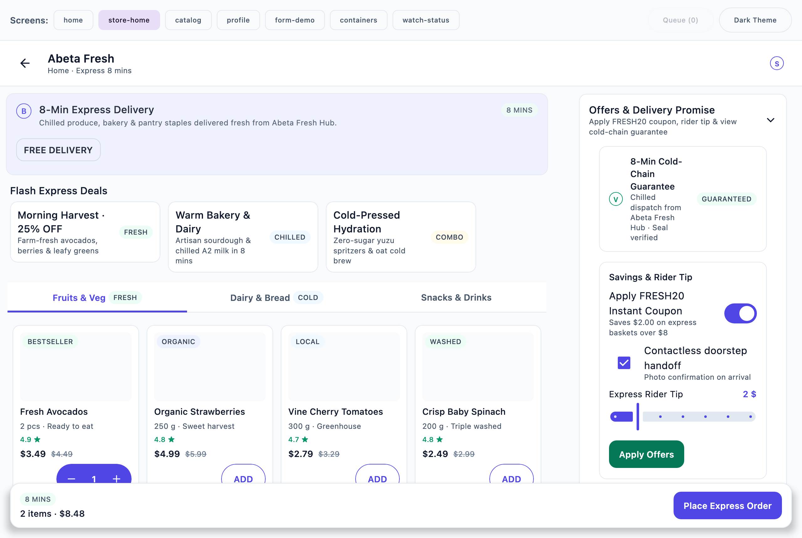
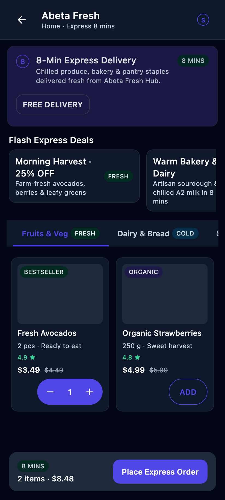
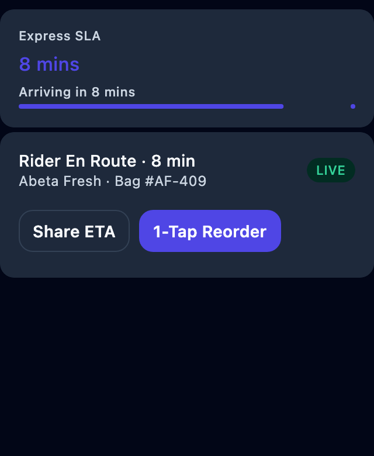
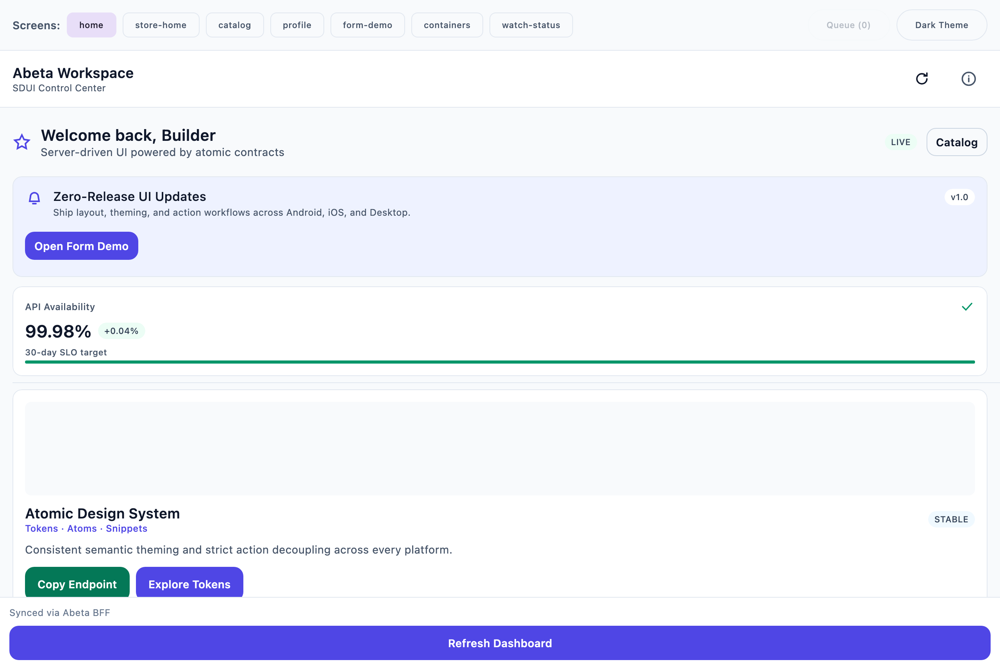
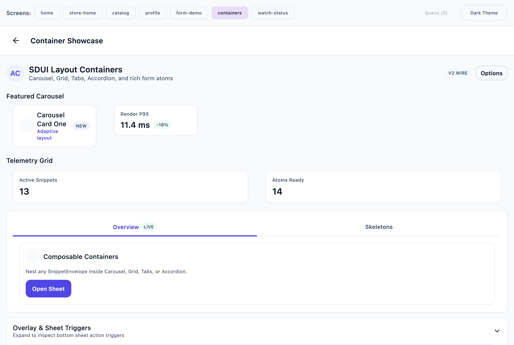
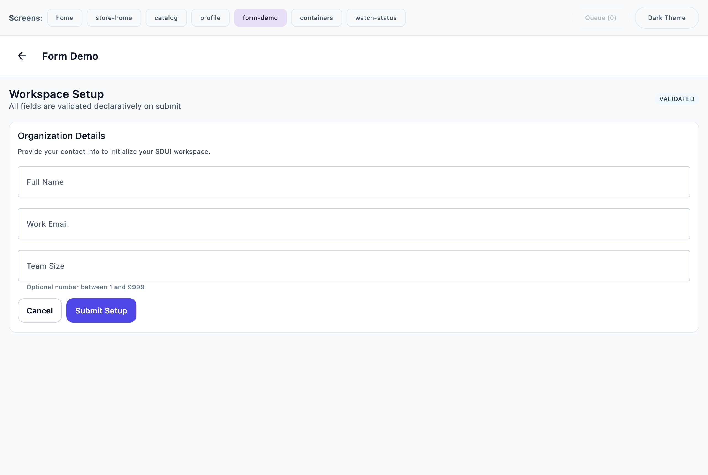
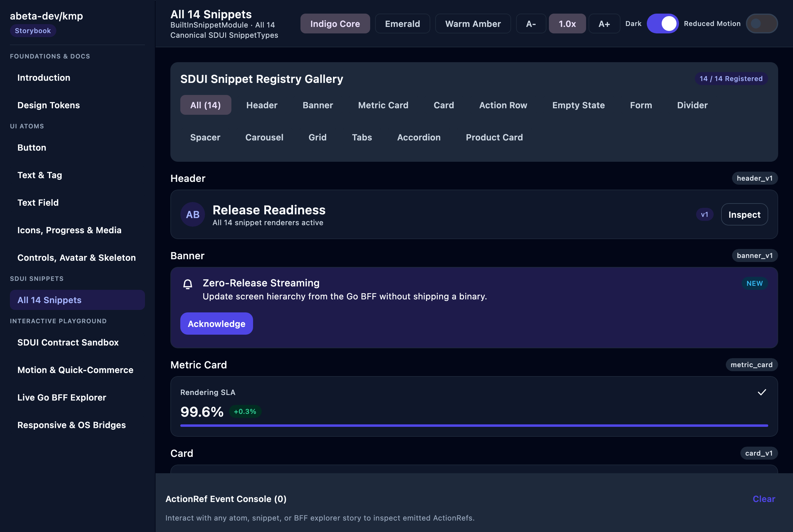
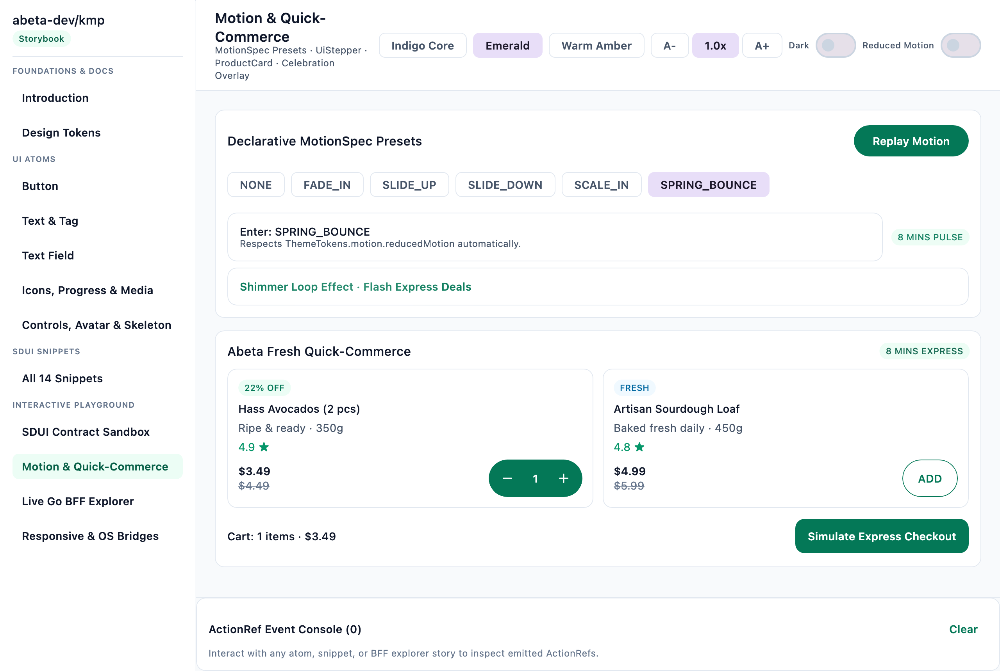
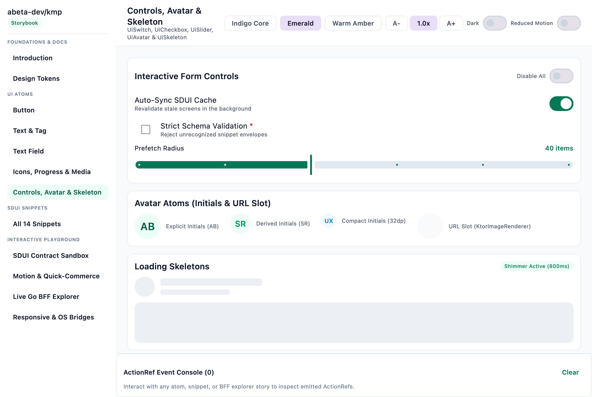

# Visual Showcase — Demo App & Storybook Screenshots

All screenshots below are **pixel-accurate Retina (2×) PNG captures** rendered directly by Compose Multiplatform (Skiko `ImageComposeScene`) from `kmp/sample-app` and `kmp/storybook` with zero mockups or hand-edited assets.

---

## 1. Sample App — Quick-Commerce & Adaptive SDUI (`kmp/sample-app`)

### Abeta Fresh Express Store (`store-home` — Desktop Split-Pane, 4-Column Responsive Grid & Floating Cart Dock)


### Mobile Phone Form Factor (`store-home` — 412dp Compact 2-Column Grid, Scrollable Tabs, Light & Dark Mode)

| Light Mode (Phone `412×915`) | Dark Mode (Phone `412×915`) |
| :---: | :---: |
|  |  |

### Wearable Glanceable Form Factor (`watch-status` — `320×390` Dark Mode)


### Workspace Home, Nested Containers & Declarative Validated Forms

| Home Dashboard (`home`) | Nested Containers (`containers`) |
| :---: | :---: |
|  |  |



---

## 2. Interactive Storybook (`kmp/storybook` — 12 Stories Across Desktop, WasmJS, macOS & iOS)

### Design Tokens & WCAG AA Contrast Specimen Board


### All 14 SDUI Snippets Gallery (Dark Mode)


### Motion Presets & Abeta Fresh Quick-Commerce Sandbox


### Interactive Form Controls, Avatars & Shimmer Skeletons


### Responsive Form-Factor Breakpoints & Live Core OS Bridges


---

## 3. Regenerating Screenshots Locally

```bash
# Export all 7 Demo screenshots (Desktop, Phone Light/Dark, Watch)
(cd kmp && ./gradlew :sample-app:run --args="--capture-screenshots=../docs/assets/screenshots")

# Export all 5 Storybook screenshots (Tokens, Controls, 14 Snippets Dark, Motion/Store, Responsive/Bridges)
(cd kmp && ./gradlew :storybook:run --args="--capture-screenshots=../docs/assets/screenshots")

# Optional: capture Demo screenshots directly against a live Go BFF
(cd bff && go run ./cmd/bff) &
(cd kmp && ./gradlew :sample-app:run --args="--bff-url=http://localhost:8080 --capture-screenshots=../docs/assets/screenshots")
```
