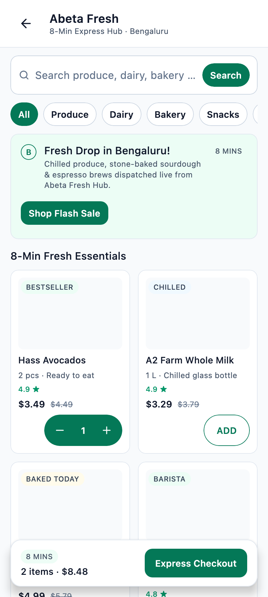
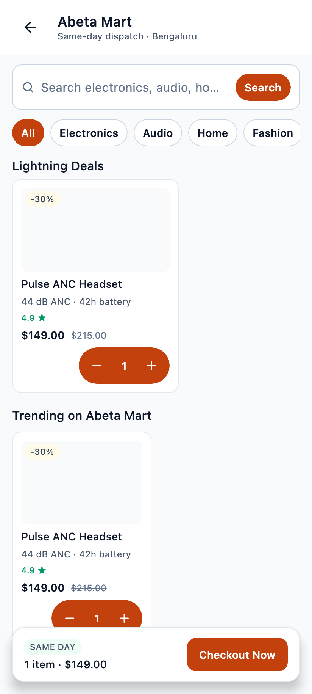
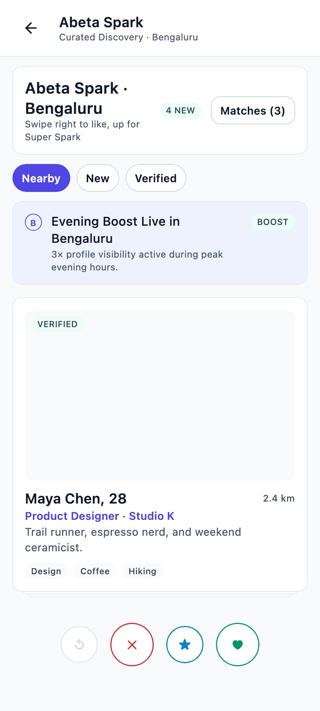
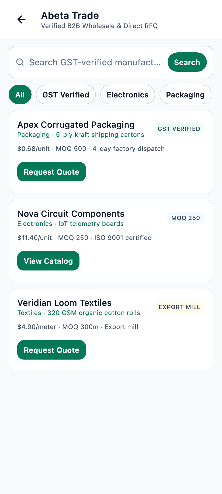
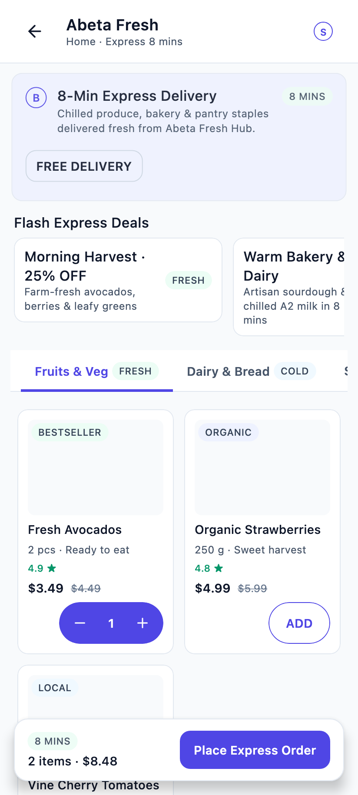
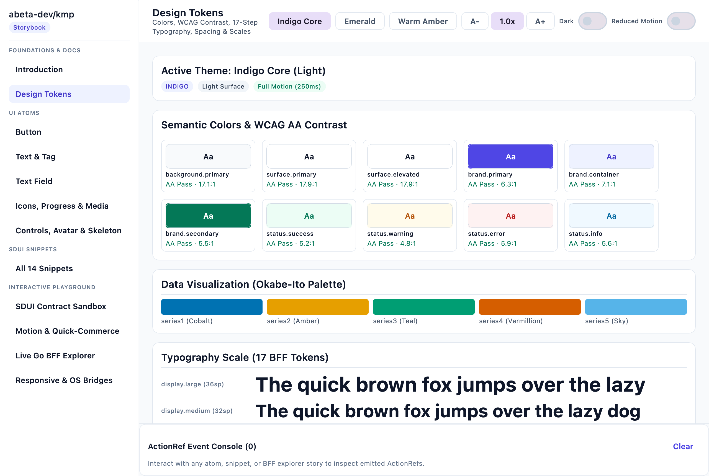
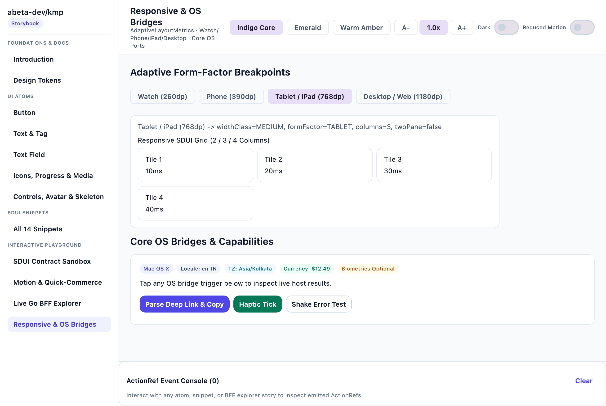

# Visual Showcase — Demo App & Storybook Screenshots

All screenshots below are **pixel-accurate Retina (2×) PNG captures** rendered directly by Compose Multiplatform (Skiko `ImageComposeScene`) from `kmp/sample-app` and `kmp/storybook` with zero mockups or hand-edited assets.

---

## 1. 6-in-1 Super-App Showcase Screenshots (`kmp/sample-app --verticals`)

Six distinct consumer and B2B verticals rendered from one shared Compose Multiplatform SDUI engine (`sdui-layout` + `ui-atoms` + `design-tokens`), powered by `search_bar`, `chip_group`, `swipe_deck`, `product_card`, responsive `grid`/`carousel`, `FloatingCartDockHost`, and adaptive theme presets (`EMERALD`, `AMBER`, `INDIGO`):

### Abeta Fresh — Quick-Commerce Grocery (Desktop `1280×860` Super-App Launcher + Adaptive Grid)


### All 6 Vertical Showcase Apps — Mobile Phone Form Factor (`412×915`)

| Abeta Fresh (`fresh-home` · 8-Min Grocery) | Abeta Bites (`bites-home` · Food Delivery) | Abeta Pulse (`pulse-home` · Events & Movies) |
| :---: | :---: | :---: |
|  |  |  |

| Abeta Mart (`mart-home` · Retail Marketplace) | Abeta Spark (`spark-deck` · Swipe Discovery) | Abeta Trade (`trade-home` · B2B Wholesale & RFQ) |
| :---: | :---: | :---: |
|  |  |  |

---

## 2. Sample App — Core Kit & Adaptive SDUI (`kmp/sample-app`)

### Abeta Fresh Express Store (`store-home` — Desktop Split-Pane, 4-Column Responsive Grid & Floating Cart Dock)


### Mobile Phone Form Factor (`store-home` — 412dp Compact 2-Column Grid, Scrollable Tabs, Light & Dark Mode)

| Light Mode (Phone `412×915`) | Dark Mode (Phone `412×915`) |
| :---: | :---: |
|  |  |

### Wearable Glanceable Form Factor (`watch-status` — `320×390` Dark Mode)


### Workspace Home, Nested Containers & Declarative Validated Forms

| Home Dashboard (`home`) | Nested Containers (`containers`) |
| :---: | :---: |
|  |  |


---

## 3. Interactive Storybook (`kmp/storybook` — 13 Stories Across Desktop, WasmJS, macOS & iOS)

### Design Tokens & WCAG AA Contrast Specimen Board


### All 17 SDUI Snippets Gallery (Dark Mode)


### Motion Presets & Abeta Fresh Quick-Commerce Sandbox


### Interactive Form Controls, Avatars & Shimmer Skeletons


### Responsive Form-Factor Breakpoints & Live Core OS Bridges


---

## 4. Regenerating Screenshots Locally

```bash
# Export all 7 Core Demo screenshots (Desktop, Phone Light/Dark, Watch)
(cd kmp && ./gradlew :sample-app:run --args="--capture-screenshots=../docs/assets/screenshots")

# Export all 6-in-1 Super-App Showcase screenshots (Phone & Desktop across all 6 verticals)
(cd kmp && ./gradlew :sample-app:run --args="--capture-verticals=../docs/assets/screenshots")

# Export all 5 Storybook screenshots (Tokens, Controls, 17 Snippets Dark, Motion/Store, Responsive/Bridges)
(cd kmp && ./gradlew :storybook:run --args="--capture-screenshots=../docs/assets/screenshots")

# Optional: capture screenshots directly against a live Go BFF (bff/ or Abeta-dev/sdui-bff)
(cd bff && go run ./cmd/bff) &
(cd kmp && ./gradlew :sample-app:run --args="--bff-url=http://localhost:8080 --capture-verticals=../docs/assets/screenshots")
```
