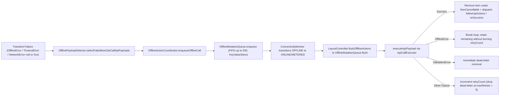

# Action Dispatch, OS Bridges & Offline Sync Flow

This document traces how user interactions in stateless `ui-atoms` flow through `LayoutController`, `DefaultActionDispatcher`, OCP decoders and handlers, HTTP/CSRF execution, UI reducers, and durable offline mutation queueing and replay.

## End-to-End Action & Offline Sync Sequence

```mermaid
sequenceDiagram
    autonumber
    participant Atom as "Stateless ui-atoms / SnippetRenderer"
    participant Ctrl as "LayoutController"
    participant Disp as "DefaultActionDispatcher"
    participant Val as "DefaultActionValidator"
    participant Dec as "ActionDecoderRegistry"
    participant Reg as "ActionRegistry (OCP)"
    participant Api as "RemoteApiCallExecutor + KtorHttpTransport"
    participant Bridge as "PlatformBridgeOutcomeExecutor"
    participant Queue as "OfflineActionCoordinator + OfflineMutationQueue"

    Atom->>Ctrl: onAction(ActionRef)
    Ctrl->>Ctrl: Capture screenGeneration, clear validationErrors, track interaction
    Ctrl->>Disp: dispatch(action, ActionContext(sessionState, metadata))
    Disp->>Disp: Guard depth <= 16 & DispatchBudget <= 64
    Disp->>Val: validate(action, context)
    alt Validation Failure
        Val-->>Ctrl: AppResult.Failure(ValidationError)
        Ctrl->>Ctrl: HapticStyle.ERROR, bump errorShakeSequence, show error toast
    else Valid
        Disp->>Dec: decode(action.type, action.payload)
        Dec-->>Disp: Typed ActionPayload
        alt BatchPayload
            Disp->>Disp: Expand child actions (sequential propagates StateMutated; parallel via async)
        else Standard ActionPayload
            Disp->>Reg: handlerFor(payload::class).handle(payload, context)
            opt CallApiPayload
                Reg->>Api: execute(payload, context)
                Note over Api: Same-origin BearerAuth + CsrfTokenProvider (single 403 refresh & retry)
                Api-->>Reg: AppResult(ActionOutcome.ApiCallResult + followUpActions)
            end
            Reg-->>Disp: AppResult(ActionOutcome)
            Disp->>Disp: Dispatch followUpActions & secondaryActions within budget
        end
        Disp-->>Ctrl: List of AppResult(ActionOutcome)
        Ctrl->>Ctrl: Drop if generation != screenGeneration
        loop Each Result
            alt Bridge Outcome (Clipboard / OpenUrl / Share / Permission / Biometric)
                Ctrl->>Bridge: executeIfBridgeOutcome(outcome)
                Bridge-->>Ctrl: Invoke OS port & dispatch onGranted/onDenied/onAuthenticated/onFailed
            else Standard Outcome
                Ctrl->>Ctrl: Apply StateMutated, SnippetsUpdated, OverlayRequested, FeedbackTriggered, Navigation
            end
        end
        opt Transient Failure on Non-GET call_api
            Ctrl->>Queue: enqueueOfflineCall(payload, reason)
            Queue-->>Ctrl: Persist QueuedMutation & update pendingOfflineActions
        end
    end
```

## Stage-by-Stage Breakdown

### 1. Pure UI Intent Emission (`ui-atoms` & `SnippetRenderer`)
- Stateless atoms in `kmp/ui-atoms` (`UiButton`, `UiText`, `UiIcon`, `UiChip`, `UiStepper`, `UiOtpInput`, etc.) never import `core`, `action-engine`, or `network`. They emit `onAction: (ActionRef) -> Unit` and `onFormValueChange: (String, String) -> Unit`.
- `LayoutController.onFormFieldChanged(fieldId, value)` writes `JsonPrimitive(value)` to `SessionStore`, updates `LayoutUiState.Ready.formValues`, and removes any stale field entry from `validationErrors`.

### 2. Validation, Decoding & Bounded OCP Dispatch (`action-engine`)
- `LayoutController.dispatchAndApply` captures `screenGeneration`, emits interaction analytics (`LayoutAnalyticsHelper.buildActionInteractionEvents`), builds `ActionContext(sessionState, metadata)` via `LayoutStateReducer.buildActionContext`, and calls `actionDispatcher.dispatch(action, context)`.
- **`DefaultActionDispatcher`** (`kmp/action-engine/.../handler/NavigationAndNetworkActionHandlers.kt`) executes a 5-step pipeline:
  1. **Recursion & Budget Guards**: Rejects actions exceeding `maxDepth` (`DEFAULT_MAX_DEPTH = 16`) or total executions exceeding `maxTotalActions` (`DEFAULT_MAX_TOTAL_ACTIONS = 64`) via a CAS-backed `DispatchBudget`.
  2. **Declarative Validation (`DefaultActionValidator`)**: Evaluates `ActionRef.validations` against `context.sessionState` (falling back to `context.metadata`) using 5 built-in rules matching Go BFF `usecase.ActionService`: `required`, `min_length`, `max_length`, anchored `regex` (`Regex(pattern).matches(actual)`, max pattern length 256), and `equals`, plus optional `customRules`.
  3. **OCP Decoding (`ActionDecoderRegistry`)**: Looks up `action.type` across the **18** built-in `ActionTypes` registered in `BuiltInActionDecoders` (or custom feature decoders) via `kotlinxActionDecoder<P>(SduiJson)`.
  4. **OCP Handling (`ActionRegistry`)**: Resolves `handlerFor(decoded::class)`. If no custom handler overrides `BatchPayload`, `dispatchBatch` runs children either sequentially (propagating every `ActionOutcome.StateMutated` immediately into `currentContext.sessionState` for subsequent validations/actions and honoring `stopOnError`) or in parallel (`batch.parallel && !batch.stopOnError` via `coroutineScope { async { ... }.awaitAll() }`).
  5. **Chained Follow-Ups & Secondary Actions**: For `CallApiPayload`, if `execute` fails and `payload.onError != null`, `onError` is dispatched immediately. On success, `ActionOutcome.ApiCallResult.followUpActions` (enriched with `payload.onSuccess` / `payload.onError` if empty) execute first, followed by `action.secondaryActions` (when `outcome !is ApiCallResult || outcome.isSuccess`).

### 3. Remote API Execution, Bearer Auth & CSRF 403 Retry
- **`RemoteApiCallExecutor`** (`kmp/sdui-layout/.../repository/ScreenRepository.kt`) implements `ApiCallExecutor` using `HttpTransport.request` (`GET`/`POST`/`PUT`/`PATCH`/`DELETE`), decodes `BffEnvelope<JsonElement>`, and extracts server-driven `data.follow_up_actions`.
- **`HttpClientFactory`** (`kmp/network/.../client/HttpClientFactory.kt`) restricts both static/dynamic headers (`AbetaSameOriginHeaders`) and Ktor `Auth` `bearer` tokens (`sendWithoutRequest` and `refreshTokens`) strictly to `baseOrigin.matches(request.url)` so credentials never leak to cross-origin URLs.
- **`KtorHttpTransport.executeWithCsrf`** (`kmp/network/.../client/KtorHttpTransport.kt`) injects `CsrfTokenProvider.currentToken()` (`X-CSRF-Token` by default) on `POST`/`PUT`/`PATCH`/`DELETE`. If the server returns `403 Forbidden`, it calls `provider.refreshToken()`, drains/cancels the failed response cleanly, and performs exactly **one** retry with the refreshed token.

### 4. Applying Outcomes in `LayoutController` & `SduiScreen`
- **`PlatformBridgeOutcomeExecutor`** (`kmp/sdui-layout/.../engine/PlatformBridgeOutcomeExecutor.kt`) intercepts OS bridge outcomes before standard UI reduction:
  - `ClipboardCopyRequested` → `bridges.clipboardPort.copy`, then `clipboardListener`.
  - `OpenUrlRequested` → `bridges.externalLauncher.openUrl`; on failure navigates to `fallbackRoute` or shows an error toast.
  - `ShareRequested` → `bridges.sharePort.share`; on failure copies combined text to clipboard as fallback.
  - `PermissionRequested` → `bridges.permissionPort.request`, then dispatches `onGranted` or `onDenied`.
  - `BiometricAuthRequested` → `bridges.biometricAuthenticator.authenticate`, then dispatches `onAuthenticated` or `onFailed`.
- **Standard UI Outcomes** (`LayoutController.applyStandardOutcome`):
  - `SnippetsUpdated` → `SnippetListMutator.mutate` (`append`, `prepend`, `replace`, `remove`) with `deduplicateById` preventing duplicate `LazyColumn` keys.
  - `OverlayRequested` / `OverlayDismissed` → renders `OverlayHost` (`AlertDialog` or `ModalBottomSheet` in `SduiOverlays.kt`); if `sheetScreenId` is set and `snippets` is empty, fetches the remote sheet screen asynchronously under the `screenGeneration` guard.
  - `FeedbackTriggered` → performs `outcome.effect.toHapticStyle()`, increments `feedbackSequence` to launch `UiCelebrationOverlay` (`CELEBRATION`), or bumps `errorShakeSequence` + `errorShakeTargetId` to drive `Modifier.shakeOnError` (`SHAKE_ERROR`).
  - `ValidationError` failure → triggers `HapticStyle.ERROR`, populates `validationErrors[field]`, bumps `errorShakeSequence`, and displays an error toast.

### 5. Offline Enqueue, Incremental Checkpointing & Replay



- **`OfflinePayloadSelector`** (`LayoutStateHelpers.kt`) matches dispatched `CallApiPayload`s (including nested inside `batch`) against completed `ApiCallResult`s, enqueueing only failed **non-GET** mutations so idempotent reads are never queued.
- **`OfflineMutationQueue.flush`** (`kmp/state/.../sync/OfflineMutationQueue.kt`) snapshots pending items under `mutex`, releases `mutex` during network I/O so new user enqueues never block, and persists each completed removal or retry-count increment immediately under `withContext(NonCancellable)` to prevent duplicate replay if the coroutine is cancelled mid-flush.
- When `LayoutController.observeConnectivity()` observes a transition from `ConnectivityStatus.OFFLINE` to online, it automatically invokes `flushOfflineActions()`, passing `onFollowUpAction = { dispatchAndApply(it, screenGeneration) }` so server-returned follow-up actions (toasts, celebrations, snippet refreshes) apply immediately on reconnect.

## Failure, Security & Retry Guarantees

| Condition | Exact Runtime Behavior | Owning Symbol |
| :--- | :--- | :--- |
| Action recursion depth `> 16` or total count `> 64` | Returns `ValidationError` immediately without executing child actions | `DefaultActionDispatcher` (`DispatchBudget`) |
| Field fails `required` / `min_length` / `max_length` / `regex` / `equals` | Triggers `HapticStyle.ERROR`, populates `validationErrors`, increments `errorShakeSequence` | `DefaultActionValidator`, `LayoutStateReducer` |
| Cross-origin URL in `call_api` | `AbetaSameOriginHeaders` and Ktor `Auth` `bearer` omit default headers and bearer tokens | `HttpClientFactory` (`ParsedOrigin`) |
| `403 Forbidden` on state-changing HTTP call | Calls `CsrfTokenProvider.refreshToken()`, drains failed response, performs exactly 1 retry | `KtorHttpTransport.executeWithCsrf` |
| `OfflineError` during offline queue replay | Breaks flush loop immediately; retains unattempted items without incrementing `retryCount` | `OfflineMutationQueue.flush` |

## Key Symbols & Source File Map

| Component | Symbol | Source Path |
| :--- | :--- | :--- |
| Action Validation & Dispatch | `DefaultActionDispatcher`, `DefaultActionValidator` | `kmp/action-engine/.../handler/NavigationAndNetworkActionHandlers.kt`, `.../validation/ActionValidator.kt` |
| Decoders & Handlers | `ActionDecoderRegistry`, `ActionRegistry`, `ActionOutcome` | `kmp/action-engine/.../codec/ActionPayloadDecoder.kt`, `.../handler/ActionHandler.kt` |
| Network Auth & CSRF | `HttpClientFactory`, `KtorHttpTransport`, `CsrfTokenProvider` | `kmp/network/.../client/{HttpClientFactory,KtorHttpTransport}.kt`, `.../ports/NetworkPorts.kt` |
| Bridge & Snippet Reducers | `PlatformBridgeOutcomeExecutor`, `SnippetListMutator`, `OverlayHost` | `kmp/sdui-layout/.../engine/{PlatformBridgeOutcomeExecutor,LayoutStateHelpers}.kt`, `.../ui/SduiOverlays.kt` |
| Offline Replay | `OfflineActionCoordinator`, `OfflineMutationQueue` | `kmp/sdui-layout/.../engine/OfflineActionCoordinator.kt`, `kmp/state/.../sync/OfflineMutationQueue.kt` |
