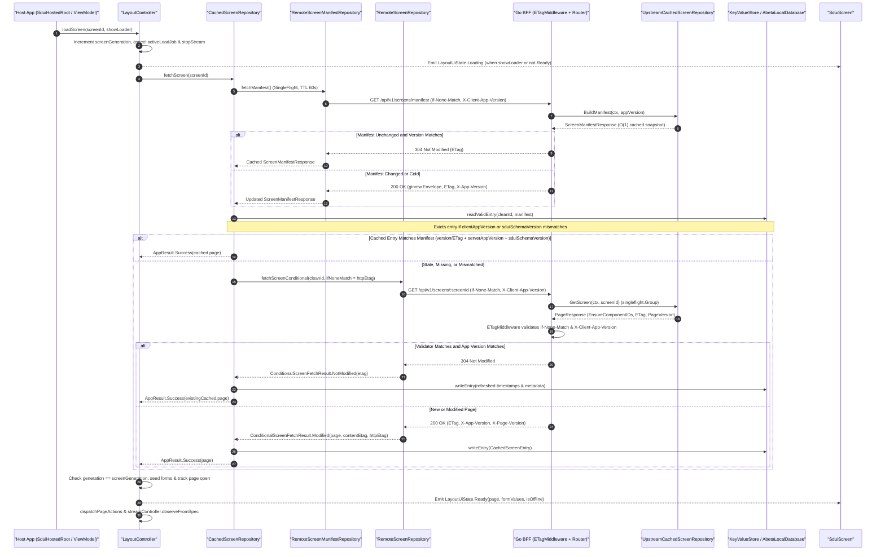
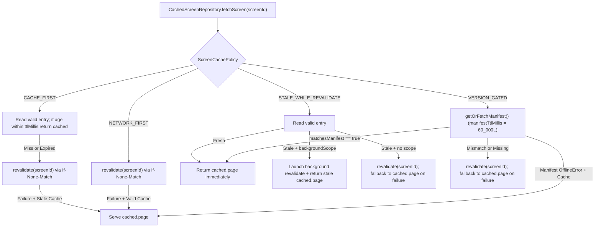

# Screen Load, Caching & Manifest Handshake Flow

This document traces the complete lifecycle of an SDUI screen load from app boot or navigation through `LayoutController`, `CachedScreenRepository`, the Go BFF (`ETagMiddleware` and `UpstreamCachedScreenRepository`), durable local persistence, and `SduiScreen` rendering.

## End-to-End Sequence (`VERSION_GATED` Policy)

## Cache Policy Decision Matrix

`CachedScreenRepository` (`kmp/sdui-layout/.../repository/CachedScreenRepository.kt`) wraps `RemoteScreenRepository` (or any `ScreenRepository`) with per-screen `SingleFlight` deduplication and four `ScreenCachePolicy` modes:

## Stage-by-Stage Responsibilities

### 1. Boot, Resume & Generation Guard (`LayoutController`)
- `SduiHostedRoot` (`kmp/sdui-layout/.../ui/SduiHostRoot.kt`) or `SduiLayoutViewModel` (`kmp/sdui-layout/.../engine/SduiLayoutViewModel.kt`) calls `loadScreen(screenId)` and `observeConnectivity()`.
- `LayoutController.loadScreenInternal` increments `screenGeneration`, cancels any prior `activeLoadJob` and `screenScopedJobs`, stops any active SSE stream (`stopStream()`), clears deduplicated impression sets, and emits `LayoutUiState.Loading` (unless `showLoader == false` during pull-to-refresh).
- Before emitting `LayoutUiState.Ready`, `onPageLoaded` verifies `generation == screenGeneration`, seeds form controls via `LayoutFormSeeder.extractInitialFormValues` (merging restored `SavedState` values and `DeepLinkParser` params), tracks page open + impression events, dispatches `page.pageActions`, and attaches `page.streamSpec` if configured.

### 2. Manifest Handshake & Conditional Revalidation (KMP)
- **`RemoteScreenManifestRepository`** (`kmp/sdui-layout/.../repository/ScreenManifestRepository.kt`) calls `GET /api/v1/screens/manifest` (`DEFAULT_MANIFEST_PATH`; the Go BFF also aliases `GET /api/v1/manifest`). It caches `lastEtag` and `lastManifest` behind a `Mutex`, sending `If-None-Match` and `X-Client-App-Version`. On HTTP `304`, it returns the cached `ScreenManifestResponse`.
- **`CachedScreenRepository.matchesManifest`** serves a cached page directly without fetching the screen body only when:
  1. `manifest.appVersion` matches `cached.serverAppVersion` (when both are non-blank).
  2. `manifest.sduiSchemaVersion` matches `cached.sduiSchemaVersion`.
  3. `manifest.screens[cleanId]` matches `cached.pageVersion` and/or `cached.contentEtag`.
- **`RemoteScreenRepository`** (`kmp/sdui-layout/.../repository/ScreenRepository.kt`) calls `HttpTransport.requestConditional` on `GET /api/v1/screens/:screenId` with `If-None-Match` (preferring `httpEtag` so weak `W/` compressed validators match) and `X-Client-App-Version`.
- **`CachedScreenEntry`** stores `cachedAtEpochMillis`, `page`, `etag`, `pageVersion`, `appVersion`, `httpEtag`, `contentEtag`, `serverAppVersion`, `clientAppVersion`, and `sduiSchemaVersion` under key `"abeta_screen_cache:<cleanId>"`. Any `clientAppVersion` or `sduiSchemaVersion` mismatch immediately evicts the stale entry on read (`readValidEntry`).

### 3. Go BFF Caching, Manifest & ETag Pipeline
- **`cache.UpstreamCachedScreenRepository`** (`bff/pkg/sdui/cache/cache.go`):
  - Coalesces concurrent misses per `(scope, screenID)` via `golang.org/x/sync/singleflight.Group` using `context.WithoutCancel(ctx)` so one cancelled caller does not abort shared upstream work.
  - Normalizes every fetched page via `snippets.EnsureComponentIDs`, `snippets.ComputePageETag`, and `snippets.DerivePageVersion`, guarding against mid-flight cache poisoning with `invalidationGen`.
  - Evicts by TTL (`DefaultTTL = 5m`) and bounded LRU (`DefaultMaxEntries = 256`), and supports `Invalidate`, `InvalidatePrefix`, `InvalidateTag`, and `InvalidateAll`, each bumping `manifestGen` and clearing cached manifest snapshots.
  - Serves `BuildManifest` in **O(1)** once populated, cloning snapshots while `snap.generation == manifestGen` and `now < earliestExpiry`.
- **`handler.bffHandler.getScreen`** (`bff/internal/handler/router.go`) stamps `ETag` (`page.ETag`), `X-App-Version`, and `X-Page-Version` before returning `ginmw.RespondSuccess(c, page)`.
- **`server.ETagMiddleware`** (`bff/pkg/sdui/server/etag.go`):
  - Honors handler-set `ETag` headers; otherwise hashes canonical JSON after stripping volatile keys (`generated_at_epoch_ms`, `request_id`).
  - Defaults `Cache-Control` to `private, no-cache` and downgrades authenticated requests (`RequireAuth` or `Authorization`/`Cookie` header) to `private, no-cache` + `Vary: Authorization`.
  - Compares strong/weak `If-None-Match` tokens, **bypassing `304 Not Modified`** whenever `X-Client-App-Version != X-App-Version` so upgraded apps always receive fresh screen contracts.
  - When `server.CompressionMiddleware` compresses the body (`br` or `gzip`), it weakens the `ETag` to `W/"..."` per RFC 9110.

### 4. Local Persistence & Offline Fallback
- **Zero-KSP Disk KV (`createDiskKeyValueStore`)**: Default in `createSduiKoinModule(useDiskCacheStore = true)` (`kmp/sdui-layout/.../di/SduiKoinModule.kt`). Uses `FileKeyValueStore` on JVM Desktop, `UserDefaultsKeyValueStore` on Apple (`iOS`/`macOS`/`watchOS`), and `WebStorageKeyValueStore` (`localStorage` w/ memory fallback) on WasmJS. Android hosts inject `AndroidSharedPreferencesKeyValueStore`.
- **Room 3 SQLite (`AbetaLocalDatabase`)**: Optional relational store in `kmp/database` (`AbetaDatabase` schema v2 with `MIGRATION_1_2` adding `pageVersion` and `appVersion` to `cached_screens`, `offline_mutations`, and `key_value_records` across JVM, Android, Apple, and WasmJS OPFS).
- **Render & Offline UX (`SduiScreen`)**: `LayoutUiState.Loading` renders `SkeletonScreenPlaceholder`; `LayoutUiState.Ready` renders `ReadyScreenContent` with `OfflineStatusBanner` whenever `state.isOffline` is true; `LayoutUiState.Error` renders `ErrorScreenContent` with a `Retry` button wired to `controller.retry()`. When offline, `CachedScreenRepository` returns the last valid cached page instead of failing the screen.

## Key Symbols & Source File Map

| Layer / Side | Symbol | Source Path |
| :--- | :--- | :--- |
| KMP Orchestrator | `LayoutController`, `LayoutUiState` | `kmp/sdui-layout/src/commonMain/kotlin/dev/abeta/kmp/layout/engine/LayoutController.kt` |
| KMP Cache Decorator | `CachedScreenRepository`, `ScreenCachePolicy` | `kmp/sdui-layout/src/commonMain/kotlin/dev/abeta/kmp/layout/repository/CachedScreenRepository.kt` |
| KMP Manifest Client | `RemoteScreenManifestRepository` | `kmp/sdui-layout/src/commonMain/kotlin/dev/abeta/kmp/layout/repository/ScreenManifestRepository.kt` |
| KMP Screen Client | `RemoteScreenRepository`, `ConditionalScreenRepository` | `kmp/sdui-layout/src/commonMain/kotlin/dev/abeta/kmp/layout/repository/ScreenRepository.kt` |
| KMP Local Persistence | `createDiskKeyValueStore`, `AbetaLocalDatabase`, `AbetaDatabase` | `kmp/state/.../storage/DiskKeyValueStore.kt`, `kmp/database/.../AbetaLocalDatabase.kt` |
| Go BFF Router & ETag | `bffHandler.getScreen`, `server.ETagMiddleware` | `bff/internal/handler/router.go`, `bff/pkg/sdui/server/etag.go` |
| Go BFF Upstream Cache | `cache.UpstreamCachedScreenRepository` | `bff/pkg/sdui/cache/cache.go` |
