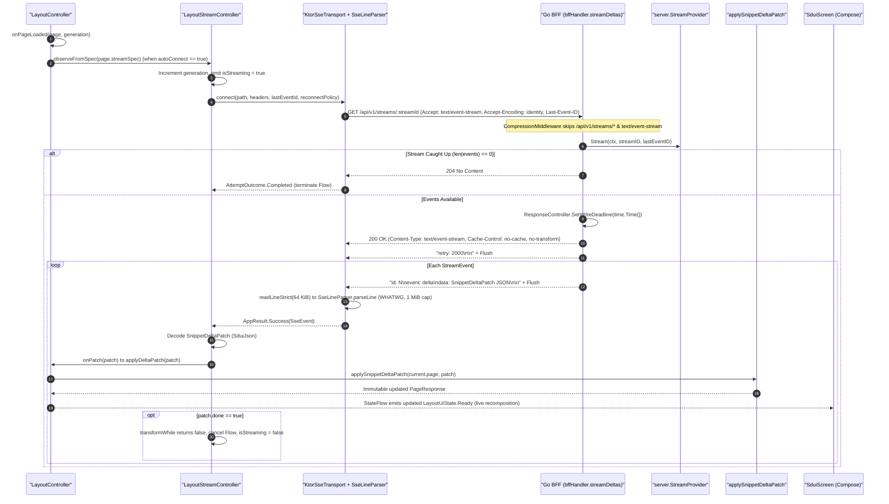
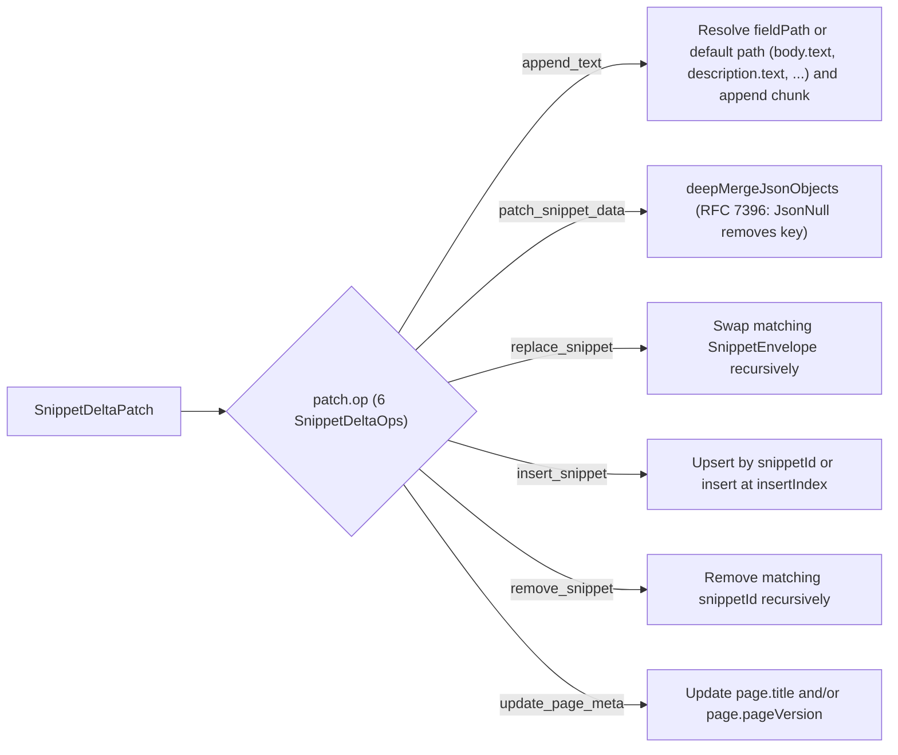

# SSE Streaming & Incremental Delta Patch Flow

This document traces real-time Server-Sent Events (SSE) delivery from `PageResponse.streamSpec` through `LayoutStreamController`, `KtorSseTransport`, Go BFF `streamDeltas`, and the deterministic `applySnippetDeltaPatch` reducer.

## End-to-End Streaming & Reconnect Sequence

## Stage-by-Stage Responsibilities

### 1. Stream Attachment & Generation Guards (`LayoutController` + `LayoutStreamController`)
- `PageResponse.streamSpec` (`SseStreamSpec` in `kmp/sdui-contracts/.../StreamingAndManifestContracts.kt`) declares `path`, `autoConnect` (default `true`), `headers`, and optional `retryMs`.
- Inside `LayoutController.onPageLoaded`, after `LayoutUiState.Ready` is emitted and `page.pageActions` run, `LayoutController` checks `generation == screenGeneration` and delegates to `streamController.observeFromSpec(spec)`. Callers can also attach streams manually via `LayoutController.observeStream(path, headers, lastEventId, reconnectPolicy)`.
- `LayoutStreamController` (`kmp/sdui-layout/.../engine/LayoutStreamController.kt`) maintains its own monotonic `generation` counter. Every incoming `AppResult<SseEvent>` passes through `Flow.transformWhile`:
  - Stale generations immediately return `false` and terminate collection.
  - Malformed JSON frames are logged and ignored without killing the stream.
  - A decoded `SnippetDeltaPatch` invokes `onPatch(patch)` and stops collection immediately when `patch.done == true`.
  - The `finally` block resets `activeJob = null` and emits `isStreaming = false` only if `generation == activeGen`.

### 2. Transport, Line Parsing & Reconnect Policy (`KtorSseTransport`)
- **`KtorSseTransport`** (`kmp/network/.../sse/KtorSseTransport.kt`) opens a streaming request via `httpClient.prepareGet(spec.path)` with:
  - `requestTimeoutMillis = HttpTimeoutConfig.INFINITE_TIMEOUT_MS` and `socketTimeoutMillis = HttpTimeoutConfig.INFINITE_TIMEOUT_MS` so long-lived streams are never killed by standard HTTP timeouts.
  - `Accept: text/event-stream`, `Cache-Control: no-cache`, `Accept-Encoding: identity` (preventing compressed buffering by proxies or engines), and `Last-Event-ID` when known.
  - `HttpClientFactory` explicitly excludes `Accept: text/event-stream` requests from Ktor's `HttpRequestRetry` plugin (`isRetryEligibleRequest` returns `false`), leaving reconnect semantics strictly under `KtorSseTransport`.
- **Response Handling**:
  - `204 No Content` maps to `AttemptOutcome.Completed` — clean terminal completion with zero reconnect attempts.
  - Non-2xx status codes map via `mapStatusError` (extracting `Retry-After` for `429 RateLimitError`).
  - `2xx` responses whose `Content-Type` does not start with `text/event-stream` fail with `NetworkError`.
- **WHATWG Parsing (`SseLineParser` in `SseTransport.kt`)**:
  - Reads lines incrementally with `channel.readLineStrict(limit = 65_536L, lineEnding = LineEnding.Lenient)` and enforces `maxEventDataBytes = 1_048_576` (1 MiB) per event.
  - Strips a leading UTF-8 BOM on line 1, ignores `:comment` lines, strips at most one leading space after `:`, joins multi-line `data:` fields with `\n`, ignores `id:` containing U+0000, parses non-negative ASCII `retry:` delays, and dispatches on blank lines.
- **Bounded Reconnect & Backoff Reset**:
  - When a stream closes (`AttemptOutcome.StreamClosed`), if at least one event was delivered (`receivedEvents == true`), `reconnectAttempts` resets to `0`.
  - Delay calculation (`computeReconnectDelayMillis`) prefers `Retry-After` → server `retry:` hint → exponential backoff (`initialDelayMillis * 2^attempt`, capped at `maxDelayMillis`, default 1s..30s, max 5 attempts).

### 3. Go BFF SSE Endpoint & Graceful Shutdown (`bff/internal/handler/stream.go`)
- Route `GET /api/v1/streams/:streamId` is handled by `bffHandler.streamDeltas` and bypassed by `server.CompressionMiddleware` (both by path prefix `/api/v1/streams/` and `Accept: text/event-stream`).
- Calls `server.StreamProvider.Stream(ctx, streamID, lastEventID)`. When no custom provider is configured on `RouterConfig.StreamProvider`, `builtInStreamProvider` serves `"ai-assistant"`, `"order-live"`, and `"sync-status"` via `usecase.BuildStreamPatches`.
- If `len(events) == 0` (e.g., client reconnected with `Last-Event-ID` at or past the last frame), the handler replies `204 No Content` so `KtorSseTransport` stops reconnecting.
- Before writing frames, `streamDeltas`:
  1. Clears `http.Server.WriteTimeout` via `http.NewResponseController(c.Writer).SetWriteDeadline(time.Time{})`.
  2. Sets `Content-Type: text/event-stream; charset=utf-8`, `Cache-Control: no-cache, no-transform`, `X-Accel-Buffering: no`, and `Connection: keep-alive` **only when `c.Request.ProtoMajor == 1`** (avoiding HTTP/2 protocol violations).
  3. Writes `retry: 2000\n\n` and flushes each `id`/`event`/`data` frame immediately.
  4. Checks `h.isStreamCancelled(ctx)` against both `c.Request.Context()` and `h.shutdownCtx` (`cmd/bff/main.go` wires `http.Server.BaseContext` and `RouterConfig.ShutdownContext` to `signal.NotifyContext(SIGINT, SIGTERM)`) so `srv.Shutdown` drains active SSE connections cleanly.

### 4. Deterministic Patch Reduction (`LayoutDeltaPatcher.kt` & `LayoutDeltaJsonHelpers.kt`)

- **Nested Container Traversal**: `updateSnippetRecursive` and `removeSnippetRecursive` traverse up to `MAX_PATCH_RECURSION_DEPTH = 16` into `carousel` (`items`), `grid` (`items`), `accordion` (`snippets`), and `tabs` (`tabs[].snippets`) via `transformContainerChildren`.
- **`append_text` Path Resolution**: If `field_path` is provided (e.g. `"description.text"` or `"items.0.title.text"`), `appendTextAtPath` walks both `JsonObject` keys and numeric `JsonArray` indices (`appendTextInArray`). If omitted, `resolveAppendPathSegments` probes `body.text`, `description.text`, `text.text`, `message.text`, `subtitle.text`, and `title.text` in order.
- **`patch_snippet_data` RFC 7396 Merge**: `deepMergeJsonObjects` recursively merges nested `JsonObject`s, replaces scalars/arrays, and **removes any key whose overlay value is `JsonNull`**.

### 5. Teardown Lifecycle
Active streams are cancelled automatically on:
- `LayoutController.loadScreen` (navigation or refresh to another screen),
- `ActionOutcome.NavigationRequested` and `ActionOutcome.BackRequested` (before invoking listeners),
- Terminal `SnippetDeltaPatch(done = true)` or HTTP `204 No Content`,
- Explicit `LayoutController.stopStream()`, or cancellation of the owning `CoroutineScope` / `SduiLayoutViewModel.onCleared()`.

## `SnippetDeltaOp` Wire Reference

| Wire `op` | Required Fields | Mutation Semantics |
| :--- | :--- | :--- |
| `append_text` | `snippet_id`, `text_chunk` (opt `field_path`) | Appends text into `JsonObject` or `JsonArray` path (default probes `body.text`, `description.text`, `text.text`, `message.text`, `subtitle.text`, `title.text`) |
| `patch_snippet_data` | `snippet_id`, `data_patch` | Recursive RFC 7396 `deepMergeJsonObjects`; `JsonNull` values remove keys |
| `replace_snippet` | `snippet_id`, `snippet` | Replaces matching `SnippetEnvelope` at top level or nested inside containers (depth `<= 16`) |
| `insert_snippet` | `snippet` (opt `insert_index`) | Upserts if `snippet_id` exists; otherwise inserts at clamped `insert_index` (defaults to end) |
| `remove_snippet` | `snippet_id` | Removes matching `SnippetEnvelope` at top level or nested inside containers |
| `update_page_meta` | opt `title`, `page_version` | Updates top-level `PageResponse.title` and/or `pageVersion` |

## Key Symbols & Source File Map

| Layer / Side | Symbol | Source Path |
| :--- | :--- | :--- |
| KMP Contracts | `SseStreamSpec`, `SnippetDeltaOp`, `SnippetDeltaPatch` | `kmp/sdui-contracts/.../StreamingAndManifestContracts.kt` |
| KMP Network SSE | `SseTransport`, `SseLineParser`, `KtorSseTransport`, `SseReconnectPolicy` | `kmp/network/.../sse/{SseTransport,KtorSseTransport}.kt` |
| KMP Stream & Patcher | `LayoutStreamController`, `applySnippetDeltaPatch`, `transformContainerChildren`, `deepMergeJsonObjects` | `kmp/sdui-layout/.../engine/{LayoutStreamController,LayoutDeltaPatcher,LayoutDeltaJsonHelpers}.kt` |
| Go BFF Stream Handler | `bffHandler.streamDeltas`, `server.StreamProvider`, `usecase.BuildStreamPatches` | `bff/internal/handler/stream.go`, `bff/pkg/sdui/server/upstream.go`, `bff/internal/usecase/stream.go` |
