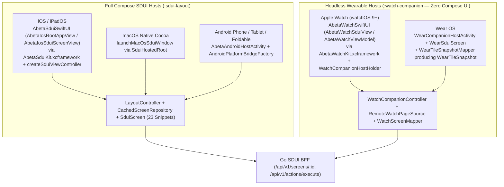
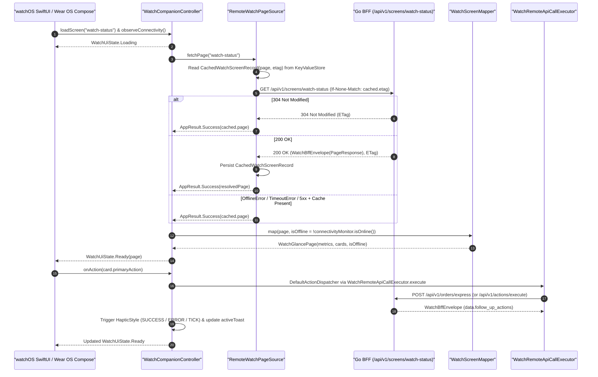

# Wearable & Native Apple / Android Host Flow

This document traces how native platform hosts — Apple iOS/iPadOS, macOS, watchOS, Android, and Wear OS — embed either the full Compose Multiplatform SDUI engine (`:sdui-layout`) or the headless wearable companion engine (`:watch-companion`).

## Multi-Host Architecture Topology

## Headless Wearable Fetch, Mapping & 1-Tap Action Sequence

## Host-by-Host Wiring Details

### 1. Apple iOS & iPadOS (`AbetaSduiKit.xcframework` + `AbetaSduiSwiftUI`)
- **XCFramework**: `kmp/sdui-layout/build.gradle.kts` assembles static `AbetaSduiKit.xcframework` for `iosArm64` and `iosSimulatorArm64`.
- **Kotlin Entrypoint**: `kmp/sdui-layout/src/iosMain/.../SduiViewController.kt` exposes a Swift-friendly 2-parameter overload `createSduiViewController(screenId: String, bffBaseUrl: String?)` alongside the 3-parameter `logger` overload, returning `ComposeUIViewController { SduiHostedRoot(...) }`.
- **SwiftUI Wrapper**: `kmp/platforms/apple/Sources/AbetaSduiSwiftUI/AbetaSduiSwiftUI.swift` (published in SwiftPM `Abeta-dev/kmp-spm`) exports:
  - `AbetaIosSduiScreenView` (`UIViewControllerRepresentable`) calling `SduiViewControllerKt.createSduiViewController(screenId:bffBaseUrl:)`.
  - `AbetaIosRootAppView` wrapping `AbetaIosSduiScreenView` inside `NavigationStack` (iOS 16+) / `NavigationView` (iOS 15) with `.onOpenURL` deep-link resolution (`defaultResolveScreenId(from:)` supporting `abeta://screens/<id>`, `https://.../screens/<id>`, and `?screen=<id>`).
- **macOS Native Cocoa**: `kmp/sdui-layout/src/macosMain/.../SduiMacOsWindow.kt` exposes `launchMacOsSduiWindow(...)`, rendering `SduiHostedRoot(platformLabel = "macOS")` inside a native Compose Cocoa `Window`.

### 2. Apple Watch (`AbetaWatchKit.xcframework` + `AbetaWatchSwiftUI`)
- **XCFramework**: `kmp/watch-companion/build.gradle.kts` assembles static `AbetaWatchKit.xcframework` for `watchosArm64`, `watchosSimulatorArm64`, and `watchosDeviceArm64`, explicitly calling `export(projects.sduiContracts)` and `export(projects.core)` so Swift sees `ActionRef`, `AppError`, and `PlatformCapabilities` directly.
- **Kotlin Factory (`WatchAppleFactory.kt`)**: Provides 0-arg, 1-arg, and 3-arg `createAppleWatchCompanionHost` overloads returning `WatchCompanionHostHolder`. The holder exposes Swift-callable `observeUiState(onChange: (WatchUiState) -> Unit): () -> Unit`, `startConnectivityObservation(): () -> Unit`, and `close()`. When `bffBaseUrl` is `null` or blank, it automatically wires `WatchOfflineStarterDefaults` for standalone simulator previews.
- **SwiftUI Wrapper (`AbetaWatchSwiftUI.swift`)**: Exports `@MainActor AbetaWatchViewModel`, `AbetaWatchSduiView`, `AbetaWatchTheme`, `AbetaWatchMetricRow`, and `AbetaWatchActionCardView`.
  - Bridges Kotlin callbacks safely under Swift 6 strict concurrency using `@unchecked Sendable` helpers (`WatchUiStateBox`, `WatchCancelHandle`, `WatchObservationLifecycle`) and hops updates onto `@MainActor`.
  - Adds `WatchCompanionHostHolder.uiStateStream() -> AsyncStream<WatchUiState>`, `loadScreenAndAwaitReady(_:)`, and `refreshAndAwaitReady()` to power SwiftUI `.refreshable` with zero polling.

### 3. Wear OS (`WearCompanionHostActivity` + `WearSduiRenderer` + Tiles)
- **Host Activity**: `kmp/platforms/wearos/WearCompanionHostActivity.kt` injects Android-native implementations (`WearHapticEngine`, `AndroidSharedPreferencesKeyValueStore`, `AndroidKeyStoreSecureStore`, `AndroidConnectivityMonitor`, `AndroidExternalLauncher`, `AndroidSharePort`) into `createWatchCompanionModule(...)`, avoiding JVM Desktop `java.awt.*` or `java.util.prefs` fallbacks.
- **Wear Compose UI (`kmp/platforms/wearos/WearSduiRenderer.kt`)**: `WearSduiScreen` collects `controller.uiState` via `collectAsStateWithLifecycle()` inside a Wear Material `Scaffold` (`TimeText`, `Vignette`, rotary `PositionIndicator`) and renders `ScalingLazyColumn` items using `WearOfflineChip`, `WearToastChip`, `WearMetricChip`, and `WearActionCardChip`.
- **Tiles, Glance & Complications**: `WearTileSnapshotMapper.map(page, deepLinkScheme = "abeta")` translates `WatchGlancePage` into a bounded `WearTileSnapshot` containing 1 `primaryMetric`, up to 2 `secondaryMetrics` (`WearTileMetricSlot`), a `primaryActionLabel`, and a normalized `primaryActionDeepLinkUri` (`open_url` URL, `navigate` `abeta://screens/<route>`, or `abeta://screens/<pageId>?action=<id>`).

### 4. Android Phone, Tablet & Foldable (`AbetaAndroidHostActivity`)
- `kmp/platforms/android/AbetaAndroidHostActivity.kt` (`FragmentActivity`) enables edge-to-edge insets (`enableEdgeToEdge()`), predictive Back (`OnBackPressedCallback`), Material 3 dynamic color blending (`dynamicDarkColorScheme` / `dynamicLightColorScheme` on API 31+), reduced-motion tokens, `ActivityResultContracts.RequestPermission()`, and `onNewIntent` deep-link forwarding into `LayoutController.handleDeepLink`.
- `kmp/platforms/android/AndroidPlatformBridgeFactory.kt` wires native Android implementations for all OS bridges (KeyStore AES-256-GCM `AndroidKeyStoreSecureStore`, `BiometricPrompt`, `ConnectivityManager`, `VibratorManager`, `ClipboardManager`, `Intent` launcher/share sheet, and `ContentResolver` file picker).

### 5. Shared Headless Wearable Pipeline (`:watch-companion`)
- **`RemoteWatchPageSource`** (`WatchBffClient.kt`) fetches `GET /api/v1/screens/:screenId` with `If-None-Match` (`304 Not Modified`), caches `CachedWatchScreenRecord` in `KeyValueStore`, and falls back to the cached page on `OfflineError`, `TimeoutError`, or `NetworkError` (`statusCode == null || >= 500`).
- **`WatchScreenMapper`** (`WatchScreenMapper.kt`) normalizes full SDUI `PageResponse` trees (all **23** snippet types) into `WatchGlancePage(metrics, cards)` without Compose UI:
  - Recursively unpacks containers up to `MAX_TRAVERSAL_DEPTH = 6`: `carousel`, `grid`, `tabs`, `accordion`, and `custom_slot.fallback`.
  - Maps `metric_card` (and `composed_block` `stat_tile` nodes) to `WatchMetricGlance`.
  - Extracts titles, subtitles, badges, and up to 2 CTA buttons from `composed_block` node trees (`collectComposedNode`) and leaf renderers (`card`, `banner`, `action_row`, `header`, `product_card`, `order_tracker`, `nudge_bar`, `marquee_strip`, `graph_canvas`, `empty_state`).
- **`WatchCompanionController`** (`WatchCompanionController.kt`) executes `page.pageActions` and user tap `ActionRef`s through `DefaultActionDispatcher` + `WatchRemoteApiCallExecutor`, routing haptics (`WKHapticType` on watchOS, `VibrationEffect` on Wear OS), toasts, navigation, `open_url` (with `fallbackRoute`), and `share`.

## Host Packaging & Entrypoint Matrix

| Platform Host | Artifact / Package | Primary Entrypoint Symbols | Source Path |
| :--- | :--- | :--- | :--- |
| iOS / iPadOS 15+ | `AbetaSduiKit.xcframework` + `AbetaSduiSwiftUI` | `AbetaIosRootAppView`, `AbetaIosSduiScreenView`, `createSduiViewController` | `kmp/platforms/apple/Sources/AbetaSduiSwiftUI/AbetaSduiSwiftUI.swift`, `kmp/sdui-layout/src/iosMain/.../SduiViewController.kt` |
| watchOS 9+ | `AbetaWatchKit.xcframework` + `AbetaWatchSwiftUI` | `AbetaWatchSduiView`, `AbetaWatchViewModel`, `WatchCompanionHostHolder`, `createAppleWatchCompanionHost` | `kmp/platforms/apple/Sources/AbetaWatchSwiftUI/AbetaWatchSwiftUI.swift`, `kmp/watch-companion/src/appleMain/.../WatchAppleFactory.kt` |
| macOS (arm64) | `:sdui-layout` (`macosArm64`) | `launchMacOsSduiWindow`, `SduiHostedRoot` | `kmp/sdui-layout/src/macosMain/.../SduiMacOsWindow.kt` |
| Android Phone / Tablet | `io.github.abeta-dev:sdui-layout` + drop-in glue | `AbetaAndroidHostActivity`, `AndroidPlatformBridgeFactory`, `AndroidDatabaseFactory` | `kmp/platforms/android/{AbetaAndroidHostActivity,AndroidPlatformBridgeFactory,AndroidDatabaseFactory}.kt` |
| Wear OS | `io.github.abeta-dev:watch-companion` + drop-in glue | `WearCompanionHostActivity`, `WearSduiScreen`, `WearTileSnapshotMapper` | `kmp/platforms/wearos/{WearCompanionHostActivity,WearSduiRenderer}.kt` |
| Shared Wearable Core | `io.github.abeta-dev:watch-companion` | `WatchCompanionController`, `RemoteWatchPageSource`, `WatchScreenMapper`, `WatchGlancePage` | `kmp/watch-companion/src/commonMain/kotlin/dev/abeta/kmp/watch/` |

## Lifecycle & Concurrency Safeguards

- **Cancellation on Disposal**: `SduiHostedRoot` and `WearCompanionHostActivity` close their isolated `KoinApplication` inside `DisposableEffect { onDispose { koinApp.close() } }`; `AbetaWatchViewModel.deinit` invokes `WatchObservationLifecycle.close()` to cancel both `observeUiState` and `startConnectivityObservation` handles and close `WatchCompanionHostHolder`.
- **Stale Load Suppression**: `WatchCompanionController` increments `loadGeneration` and cancels `activeLoadJob` on every `loadScreen` / `refresh` call so out-of-order responses never overwrite a newer screen.
- **Zero Compose UI on Watch**: `check_architecture_and_owners.sh` blocks `androidx.compose.*`, `design-tokens`, `ui-atoms`, and `sdui-layout` imports inside `kmp/watch-companion`, keeping `AbetaWatchKit.xcframework` lean for watchOS memory budgets.
