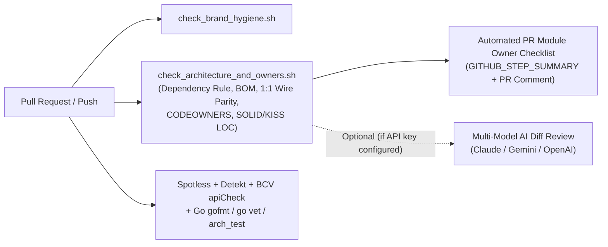

# Per-Module Code Owners & Automated CI/CD Governance

Every module in `abeta-dev/kmp` has a dedicated **Module Code Owner Agent** in [`agents/owners/`](../agents/owners/) paired with GitHub [`.github/CODEOWNERS`](../.github/CODEOWNERS) and enforced deterministically in CI by [`scripts/check_architecture_and_owners.sh`](../scripts/check_architecture_and_owners.sh) and [`.github/workflows/module-owner-architecture-review.yml`](../.github/workflows/module-owner-architecture-review.yml).

---

## 1. Per-Module Code Owner Registry (17 Owners)

| Layer | Module / Path | Code Owner Agent | Primary Verification Gate |
| :--- | :--- | :--- | :--- |
| **Layer 0** | `kmp/core/**` | [`core-owner.md`](../agents/owners/core-owner.md) | Spotless, Detekt, `apiCheck`, `jvmTest`, `macosArm64Test`, `compileAppleMainKotlinMetadata`, `watchosArm64`, `wasmJs` |
| **Layer 0** | `kmp/state/**` | [`state-owner.md`](../agents/owners/state-owner.md) | Spotless, Detekt, `apiCheck`, `jvmTest`, `macosArm64Test`, `watchosArm64`, `wasmJs` |
| **Layer 0** | `kmp/analytics/**` | [`analytics-owner.md`](../agents/owners/analytics-owner.md) | Spotless, Detekt, `apiCheck`, `jvmTest`, `macosArm64Test`, `watchosArm64`, `wasmJs` |
| **Layer 0** | `kmp/database/**` | [`database-owner.md`](../agents/owners/database-owner.md) | Spotless, Detekt, `apiCheck`, Room 3 KSP (`3.0.3`), schema exports, `jvmTest`, `macosArm64Test`, `wasmJs` |
| **Layer 1** | `kmp/design-tokens/**` | [`design-tokens-owner.md`](../agents/owners/design-tokens-owner.md) | Spotless, Detekt, `apiCheck`, contrast & responsive token tests |
| **Layer 1** | `kmp/sdui-contracts/**` | [`sdui-contracts-owner.md`](../agents/owners/sdui-contracts-owner.md) | Spotless, Detekt, `apiCheck`, 28 wire atoms, 21 snippets (incl. `composed_block` w/ 29 `ComposedNodeKind`s), 8 golden JSON parity fixtures |
| **Layer 1** | `kmp/ui-atoms/**` | [`ui-atoms-owner.md`](../agents/owners/ui-atoms-owner.md) | Spotless, Detekt, `apiCheck`, 30 stateless atoms, `UiAtomsComposeTest`, `ExtendedAtomsComposeTest`, `/impeccable` craft checks |
| **Layer 2** | `kmp/action-engine/**` | [`action-engine-owner.md`](../agents/owners/action-engine-owner.md) | Spotless, Detekt, `apiCheck`, 18 `ActionTypes` parity, `ActionsEngineTest` |
| **Layer 2** | `kmp/network/**` | [`network-owner.md`](../agents/owners/network-owner.md) | Spotless, Detekt, `apiCheck`, `compileAppleMainKotlinMetadata`, pinning & Brotli tests |
| **Layer 3** | `kmp/sdui-layout/**` | [`sdui-layout-owner.md`](../agents/owners/sdui-layout-owner.md) | Spotless, Detekt, `apiCheck`, 21 snippet renderers, `SduiScreenComposeTest`, safe-area/IME/accessibility checks |
| **Layer 3** | `kmp/watch-companion/**` | [`watch-companion-owner.md`](../agents/owners/watch-companion-owner.md) | Spotless, Detekt, `apiCheck`, zero-Compose guard, `AbetaWatchKit.xcframework` |
| **Layer 3** | `kmp/storybook/**` | [`storybook-owner.md`](../agents/owners/storybook-owner.md) | Spotless, Detekt, `StorybookComposeTest`, 20 stories (incl. 8 UI Atom stories & Live 7-in-1 Super-App Demos), WasmJS & `AbetaStorybookKit` |
| **Layer 3** | `kmp/sample-app/**` | [`sample-app-owner.md`](../agents/owners/sample-app-owner.md) | Spotless, Detekt, `SampleWiringTest`, `--headless` & `--verticals` smoke checks across the 7-in-1 Super-App Showcase & core screens |
| **Layer 3** | `kmp/platforms/**` | [`platforms-owner.md`](../agents/owners/platforms-owner.md) | Brand hygiene, native Android/Wear/Apple/Web `/impeccable` conformance |
| **Platform** | `kmp-bom`, `dependencyManagement`, root Gradle | [`bom-catalog-owner.md`](../agents/owners/bom-catalog-owner.md) | Zero hardcoded versions, 4-way registration, `apiCheck` across all 11 publishable modules (`io.github.abeta-dev:*:0.3.0`) |
| **Go BFF** | `bff/**` | [`bff-owner.md`](../agents/owners/bff-owner.md) | `gofmt`, `go vet`, `go test -count=1 -race -cover ./...`, `arch_test.go`, `bff@v0.5.0`, 8 golden fixtures |
| **Governance** | `.github/**`, `scripts/**`, `agents/**`, `skills/**`, IDE configs | [`cicd-platform-owner.md`](../agents/owners/cicd-platform-owner.md) | Brand hygiene, `check_architecture_and_owners.sh`, full `./scripts/verify_all.sh` |

---

## 2. Deterministic CI/CD Architecture & Owner Automation

- **Fail-Closed Deterministic Gates**: Dependency Rule violations, hardcoded module dependency versions, missing BCV `.api` descriptors, KMP<->BFF `ActionTypes`/`SnippetTypes` drift, or missing module owners immediately fail CI.
- **Zero-Secret Fork Compatibility**: Optional LLM diff review (`AI_REVIEW_PROVIDER=anthropic|gemini|openai`) skips cleanly when org secrets are absent so open-source PRs and forks remain green.
