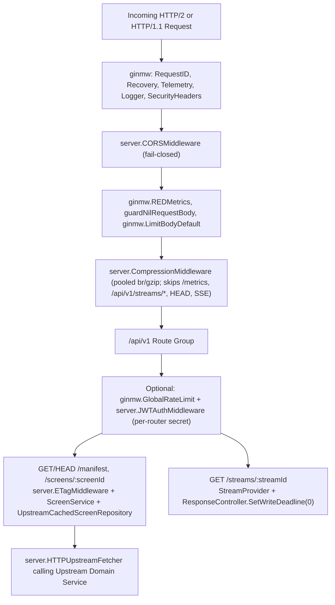

# Pattern: Go BFF Caching, Middleware & Downstream Server Composition

Downstream Go services (such as Aegis) import the public `github.com/abeta-dev/kmp/bff/pkg/sdui/*` packages (`bff@v0.9.0`, Go 1.26.0) to assemble an SDUI BFF or edge caching proxy without reimplementing wire contracts, singleflight caching, CORS/ETag/Brotli safety, or SSE streaming.

## Recommended Package & Middleware Stack



## Step 1: Import Public Packages (`bff/pkg/sdui/*`)

```go
import (
    "github.com/abeta-dev/kmp/bff/pkg/sdui/actions"
    "github.com/abeta-dev/kmp/bff/pkg/sdui/atoms"
    "github.com/abeta-dev/kmp/bff/pkg/sdui/cache"
    "github.com/abeta-dev/kmp/bff/pkg/sdui/server"
    "github.com/abeta-dev/kmp/bff/pkg/sdui/snippets"
    "github.com/abeta-dev/kmp/bff/pkg/sdui/theming"
)
```

- `cache`, `snippets`, `actions`, `atoms`, `theming`, `analytics`, and `molecules` are **pure Go** (zero `net/http`, `gin`, or SQL imports).
- `server` holds all Gin/HTTP adapters (`CORSMiddleware`, `CompressionMiddleware`, `ETagMiddleware`, `JWTAuthMiddleware`, `HTTPUpstreamFetcher`, `StreamProvider`).

## Step 2: Wire `HTTPUpstreamFetcher` + `UpstreamCachedScreenRepository`

`HTTPUpstreamFetcher.FetchScreen` satisfies `cache.ScreenFetcher` directly and transparently unwraps both `ginmw.Envelope` (`{ "success": true, "data": ... }`) and raw `snippets.PageResponse` JSON payloads:

```go
fetcher := server.NewHTTPUpstreamFetcher(
    upstreamBaseURL,
    server.WithTimeout(10*time.Second),
    server.WithClientAppVersion(appVersion),
    server.WithScreenPathTemplate("/api/v1/screens/%s"),
    server.WithMaxResponseBytes(8<<20), // default 8 MiB
    server.WithHeaderForwarder(func(ctx context.Context) http.Header {
        h := make(http.Header)
        if tenant := tenantFromContext(ctx); tenant != "" {
            h.Set("X-Tenant-ID", tenant)
        }
        return h
    }),
)

repo := cache.NewUpstreamCachedScreenRepository(
    fetcher.FetchScreen,
    cache.WithTTL(5*time.Minute),
    cache.WithMaxEntries(256),
    cache.WithAppVersion(appVersion),
    cache.WithSchemaVersion(snippets.DefaultSduiSchemaVersion),
    cache.WithScopeKeyFunc(func(ctx context.Context) string {
        return tenantFromContext(ctx) + ":" + localeFromContext(ctx)
    }),
    cache.WithKnownScreens("home", "catalog", "store-home"),
)

// Register tags for targeted cache invalidation
repo.RegisterScreen("store-home", "commerce", "pricing")
repo.RegisterScreen("catalog", "commerce")
```

### Cache Invalidation & O(1) Manifest Semantics
- **Singleflight Coalescing**: `GetScreen` coalesces concurrent misses per `(scope, screenID)` with `context.WithoutCancel(ctx)` so one cancelled client never aborts shared upstream fetches, and checks `invalidationGen` before writing back so mid-flight invalidations cannot re-poison the cache.
- **Normalization**: Every fetched page runs `snippets.EnsureComponentIDs(&page)`, `snippets.ComputePageETag(*page)`, and `snippets.DerivePageVersion(etag)` automatically.
- **Targeted Eviction**: Call `repo.Invalidate(screenID)`, `repo.InvalidatePrefix("pay-")`, `repo.InvalidateTag("pricing")`, or `repo.InvalidateAll()` from webhook or pub/sub handlers. Every mutation clears cached manifest snapshots and atomically bumps `repo.ManifestGeneration()`.
- **O(1) Manifests**: `repo.BuildManifest(ctx, appVersion)` returns a cloned `ScreenManifestResponse` in O(1) while `manifestGen` and `earliestExpiry` remain valid.

## Step 3: Assemble the Hardened Gin Middleware Stack

Follow the exact middleware order used in `bff/internal/handler/router.go`:

1. **Fail-Closed CORS (`server.CORSMiddleware`)**:
   - Passing empty `AllowedOrigins` fails closed (emits `Vary: Origin`, no `Access-Control-Allow-Origin`, rejects preflight `OPTIONS` with `403`).
   - Supports exact origins (`"https://app.abeta.dev"`), subdomain wildcards (`"https://*.abeta.dev"`), and `"*"`. Never emits `Access-Control-Allow-Credentials: true` when wildcard `"*"` is matched.
   - Default allowed headers include `If-None-Match`, `Last-Event-ID`, `X-CSRF-Token`, `X-Request-ID`, and `X-Client-App-Version`; default exposed headers include `ETag`, `X-App-Version`, and `X-Page-Version`.
2. **Pooled Compression (`server.CompressionMiddleware` / `CompressionMiddlewareWithConfig`)**:
   - Uses `sync.Pool` for Brotli level 4 (`br`) and `gzip`, capped at `DefaultMaxBufferBytes = 8 MiB` (streams uncompressed on overflow).
   - Automatically skips `/metrics`, `/api/v1/streams/*`, `HEAD`, and `Accept: text/event-stream`.
   - Weakens strong `ETag` headers to `W/"..."` when compressing and on `304 Not Modified`.
3. **Version-Aware ETag (`server.ETagMiddleware`)**:
   - Attach per read route (`GET` / `HEAD` for `/manifest`, `/screens/manifest`, `/screens/:screenId`, `/catalog/tokens`).
   - Preserves handler-stamped `ETag` (`page.ETag`) and `X-App-Version` / `X-Page-Version`; strips volatile keys (`generated_at_epoch_ms`, `request_id`) when computing fallback SHA-256 hashes.
   - Defaults `Cache-Control` to `private, no-cache`, automatically downgrading authenticated requests (`RequireAuth`, `Authorization`, or `Cookie`) to `private, no-cache` + `Vary: Authorization`.
   - Bypasses `304 Not Modified` whenever `X-Client-App-Version != X-App-Version`.
4. **Per-Router JWT Auth (`server.JWTAuthMiddleware`)**:
   - Closes over a defensive `bytes.Clone(secret)` copy (never mutating global `ginmw` state), enforces HS256-only (`jwt.WithValidMethods`), fails closed on empty secret with `401`, and stores `*ginmw.Claims` under `"claims"` for `ginmw.GetClaims(c)`.

## Step 4: Plug In a Custom `server.StreamProvider`

Implement `server.StreamProvider` (`bff/pkg/sdui/server/upstream.go`) and pass it to `handler.RouterConfig.StreamProvider` (or your custom SSE handler):

```go
type LiveStreamProvider struct{}

func (LiveStreamProvider) Stream(
    ctx context.Context,
    streamID string,
    lastEventID string,
) ([]server.StreamEvent, bool, error) {
    // Return (events, true, nil) to stream; ([]StreamEvent{}, true, nil) -> 204 No Content;
    // (nil, false, nil) -> 404 Not Found.
}
```

- Always clear the server write deadline inside SSE handlers (`http.NewResponseController(c.Writer).SetWriteDeadline(time.Time{})`), set `Connection: keep-alive` only for HTTP/1.1 (`c.Request.ProtoMajor == 1`), and bind `http.Server.BaseContext` + `RouterConfig.ShutdownContext` to `signal.NotifyContext(SIGINT, SIGTERM)` as in `bff/cmd/bff/main.go`.

## Step 5: Obey Clean Architecture Boundaries (`arch_test.go`)

`bff/internal/domain/arch_test.go` (and `scripts/check_architecture_and_owners.sh`) parses every non-test Go file under `internal/domain`, `internal/usecase`, and pure `pkg/sdui/*` packages (`theming`, `actions`, `atoms`, `snippets`, `analytics`, `molecules`, `cache`) and **fails CI** if any file imports:
- `github.com/gin-gonic/gin`, `net/http`
- `database/sql`, `github.com/jackc/pgx`
- `internal/infra`, `internal/handler`

Keep transport and persistence adapters strictly in `pkg/sdui/server`, `internal/handler`, and `internal/infra`. Verify with:

```bash
(cd bff && go vet ./... && go test -race -cover ./...)
./scripts/check_architecture_and_owners.sh
```

## Security & Header Guarantees Quick Reference

| Middleware / Component | Default Behavior | Safety Guarantee |
| :--- | :--- | :--- |
| `server.CORSMiddleware` | Empty `AllowedOrigins` fails closed (`403` preflight) | Always sets `Vary: Origin`; never combines `*` with `Access-Control-Allow-Credentials: true` |
| `server.CompressionMiddleware` | Brotli level 4 (`br`) preferred over `gzip`; 8 MiB cap | Skips SSE & `/metrics`; weakens compressed `ETag` to `W/"..."` |
| `server.ETagMiddleware` | `Cache-Control: private, no-cache` | Forces `Vary: Authorization` on auth; skips `304` when `X-Client-App-Version != X-App-Version` |
| `server.JWTAuthMiddleware` | HS256-only (`jwt.WithValidMethods`) | Clones secret per router; empty secret fails closed with `401` |
| `cache.UpstreamCachedScreenRepository` | TTL `5m`, LRU `256`, `singleflight.Group` | `invalidationGen` prevents mid-flight stale write-back; pure Go (zero HTTP imports) |
