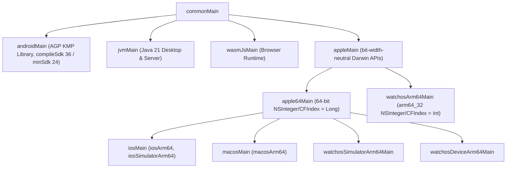

# Pattern: KMP Multiplatform HMPP, Room 3, Swift Interop & ABI Discipline

This guide codifies the Kotlin Multiplatform structural patterns required across `kmp/` so all targets (`android`, `jvm`, `iosArm64`, `iosSimulatorArm64`, `macosArm64`, `watchosArm64`, `watchosSimulatorArm64`, `watchosDeviceArm64`, `wasmJs`), Room 3 SQLite schemas, Apple XCFrameworks, and Maven Central BOM releases stay deterministic.

## 1. HMPP Hierarchy & 32-Bit vs 64-Bit Apple Bit-Width Safety

`watchosArm64` uses Apple's **arm64_32** ABI where `NSInteger`, `NSUInteger`, and `CFIndex` are **32-bit (`Int`/`UInt`)**, whereas `iosArm64`, `iosSimulatorArm64`, `macosArm64`, `watchosSimulatorArm64`, and `watchosDeviceArm64` use **64-bit (`Long`/`ULong`)**. Placing C/ObjC interop referencing those types directly in `appleMain` breaks HMPP metadata compilation (`allMetadataJar`) and Dokka. Meanwhile, Android library targets use AGP's `com.android.kotlin.multiplatform.library` plugin (`android { namespace = ...; compileSdk = 37; minSdk = 24; withHostTestBuilder {} }`) with dedicated `androidMain` source sets (e.g., `kmp/network/src/androidMain/`).



### Canonical Wiring (`build.gradle.kts` + Shims)
- Call `applyDefaultHierarchyTemplate()`, then declare `apple64Main` depending on `appleMain` and attach `iosMain`, `macosMain`, `watchosSimulatorArm64Main`, and `watchosDeviceArm64Main` (see `kmp/core/build.gradle.kts`):
  ```kotlin
  val apple64Main = create("apple64Main") { dependsOn(appleMain.get()) }
  iosMain.get().dependsOn(apple64Main)
  macosMain.get().dependsOn(apple64Main)
  watchosSimulatorArm64Main.get().dependsOn(apple64Main)
  watchosDeviceArm64Main.get().dependsOn(apple64Main)
  ```
- Keep bit-width-sensitive `platform.*` calls behind `internal expect fun` declarations in `appleMain`, with paired `actual` files in `apple64Main` and `watchosArm64Main` converting `Int` ↔ `Long` (e.g., `nsError?.code?.toLong()` on `watchosArm64`). Existing examples:
  - `kmp/core/src/{apple64Main,watchosArm64Main}/.../security/AppleSecurityArchShims.*.kt`
  - `kmp/core/src/{apple64Main,watchosArm64Main}/.../platform/LocaleFormatter.*.kt`
  - `kmp/network/src/{apple64Main,watchosArm64Main}/.../client/ApplePinnedTrustBridge.*.kt`
  - `kmp/state/src/{apple64Main,watchosArm64Main}/.../storage/DataStoreDirectory.*.kt`
- Always verify HMPP commonizer health with `(cd kmp && ./gradlew allMetadataJar)`.

## 2. Room 3 Multiplatform Migrations & Schema Exports (`kmp/database`)

`AbetaDatabase` (`kmp/database/src/commonMain/kotlin/dev/abeta/kmp/database/AbetaDatabase.kt`) runs Room 3 (`3.0.3`) across all 8 KMP targets using `sqlite-bundled:2.7.1` on JVM/Apple and `sqlite-web:2.7.1` on WasmJS:

- **No Reflection Constructor**: Annotate `@ConstructedBy(AbetaDatabaseConstructor::class)` with `internal expect object AbetaDatabaseConstructor : RoomDatabaseConstructor<AbetaDatabase>` generated by KSP across all 8 targets (`kspJvm` through `kspWasmJs` in `kmp/database/build.gradle.kts`).
- **Migration SQL Bridge**: Because `androidx.sqlite.execSQL` has platform-specific dispatch in Room 3 / SQLite multiplatform, `AbetaDatabase.MIGRATION_1_2` calls `internal expect suspend fun executeMigrationSql(connection: SQLiteConnection, sql: String)` (`MigrationSqlExecutor.kt`), with actuals in `jvmMain`, `appleMain`, and `wasmJsMain`.
- **Schema Exports**: `room3 { schemaDirectory("$projectDir/schemas") }` exports immutable JSON snapshots under `kmp/database/schemas/dev.abeta.kmp.database.AbetaDatabase/` (`1.json`, `2.json`). Whenever bumping `AbetaDatabase.SCHEMA_VERSION`:
  1. Add a tested `Migration(N, N+1)` object using `executeMigrationSql` and attach it in `createAbetaDatabaseBuilder` (`DatabaseFactory.kt`) and `kmp/platforms/android/AndroidDatabaseFactory.kt`.
  2. Commit the newly generated `<N+1>.json` schema export file.
  3. Keep `Detekt` excluding `/generated/` KSP output (`kmp/database/build.gradle.kts`).

## 3. Swift / ObjC Interop & 4-Product SwiftPM Packaging

Kotlin/Native's Objective-C header export drops Kotlin default parameter values and hides unexported transitive modules. Follow these four rules:

1. **Explicit Default-Argument Overloads**: Whenever exposing a top-level Kotlin factory to Swift, add explicit zero/reduced-argument Kotlin overloads:
   - `SduiViewController.kt`: `createSduiViewController(screenId: String, bffBaseUrl: String?)` alongside the 3-arg `logger` overload.
   - `WatchAppleFactory.kt`: `createAppleWatchCompanionHost()` and `createAppleWatchCompanionHost(bffBaseUrl: String?)` alongside the 3-arg overload.
2. **Transitive Framework Exports**: In `kmp/watch-companion/build.gradle.kts`, `AbetaWatchKit` explicitly declares `isStatic = true`, `export(projects.sduiContracts)`, and `export(projects.core)` so Swift callers receive `ActionRef`, `AppError`, and `PlatformCapabilities` without Objective-C name mangling.
3. **Swift 5 & Swift 6 Strict Concurrency**: In `kmp/platforms/apple/Sources/AbetaWatchSwiftUI/AbetaWatchSwiftUI.swift`:
   - Annotate Observable view models (`AbetaWatchViewModel`) and SwiftUI initializers with `@MainActor`.
   - Wrap Kotlin callback captures crossing threads into `@unchecked Sendable` boxes (`WatchUiStateBox`, `WatchCancelHandle`, `WatchObservationLifecycle` guarded by `NSLock`) and hop back with `Task { @MainActor in ... }`.
   - Bridge `StateFlow` via Kotlin callback registration (`WatchCompanionHostHolder.observeUiState`) wrapped into a cancellation-safe Swift `AsyncStream`.
4. **SwiftPM Manifest & Typecheck Verification**: Verify the 4-product package (`AbetaSduiKit`, `AbetaWatchKit`, `AbetaSduiSwiftUI`, `AbetaWatchSwiftUI` in `kmp/platforms/apple/Package.template.swift`) before release:
   ```bash
   ./scripts/verify_spm_package.sh <path/to/Package.swift> \
     --sdui-framework <AbetaSduiKit.xcframework> \
     --watch-framework <AbetaWatchKit.xcframework>
   ```
   On macOS, `verify_spm_package.sh` runs `swiftc -typecheck` in both **Swift 5** and **Swift 6** language modes against the real XCFramework slices.

## 4. BCV ABI Stability, Gradle BOM & Version Catalog Discipline

All **11** publishable KMP library modules (`core`, `state`, `analytics`, `database`, `design-tokens`, `sdui-contracts`, `ui-atoms`, `action-engine`, `network`, `sdui-layout`, `watch-companion`) plus `kmp-bom` (`bom`) and `dependencyManagement` (`dependencies`) publish under `io.github.abeta-dev`.

- **Zero Hardcoded Versions**: Declare external versions only in `kmp/dependencyManagement/gradle/libs.versions.toml` and internal coordinates only in `kmp/dependencyManagement/gradle/internal.versions.toml`. `check_architecture_and_owners.sh` fails on any hardcoded `"group:name:1.2.3"` dependency inside module `build.gradle.kts`.
- **Module Registration Checklist** (when adding any publishable module):
  1. `kmp/dependencyManagement/gradle/internal.versions.toml` (`kmp-<alias> = { group = "io.github.abeta-dev", name = "<module>", ... }`)
  2. `kmp/kmp-bom/build.gradle.kts` (`api(internal.kmp.<alias>)` inside `constraints`)
  3. `kmp/build.gradle.kts` (`publishableModules`)
  4. `kmp/settings.gradle.kts` (`include(":<module>")` and `moduleMappings` for `abeta.kmpLocalBuild`)
  5. `.github/CODEOWNERS` + `agents/owners/<module>-owner.md` + `scripts/check_architecture_and_owners.sh`
- **Public ABI Baselines (BCV)**: Every publishable library maintains Binary Compatibility Validator `.api` descriptors under `kmp/<module>/api/` (`kmp/<module>/api/<module>.api`, plus `api/jvm/` / `api/android/` split when both JVM and Android targets publish binary APIs). Keep JVM ABI validation deterministic across Linux and macOS CI (avoid experimental klib BCV requiring macOS-only Apple compilation on Linux runners). After any intentional public API change, regenerate and verify:

```bash
(cd kmp && ./gradlew apiDump apiCheck allMetadataJar check)
./scripts/check_architecture_and_owners.sh
./scripts/check_brand_hygiene.sh
```

## Target & Artifact Reference Matrix

| Module Group | Modules | Compiled KMP Targets | Special Packaging / Tooling |
| :--- | :--- | :--- | :--- |
| Headless & Contract Libraries | `core`, `state`, `analytics`, `database`, `sdui-contracts`, `action-engine`, `network`, `watch-companion` | `android`, `jvm`, `iosArm64`, `iosSimulatorArm64`, `macosArm64`, `watchosArm64`, `watchosSimulatorArm64`, `watchosDeviceArm64`, `wasmJs` | BCV `.api`, KSP + Room 3 (`database`), `AbetaWatchKit.xcframework` (`watch-companion`) |
| Compose UI Libraries | `design-tokens`, `ui-atoms`, `sdui-layout` | `android`, `jvm`, `iosArm64`, `iosSimulatorArm64`, `macosArm64`, `wasmJs` | BCV `.api`, `AbetaSduiKit.xcframework` (`sdui-layout`), macOS Cocoa window |
| Platform Reference Apps | `storybook`, `sample-app` | `storybook`: Compose targets + `AbetaStorybookKit`; `sample-app`: `jvm` Desktop & `--headless` | Not in `kmp-bom`; consumer reference hosts |
| BOM & Version Catalog | `kmp-bom` (`bom`), `dependencyManagement` (`dependencies`) | Maven platform + Gradle TOML catalog (`io.github.abeta-dev:*`) | `abeta.kmpLocalBuild` substitution in `kmp/settings.gradle.kts` |

## Common Pitfalls to Avoid

1. **Importing 64-bit `NSInteger` APIs in `appleMain`**: Move them into `apple64Main` + `watchosArm64Main` shims and run `allMetadataJar` to catch commonizer errors early.
2. **Relying on Kotlin default args from Swift**: Always add explicit reduced-arity Kotlin overloads for functions invoked from SwiftUI or UIKit hosts.
3. **Forgetting to register a new KSP target in `kmp/database/build.gradle.kts`**: Every compiled target needs a matching `ksp<Target>` configuration for `AbetaDatabaseConstructor`.
4. **Skipping `apiDump` after adding public symbols**: `apiCheck` fails CI whenever public signatures drift from committed `kmp/<module>/api/` descriptors.

## Fast Verification Playbook by Change Type

| What You Changed | Minimum Required Verification Commands |
| :--- | :--- |
| Any Apple C/ObjC interop or `expect`/`actual` split | `(cd kmp && ./gradlew allMetadataJar :core:check :network:check :state:check)` |
| Room 3 entity, DAO, or schema version | `(cd kmp && ./gradlew :database:apiDump :database:check)` + verify new `<N>.json` under `kmp/database/schemas/` |
| Any public Kotlin API in an 11-lib module | `(cd kmp && ./gradlew apiDump apiCheck check)` |
| SwiftUI wrappers or XCFramework exports | `(cd kmp && ./gradlew :sdui-layout:assembleAbetaSduiKitXCFramework :watch-companion:assembleAbetaWatchKitXCFramework)` + `./scripts/verify_spm_package.sh` |
| Gradle catalog, BOM, or new module | `./scripts/check_architecture_and_owners.sh` + `./scripts/check_brand_hygiene.sh` |
