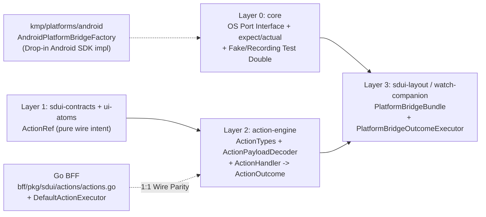

# Pattern: Adding an OCP Action & Native OS Bridge Port

The Abeta Action Engine obeys the **Open/Closed Principle (OCP)** and **Dependency Inversion Principle (DIP)**: `ui-atoms` emits `ActionRef`, `action-engine` decodes and translates payloads into pure `ActionOutcome` values without importing OS APIs or Ktor, and Layer 3 (`sdui-layout` / `watch-companion`) executes side effects through Layer 0 ports defined in `core`.

## Layer & Dependency Separation



## Step 1: Define Action Type & Wire Payload (`kmp/action-engine`, Layer 2)

Edit `kmp/action-engine/src/commonMain/kotlin/dev/abeta/kmp/actions/model/ActionPayloads.kt`:

1. Add a snake_case constant to `object ActionTypes`:
   ```kotlin
   const val MY_CAPABILITY = "my_capability"
   ```
2. Define a `@Serializable` payload implementing `BuiltInActionPayload` (for built-in BFF actions) — or `ActionPayload` inside a downstream feature module if registering an app-private action without modifying `action-engine`:
   ```kotlin
   @Serializable
   data class MyCapabilityPayload(
       val target: String,
       @SerialName("on_complete")
       val onComplete: ActionRef? = null,
   ) : BuiltInActionPayload
   ```
3. Never import Compose, Ktor, `network`, or platform SDKs in `action-engine`. Allowed dependencies are strictly `core` and `sdui-contracts`.

## Step 2: Register OCP Decoder (`ActionDecoderRegistry`)

Edit `kmp/action-engine/src/commonMain/kotlin/dev/abeta/kmp/actions/codec/ActionPayloadDecoder.kt`:

- Register inside `BuiltInActionDecoders.registerDefaults`:
  ```kotlin
  register(ActionTypes.MY_CAPABILITY, kotlinxActionDecoder<MyCapabilityPayload>(json))
  ```
- Downstream apps adding custom actions use `BuiltInActionDecoders.createDefaultRegistry().toBuilder().register("custom_op", kotlinxActionDecoder<CustomPayload>()).build()` without touching `action-engine`.

## Step 3: Add `ActionOutcome` & Pure `ActionHandler`

1. In `kmp/action-engine/src/commonMain/kotlin/dev/abeta/kmp/actions/handler/ActionHandler.kt`, add a new immutable subtype to `sealed interface ActionOutcome`:
   ```kotlin
   data class MyCapabilityRequested(
       val target: String,
       val onComplete: ActionRef? = null,
   ) : ActionOutcome
   ```
2. Register a pure handler in `OsBridgeActionHandlers.kt` (or `UiAndStateActionHandlers.kt` / `NavigationAndNetworkActionHandlers.kt`) called by `BuiltInActionHandlers.registerDefaults`:
   ```kotlin
   builder.register<MyCapabilityPayload> { payload, _ ->
       AppResult.Success(
           ActionOutcome.MyCapabilityRequested(
               target = payload.target,
               onComplete = payload.onComplete,
           ),
       )
   }
   ```
   Keep handlers pure and side-effect-free (unless mediated through a narrow port like `ApiCallExecutor`). Validation rules declared in `ActionRef.validations` run automatically in `DefaultActionDispatcher` before decoding.

## Step 4: Define OS Bridge Port in `kmp/core` (Layer 0)

If the action requires native OS capabilities:

1. **Common Port (`kmp/core/src/commonMain/kotlin/dev/abeta/kmp/core/platform/MyCapabilityPort.kt`)**:
   - Define `interface MyCapabilityPort` returning `AppResult<T>` (never throwing raw platform exceptions).
   - Declare `expect fun createPlatformMyCapabilityPort(): MyCapabilityPort`.
   - Provide a deterministic test double (`RecordingMyCapabilityPort` or `UnavailableMyCapabilityPort`) in `commonMain` for unit and headless tests.
2. **Multiplatform Source-Set Actuals**: Provide `actual fun createPlatformMyCapabilityPort()` for every target compiled by `kmp/core`:
   - `kmp/core/src/androidMain/` (Android runtime defaults via `com.android.kotlin.multiplatform.library`)
   - `kmp/core/src/jvmMain/` (JVM Desktop — guard any `java.awt.*` call for headless CI compatibility)
   - `kmp/core/src/iosMain/` (UIKit / iOS)
   - `kmp/core/src/macosMain/` (AppKit / macOS)
   - `kmp/core/src/watchosMain/` (WatchKit — or split `apple64Main` + `watchosArm64Main` if touching 32/64-bit `NSInteger` / `CFIndex` C interop; see [kmp-multiplatform-hmpp-and-abi-pattern.md](kmp-multiplatform-hmpp-and-abi-pattern.md))
   - `kmp/core/src/wasmJsMain/` (Browser Web APIs with graceful fallback)
3. **Activity-Scoped Android Host Glue (`kmp/platforms/android/AndroidPlatformBridgeFactory.kt`)**:
   - Capabilities requiring an Android `FragmentActivity` or `Context` (e.g., `BiometricPrompt`, `ActivityResultContracts.RequestPermission`, `Intent.createChooser`, `AndroidKeyStore`) are wired through `AndroidPlatformBridgeFactory.create(...)` in `kmp/platforms/android/AndroidPlatformBridgeFactory.kt` and injected into `PlatformBridgeBundle`.

## Step 5: Wire Into `PlatformBridgeBundle`, Koin & Outcome Executor (Layer 3)

1. **`PlatformBridgeBundle`** (`kmp/sdui-layout/.../platform/PlatformBridgeBundle.kt`):
   - Add `val myCapabilityPort: MyCapabilityPort = UnavailableMyCapabilityPort` to `PlatformBridgeBundle`.
   - Wire `createPlatformMyCapabilityPort()` in `createPlatformDefault(...)` and `RecordingMyCapabilityPort()` in `createTestDefault(...)`.
2. **Koin DI (`kmp/sdui-layout/.../di/SduiKoinModule.kt`)**:
   - Expose `single<MyCapabilityPort> { get<PlatformBridgeBundle>().myCapabilityPort }` in `registerPlatformBridgeBindings`.
3. **Outcome Execution (`kmp/sdui-layout/.../engine/PlatformBridgeOutcomeExecutor.kt`)**:
   - Add a `is ActionOutcome.MyCapabilityRequested ->` branch in `executeIfBridgeOutcome`.
   - On completion, dispatch any follow-up `ActionRef` via `dispatchFollowUp(followUp)` (which executes under `LayoutController`'s active `screenGeneration` guard).
4. **Wearable Companion (if applicable)**: Handle the outcome in `WatchCompanionController.applyFeedbackOrBridgeOutcome` (`kmp/watch-companion/.../WatchCompanionController.kt`).

## Step 6: Mirror in Go BFF (`bff/`) & Verify Parity

1. **`bff/pkg/sdui/actions/actions.go`**:
   - Add `ActionMyCapability ActionType = "my_capability"` (prefix `Action` is verified against KMP `ActionTypes` by `check_architecture_and_owners.sh`).
   - Add `type MyCapabilityPayload struct` with matching JSON tags and an ergonomic constructor `NewMyCapabilityAction(...)`.
2. **`bff/internal/handler/openapi_schemas.go`**: Add `string(actions.ActionMyCapability)` to `"ActionType"`.
3. **`bff/internal/infra/action_executor.go`**: Add `case actions.ActionMyCapability:` to `DefaultActionExecutor.executeWithBudget`, decoding via `actions.DecodePayload[actions.MyCapabilityPayload](t)` and validating required fields.
4. **Golden & Gate Checks**:
   - Add test coverage in `kmp/action-engine/src/commonTest/`, `bff/pkg/sdui/actions/actions_test.go`, and `bff/testdata/golden/action_batch.json`.
   - Run `./scripts/check_architecture_and_owners.sh`, `(cd kmp && ./gradlew apiDump check)`, and `(cd bff && go test -race ./...)`.

## Built-In OS Bridge & Action Outcome Reference

| Action Type (`ActionTypes`) | `ActionOutcome` Variant | Layer 0 Port (`kmp/core`) | Executor / Host Handler |
| :--- | :--- | :--- | :--- |
| `copy_to_clipboard` | `ClipboardCopyRequested` | `ClipboardPort` | `PlatformBridgeOutcomeExecutor` |
| `open_url` | `OpenUrlRequested` | `ExternalLauncherPort` | `PlatformBridgeOutcomeExecutor` + `WatchCompanionController` |
| `share` | `ShareRequested` | `SharePort` | `PlatformBridgeOutcomeExecutor` + `WatchCompanionController` |
| `request_permission` | `PermissionRequested` | `PermissionPort` | `PlatformBridgeOutcomeExecutor` (chains `onGranted` / `onDenied`) |
| `biometric_auth` | `BiometricAuthRequested` | `BiometricAuthenticator` | `PlatformBridgeOutcomeExecutor` (chains `onAuthenticated` / `onFailed`) |
| `trigger_feedback` | `FeedbackTriggered` | `HapticEngine` | `LayoutController.applyFeedbackTriggered` + `WatchCompanionController` |
| `call_api` | `ApiCallResult` | `ApiCallExecutor` (Layer 2 port) | `RemoteApiCallExecutor` / `WatchRemoteApiCallExecutor` |

## Common Pitfalls to Avoid

1. **Mixing Activity-scoped Android APIs into `commonMain` or `jvmMain`**: Keep context-free Android defaults in `androidMain`, put `FragmentActivity`-bound bridges (`BiometricPrompt`, permissions, share sheets) in `kmp/platforms/android/AndroidPlatformBridgeFactory.kt`, and guard `java.awt.*` calls in `jvmMain`.
2. **Throwing exceptions across OS ports**: Always wrap platform calls in `AppResult` (`AppResult.Success` / `AppResult.Failure`) and rethrow `CancellationException` cleanly.
3. **Monolithic `when (action.type)` switches in UI**: Keep decoding in `ActionDecoderRegistry`, handling in `ActionRegistry`, and side effects in Layer 3 outcome executors so feature modules can register custom actions without modifying `action-engine`.
4. **Skipping `screenGeneration` checks on async follow-ups**: Always route follow-up actions (like `onGranted` or `onAuthenticated`) through `PlatformBridgeOutcomeExecutor`'s `dispatchFollowUp` callback so stale callbacks after navigation are dropped.
