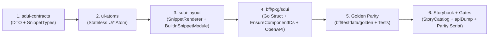

# Pattern: Adding an SDUI Atom or Snippet (1:1 KMP + Go BFF Parity)

Adding a new wire atom or snippet touches both `kmp/` and `bff/` and is guarded automatically by `./scripts/check_architecture_and_owners.sh`. Never add a snippet or atom on only one side of the wire.

## Cross-Stack Checklist Overview



## Step 1: Define Pure Wire Contracts (`kmp/sdui-contracts`, Layer 1)

Layer 1 contracts MUST stay 100% pure Kotlin + `kotlinx.serialization` — **zero** imports from `core`, `database`, `design-tokens`, `ui-atoms`, `action-engine`, `network`, `sdui-layout`, Compose, or Ktor.

- **New Wire Atom**: Add the `@Serializable data class` to `kmp/sdui-contracts/src/commonMain/kotlin/dev/abeta/kmp/contracts/Atoms.kt` or `ExtendedAtoms.kt`. Use `@SerialName("snake_case")` for every multi-word JSON property and supply defaults for optional fields so older BFF payloads stay backward-compatible.
- **New Composable Node Kind (optional)**: If the atom can be nested inside `composed_block`, add an `@SerialName("...")` entry to `enum class ComposedNodeKind` and a nullable field to `ComposedNode` in `NudgeAndComposedContracts.kt`.
- **New Snippet**:
  1. Add `const val MY_SNIPPET = "my_snippet"` to `object SnippetTypes` in `SnippetContracts.kt`.
  2. Define `@Serializable data class MySnippetData(...)` in the matching contract file (e.g., `SnippetContracts.kt`, `InteractiveSnippetContracts.kt`, `NudgeAndComposedContracts.kt`, or `SpatialAndSlotContracts.kt`).
  3. Reference user intents strictly via `ActionRef?`, validation via `ValidationRuleContract`, analytics via `TrackingContract?`, and styling via `ColorTokenRef?` / `TypographyTokenRef?` / `LayoutConfig?`.

## Step 2: Build Stateless Compose Atom (`kmp/ui-atoms`, Layer 1)

`ui-atoms` depends ONLY on `design-tokens` and `sdui-contracts` (enforced by `check_architecture_and_owners.sh`).

- Create `kmp/ui-atoms/src/commonMain/kotlin/dev/abeta/kmp/atoms/atoms/UiMyAtom.kt`:
  - Read styling strictly from `ThemeTokens.{colors, spacing, cornerRadius, strokeWidth, typography, elevation, motion, sizing}` and resolve wire token refs via `TokenResolvers` (`.resolve(...)`).
  - Never perform networking, persistence, or action execution; emit `onAction: (ActionRef) -> Unit = {}` (and `onValueChange` for inputs) and trigger tactile feedback via `LocalUiHapticFeedback.current`.
  - Honor `ThemeTokens.motion.reducedMotion` for any animation or `Modifier.pressBounce` / `MotionLoopEffect`.
  - Keep each production file under `750 LOC` (SRP ceiling checked by `check_architecture_and_owners.sh`).
- Add unit tests in `kmp/ui-atoms/src/commonTest/` and Compose semantic tests in `kmp/ui-atoms/src/jvmTest/.../UiAtomsComposeTest.kt` or `ExtendedAtomsComposeTest.kt`.

## Step 3: Implement & Register `SnippetRenderer` (`kmp/sdui-layout`, Layer 3)

- Implement `SnippetRenderer<MySnippetData>` (`kmp/sdui-layout/src/commonMain/kotlin/dev/abeta/kmp/layout/snippet/`):

```kotlin
class MySnippetRenderer(
    private val json: Json = SduiJson,
) : SnippetRenderer<MySnippetData> {
    override val snippetType: String = SnippetTypes.MY_SNIPPET

    private val decoder = kotlinxSnippetDecoder<MySnippetData>(json)

    override fun decode(data: JsonObject): AppResult<MySnippetData> = decoder(data)

    @Composable
    override fun Render(
        model: MySnippetData,
        envelope: SnippetEnvelope,
        formValues: Map<String, String>,
        onFormValueChange: (String, String) -> Unit,
        onAction: (ActionRef) -> Unit,
    ) {
        // Compose exclusively from ui-atoms + design-tokens
    }
}
```

- **Register in `BuiltInSnippetModule.kt`**: Call `register(MySnippetRenderer(json))` inside `BuiltInSnippetModule.registerDefaults`. `check_architecture_and_owners.sh` parses every `register(...)` call and fails CI if any `SnippetTypes` constant is unregistered!
- **Optional Hooks**:
  - If the snippet owns form inputs, add its type to `FORM_AWARE_SNIPPET_TYPES` in `SduiScreen.kt` and seed initial defaults in `LayoutFormSeeder` (`LayoutStateHelpers.kt`).
  - If the snippet is a container holding child `SnippetEnvelope`s, update `collectAllEnvelopes`, `transformContainerChildren` (`LayoutDeltaJsonHelpers.kt`), and `WatchScreenMapper.appendContainerSnippet` (`kmp/watch-companion`).
  - If the snippet should appear on Apple Watch / Wear OS, add a leaf mapper in `WatchScreenMapper.mapLeafCard` (`kmp/watch-companion/.../WatchScreenMapper.kt`).

## Step 4: Mirror Wire Schema in Go BFF (`bff/`)

Maintain 1:1 field names, JSON tags (`json:"snake_case,omitempty"`), and constants:

1. **Atoms (`bff/pkg/sdui/atoms/`)**: Add the Go struct to `atoms.go` or `extended_atoms.go` (and mirror any `MotionLoop*` constants).
2. **Snippets (`bff/pkg/sdui/snippets/`)**:
   - Add `SnippetTypeMySnippet = "my_snippet"` to `snippets.go` (constant prefix `SnippetType` is checked by `check_architecture_and_owners.sh`).
   - Mirror any `ComposedNode*` constants in `nudge_and_composed_snippets.go`.
   - Add the struct + ergonomic constructor/builder in `builders_*.go`.
3. **Deterministic Component IDs (`bff/pkg/sdui/snippets/component_ids.go`)**: Add a `case MySnippetData:` branch in `ensureSnippetEnvelope` (and `ensureComposedNode` / `component_ids_map.go` for map-decoded payloads) so every nested button, image, icon, and `ActionTrigger` receives a stable ID before ETag hashing.
4. **OpenAPI Spec (`bff/internal/handler/openapi_schemas.go`)**: Append `snippets.SnippetTypeMySnippet` to the `"SnippetType"` `enumSchema(...)` and register its component schema so `/openapi.json` and `/docs` stay accurate.

## Step 5: Golden JSON Parity Fixtures & Tests

- Add or extend a golden fixture under `bff/testdata/golden/` (all 11 existing fixtures cover screens, actions, extended atoms, nudges, composed blocks, streaming, and spatial/graph snippets).
- Add a Go golden test under `bff/internal/infra/golden_*_test.go` verifying deterministic JSON serialization after `EnsureComponentIDs`.
- Add a KMP round-trip deserialization test in `kmp/sdui-contracts/src/commonTest/` confirming `SduiJson.decodeFromString` decodes the exact Go-emitted payload without loss.

## Step 6: Storybook Story & Mandatory Verification Gates

- Add an interactive story or section in `kmp/storybook/src/commonMain/kotlin/dev/abeta/kmp/storybook/` (`SnippetsStory.kt`, `AtomStories.kt`, or `ExtendedAtom*Story.kt`) and register it in `StoryCatalog.kt`.
- Update Binary Compatibility Validator `.api` baselines (`sdui-contracts`, `ui-atoms`, `sdui-layout`, `watch-companion`) and verify all gates:

```bash
./scripts/check_architecture_and_owners.sh
(cd kmp && ./gradlew apiDump check)
(cd bff && go vet ./... && go test -race -cover ./...)
./scripts/check_brand_hygiene.sh
```

## Automated Parity Gates & Touchpoint Matrix

| Artifact / Check | Exact Enforcement Mechanism | File Path |
| :--- | :--- | :--- |
| `SnippetTypes` KMP ↔ Go parity | Regex parity on `object SnippetTypes` vs `SnippetType*` consts | `scripts/check_architecture_and_owners.sh` |
| `BuiltInSnippetModule` completeness | Verifies every `SnippetTypes` constant is passed to `register(...)` | `kmp/sdui-layout/.../snippet/BuiltInSnippetModule.kt` |
| `ComposedNodeKind` parity (36 kinds) | Regex parity on `@SerialName(...)` vs `ComposedNode*` consts | `NudgeAndComposedContracts.kt` ↔ `nudge_and_composed_snippets.go` |
| `MotionLoopEffect` parity (8 values) | Regex parity on `@SerialName(...)` vs `MotionLoop*` consts | `AtomEnums.kt` ↔ `bff/pkg/sdui/atoms/atoms.go` |
| Deterministic IDs & ETag stability | `EnsureComponentIDs` walks typed structs and `map[string]any` payloads | `bff/pkg/sdui/snippets/{component_ids,component_ids_map}.go` |
| Layer 1 import isolation | Fails if `sdui-contracts` or `ui-atoms` imports `core`, `actions`, `network`, `layout` | `scripts/check_architecture_and_owners.sh` |

## Common Pitfalls to Avoid

1. **Forgetting `component_ids.go` and `component_ids_map.go`**: Omitting the new snippet type leaves nested buttons or actions without deterministic IDs, breaking ETag stability and analytics attribution.
2. **Importing `core` or `ActionDispatcher` in `ui-atoms`**: Always emit `(ActionRef) -> Unit` and `LocalUiHapticFeedback.current` instead.
3. **Exceeding 750 LOC in one renderer file**: Extract helper composables into `<Feature>Helpers.kt` (matching `ComposedBlockHelpers.kt` and `GraphCanvasHelpers.kt`) to stay clean of SOLID/KISS advisories.
4. **Skipping `apiDump`**: Adding public contracts or atoms changes JVM ABI descriptors under `kmp/<module>/api/`; always commit updated `.api` files.
5. **Omitting wearable fallback mapping**: Forgetting `WatchScreenMapper` causes a new snippet to be silently omitted on Apple Watch and Wear OS — add either a container recursion case or leaf card mapping in `WatchScreenMapper.kt` when appropriate.
6. **Hardcoding colors or spacing in `ui-atoms`**: Always resolve `ColorTokenRef`, `TypographyTokenRef`, and `LayoutConfig` through `ThemeTokens` and `TokenResolvers` so dark mode, dynamic Android Material 3 colors, and theme presets stay consistent.
