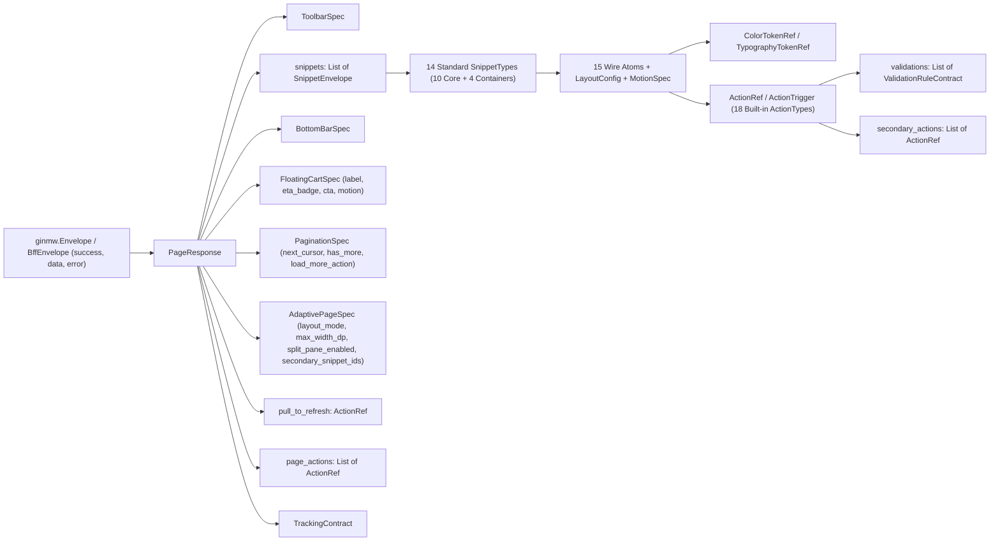

# SDUI Wire Protocol (`v1`)

`abeta-dev/kmp` uses a **versioned JSON wire protocol (`v1`)** shared **1:1** between `kmp/sdui-contracts` + `kmp/action-engine` (`kotlinx.serialization`, `SduiJson`) and `bff/pkg/sdui/{actions,atoms,snippets,theming}` (Go 1.26.0, `encoding/json`).

All HTTP API responses from the Go BFF are wrapped in `ginmw.Envelope` (`BffEnvelope<T>` on KMP, `WatchBffEnvelope<T>` in `watch-companion`). Every schema change must preserve `snake_case` field names and pass golden parity tests against `bff/testdata/golden/`.

---

## Protocol Hierarchy



---

## 1. HTTP Envelope (`ginmw.Envelope` / `BffEnvelope<T>`)

Every `/api/v1/*` endpoint returns:

```json
{
  "success": true,
  "data": { ... },
  "error": null
}
```

On failure, `success` is `false` and `error` contains `{ "code": "...", "message": "...", "detail": "..." }` (`BffApiError` in `kmp/sdui-layout/.../BffModels.kt`).

---

## 2. `PageResponse`, `AdaptivePageSpec`, `FloatingCartSpec` & `PaginationSpec`

Returned inside `data` by `GET /api/v1/screens/:screenId`:

| Field | Type | Required | Description |
| :--- | :--- | :--- | :--- |
| `page_id` | `string` | Yes | Stable screen identifier (`"home"`, `"store-home"`, `"catalog"`, `"profile"`, `"form-demo"`, `"containers"`, `"watch-status"`) |
| `title` | `string?` | No | Screen title |
| `toolbar` | `ToolbarSpec?` | No | Top app bar (`title`, `subtitle`, `navigation_icon`, `trailing_actions`, `bg_color`, `layout`) |
| `snippets` | `SnippetEnvelope[]` | No | Ordered list of screen snippets (defaults to `[]`) |
| `bottom_bar` | `BottomBarSpec?` | No | Persistent bottom action bar (`primary_button`, `secondary_button`, `helper_text`, `layout`, `motion`) |
| `floating_cart` | `FloatingCartSpec?` | No | Persistent floating cart summary bar (`label`, `eta_badge`, `cta`, `motion`) rendered by `FloatingCartDockHost` |
| `page_actions` | `ActionRef[]` | No | Lifecycle actions dispatched when the page loads (defaults to `[]`) |
| `tracking` | `TrackingContract?` | No | Page-level analytics event (`event_name`, `properties`) |
| `pagination` | `PaginationSpec?` | No | Cursor pagination metadata (`next_cursor`, `has_more`, `load_more_action`) |
| `pull_to_refresh` | `ActionRef?` | No | Optional action dispatched on pull-to-refresh (`PullToRefreshBox`) |
| `adaptive_layout` | `AdaptivePageSpec?` | No | Server-driven responsive viewport rules (`layout_mode`, `max_width_dp`, `split_pane_enabled`, `secondary_snippet_ids`) |

### `AdaptivePageSpec` & Responsive Breakpoint Specs (`AdaptiveContracts.kt` / `pkg/sdui/snippets`)

| Type | Wire Values / Fields (`snake_case`) |
| :--- | :--- |
| **`ScreenLayoutMode`** | `"single_column"` \| `"centered"` \| `"split_pane"` |
| **`AdaptivePageSpec`** | `layout_mode` (`ScreenLayoutMode`, default `"centered"`), `max_width_dp` (`int?`), `split_pane_enabled` (`boolean`, default `false`), `secondary_snippet_ids` (`string[]`) |
| **`ResponsiveColumnsSpec`** | `compact` (`int?`), `medium` (`int?`), `expanded` (`int?`) — attached via `GridSnippetData.columns_by_width` |
| **`ResponsiveIntSpec`** | `compact` (`int?`), `medium` (`int?`), `expanded` (`int?`) — attached via `CarouselSnippetData.item_width_by_width` |

### `FloatingCartSpec`

| Field | Type | Required | Description |
| :--- | :--- | :--- | :--- |
| `label` | `string` | Yes | Fallback summary label (live subtotal & item count are computed dynamically by `PageCartCalculator` when `product_card` snippets exist) |
| `eta_badge` | `TagAtom?` | No | Optional express delivery ETA badge (e.g., `"8 MINS"`) |
| `cta` | `ButtonAtom` | Yes | Checkout call-to-action button |
| `motion` | `MotionSpec?` | No | Declarative enter/exit/loop motion applied to `FloatingCartDockHost` |

### `PaginationSpec`

| Field | Type | Required | Description |
| :--- | :--- | :--- | :--- |
| `next_cursor` | `string?` | No | Opaque cursor token for fetching the subsequent page |
| `has_more` | `boolean` | No | `true` when additional pages are available (defaults to `false`) |
| `load_more_action` | `ActionRef?` | No | Action dispatched when incremental loading is requested (`LayoutController.loadMore()`) |

---

## 3. `SnippetEnvelope` & All 14 Standard `SnippetTypes`

Every section in `PageResponse.snippets` is wrapped in `SnippetEnvelope`:

| Field | Type | Required | Description |
| :--- | :--- | :--- | :--- |
| `snippet_id` | `string` | Yes | Unique instance ID within the page |
| `snippet_parent_id` | `string?` | No | Optional parent container ID (e.g., inside `carousel`, `grid`, `tabs`, or `accordion`) |
| `snippet_type` | `string` | Yes | Discriminator matching `SnippetTypes` |
| `data` | `JsonObject` | No | Typed snippet payload decoded by `SnippetRegistry` |
| `tracking` | `TrackingContract?` | No | Impression analytics (`event_name`, `properties`) |
| `motion` | `MotionSpec?` | No | Optional declarative enter/stagger/loop animation spec applied by `SnippetEntry` |

### All 14 Standard Snippet Types (`SnippetTypes`)

| `snippet_type` | Kotlin Contract (`sdui-contracts`) | Purpose |
| :--- | :--- | :--- |
| `header_v1` | `HeaderSnippetData` | Section/page header with `title`, `subtitle`, `leading_icon`, `avatar` (`AvatarAtom?`), `trailing_tag`, `trailing_action`, `trailing_icon`, `skeletons` (`SkeletonAtom[]`), `on_click`, `layout` |
| `banner_v1` | `BannerSnippetData` | Highlighted banner with `title`, `body`, `icon`, `image`, `tag`, `cta`, `dismiss_action`, `on_click`, `layout` |
| `metric_card` | `MetricCardSnippetData` | KPI card with `label`, `value`, `delta`, `caption`, `icon`, `progress`, `on_click`, `layout` |
| `card_v1` | `CardSnippetData` | Content card with `title`, `subtitle`, `description`, `media`, `avatar` (`AvatarAtom?`), `skeletons` (`SkeletonAtom[]`), `badge`, `leading_icon`, `primary_button`, `secondary_button`, `on_click`, `layout` |
| `action_row` | `ActionRowSnippetData` | Clickable row with `title`, `subtitle`, `leading_icon`, `trailing_tag`, `trailing_icon`, `on_click`, `layout` |
| `form_v1` | `FormSnippetData` | Interactive form with `form_id`, `title`, `description`, `fields` (`TextFieldAtom[]`), `switches` (`SwitchAtom[]`), `checkboxes` (`CheckboxAtom[]`), `sliders` (`SliderAtom[]`), `submit_button`, `cancel_button`, `layout` |
| `empty_state` | `EmptyStateSnippetData` | Zero-data placeholder with `title`, `message`, `icon`, `image`, `action_button`, `layout` |
| `divider` | `DividerSnippetData` | Horizontal separator wrapping `divider` (`DividerAtom`) and `layout` |
| `spacer` | `SpacerSnippetData` | Spacing element wrapping `spacer` (`SpacerAtom`) |
| `product_card` | `ProductCardSnippetData` | Quick-commerce product card with `product_id`, `title`, `subtitle`, `price`, `original_price`, `unit_price_cents`, `badge`, `image`, `stepper` (`StepperAtom`), `rating`, `on_click`, `layout` |
| `carousel` | `CarouselSnippetData` | Horizontal scrolling container with `title`, `items` (`SnippetEnvelope[]`), `item_width_dp`, `item_width_by_width` (`ResponsiveIntSpec?`), `spacing_dp`, `layout` |
| `grid` | `GridSnippetData` | Multi-column container with `title`, `columns` (default `2`), `columns_by_width` (`ResponsiveColumnsSpec?`), `spacing_dp`, `items` (`SnippetEnvelope[]`), `layout` |
| `tabs` | `TabsSnippetData` | Tabbed container with `tabs` (`TabItemSpec[]`) and `selected_index`, `layout`. Each `TabItemSpec` holds `id` (`string`), `title` (`string`, matching Go BFF `TabItemSpec.Title`), `badge` (`TagAtom?`), and `snippets` (`SnippetEnvelope[]`) |
| `accordion` | `AccordionSnippetData` | Collapsible container with `title`, `subtitle`, `initially_expanded` (default `false`), `snippets` (`SnippetEnvelope[]`), `layout` |

Unknown `snippet_type` entries are safely handled with an unknown-snippet fallback in `SnippetRegistry` without crashing the screen (`SduiJson` sets `ignoreUnknownKeys = true`).

---

## 4. Token References & `LayoutConfig`

### `ColorTokenRef`
```json
{
  "token": "text.primary",
  "alpha": 0.9,
  "fallback_hex": "#111318",
  "hex": null
}
```
Fields: `token` (`string?`), `alpha` (`float?`), `fallback_hex` (`string?`), `hex` (`string?`).

### `TypographyTokenRef`
```json
{
  "token": "title.large",
  "font_weight": "bold",
  "letter_spacing": 0.15
}
```
Fields: `token` (`string`), `font_weight` (`string?`), `letter_spacing` (`double?`).

### `LayoutConfig`
Shared box layout configuration on atoms, snippets, `ToolbarSpec`, and `BottomBarSpec`:

- `padding`: `SpacingValues` (`top`, `bottom`, `start`, `end`, `all`, `horizontal`, `vertical`)
- `margin`: `SpacingValues`
- `bg_color`: `ColorTokenRef`
- `corner_radius`: `CornerRadiusSpec` (`token`, `all`, `top_start`, `top_end`, `bottom_start`, `bottom_end`)
- `border`: `BorderSpec` (`width_dp`, `width_token`, `color`)
- `fill_max_width`: `boolean`

---

## 5. Motion & Feedback Wire Contracts (`MotionContracts.kt`, `AtomEnums.kt`, `pkg/sdui/atoms`)

`MotionSpec` attaches optional declarative entrance/exit transitions, stagger delays, and continuous loop effects to **`ButtonAtom`**, **`TagAtom`**, **`SnippetEnvelope`**, **`BottomBarSpec`**, and **`FloatingCartSpec`**. In `kmp/ui-atoms`, `MotionModifier.kt` (`applyMotionSpec`, `Modifier.shakeOnError`, `resolveMotionDurationMs`, `resolveMotionDelayMs`, `resolveEnterTransition`, `resolveExitTransition`) collapses all animations when `ThemeTokens.motion.reducedMotion` is `true`.

| Type | Wire Values / Fields (`snake_case`) |
| :--- | :--- |
| **`MotionSpec`** | `enter` (`MotionTransition`), `exit` (`MotionTransition`), `duration_token` (`MotionDurationToken?`), `duration_ms` (`int?`), `stagger_ms` (`int`, default `0`), `delay_ms` (`int`, default `0`), `loop_effect` (`MotionLoopEffect`) |
| **`MotionTransition`** | `"none"` \| `"fade_in"` \| `"slide_up"` \| `"slide_down"` \| `"scale_in"` \| `"spring_bounce"` |
| **`MotionDurationToken`** | `"instant"` \| `"fast"` \| `"normal"` \| `"slow"` |
| **`MotionLoopEffect`** | `"none"` \| `"pulse"` \| `"shimmer"` |
| **`FeedbackEffect`** | `"celebration"` \| `"cart_bounce"` \| `"shake_error"` \| `"haptic_tick"` |

---

## 6. All 15 Wire Atoms (`Atoms.kt` & `pkg/sdui/atoms`)

| Atom | Key Fields | Action Triggers |
| :--- | :--- | :--- |
| **`TextAtom`** | `id`, `text`, `color`, `typography`, `max_lines`, `alignment` (`start`\|`center`\|`end`), `markdown`, `strike_through`, `underline`, `prefix_icon`, `suffix_icon`, `layout` | `on_click` (`ActionRef`) |
| **`IconAtom`** | `id`, `name`, `size_dp`, `color`, `content_description`, `layout` | `on_click` (`ActionRef`) |
| **`TagAtom`** | `id`, `label`, `variant` (`neutral`\|`brand`\|`success`\|`warning`\|`error`\|`info`), `bg_color`, `text_color`, `border`, `icon`, `layout`, `motion` (`MotionSpec?`) | `on_click` (`ActionRef`) |
| **`ButtonAtom`** | `id`, `label`, `sub_label`, `variant` (`primary`\|`secondary`\|`outline`\|`ghost`\|`destructive`), `size` (`sm`\|`md`\|`lg`), `enabled`, `loading`, `full_width`, `leading_icon`, `trailing_icon`, `tracking`, `layout`, `motion` (`MotionSpec?`) | `on_click` (`ActionRef`) |
| **`ImageAtom`** | `id`, `url`, `content_description`, `width_dp`, `height_dp`, `aspect_ratio`, `scale_mode` (`fit`\|`fill_bounds`\|`crop`\|`inside`), `corner_radius`, `placeholder_color`, `layout` | `on_click` (`ActionRef`) |
| **`TextFieldAtom`** | `field_id`, `label`, `placeholder`, `initial_value`, `helper_text`, `error_text`, `enabled`, `read_only`, `single_line`, `max_lines`, `max_length`, `required`, `regex`, `keyboard_type` (`text`\|`number`\|`email`\|`phone`\|`password`\|`decimal`\|`uri`), `prefix_icon`, `suffix_icon`, `layout` | `on_value_change`, `on_submit` (`ActionRef`) |
| **`DividerAtom`** | `id`, `thickness_dp`, `color`, `inset_start_dp`, `layout` | None |
| **`SpacerAtom`** | `id`, `width_dp`, `height_dp`, `weight` | None |
| **`ProgressAtom`** | `id`, `kind` (`linear`\|`circular`), `progress`, `label`, `color`, `track_color`, `layout` | None |
| **`SwitchAtom`** | `field_id`, `label`, `subtitle`, `checked`, `enabled`, `layout` | `on_change` (`ActionRef`) |
| **`CheckboxAtom`** | `field_id`, `label`, `subtitle`, `checked`, `enabled`, `required`, `layout` | `on_change` (`ActionRef`) |
| **`SliderAtom`** | `field_id`, `label`, `value`, `min_value`, `max_value`, `steps`, `show_value`, `unit_label`, `enabled`, `layout` | `on_change` (`ActionRef`) |
| **`AvatarAtom`** | `id`, `url`, `initials`, `size_dp`, `bg_color`, `text_color`, `content_description`, `layout` | `on_click` (`ActionRef`) |
| **`SkeletonAtom`** | `id`, `kind` (`SkeletonKind`: `text`\|`rectangle`\|`circle`), `width_dp`, `height_dp`, `layout` | None |
| **`StepperAtom`** | `field_id`, `label`, `quantity`, `min_quantity` (default `0`), `max_quantity` (default `20`), `enabled`, `layout` | `on_increment`, `on_decrement` (`ActionRef`) |

> Note: `kmp/ui-atoms` renders all **15 wire atoms** plus `UiSurfaceCard` (a container surface atom), giving **16 stateless Compose atoms** in total (plus `UiCelebrationOverlay`, `UiHapticFeedback.kt`, and `MotionModifier.kt`).

---

## 7. `ActionRef` / `ActionTrigger` & All 18 Action Types

In KMP (`sdui-contracts`) this contract is `ActionRef`; in Go (`pkg/sdui/actions`) it is `ActionTrigger`:

```json
{
  "id": "submit_workspace_form",
  "type": "call_api",
  "payload": {
    "endpoint": "/api/v1/actions/execute",
    "method": "POST",
    "body": { "form_id": "workspace_onboarding" }
  },
  "validations": [
    {
      "field_id": "work_email",
      "rule": "regex",
      "value": "^[^@\\s]+@[^@\\s]+\\.[^@\\s]+$",
      "message": "Enter a valid email address"
    }
  ],
  "secondary_actions": [
    {
      "id": "track_form_submit",
      "type": "track_event",
      "payload": { "event_name": "workspace_form_submitted" }
    }
  ]
}
```

### Fields on `ActionRef` / `ActionTrigger`
- `id`: `string?` (in Go `ActionTrigger.ID` is non-empty string)
- `type`: `string`
- `payload`: `JsonObject` / `json.RawMessage`
- `validations`: `ValidationRuleContract[]` — `{ "field_id", "rule", "value"?, "message" }`
- `secondary_actions`: `ActionRef[]` / `ActionTrigger[]`

### All 18 Built-In Action Types (`ActionTypes`)

| `type` | Payload Fields (`snake_case`) |
| :--- | :--- |
| `navigate` | `route`, `params` (`map<string,string>`), `clear_back_stack` (`bool`), `launch_mode` (`string?`) |
| `back_press` | `result` (`map<string,any>`), `steps` (`int`, default `1`) |
| `open_dialog` | `dialog_id`, `title`, `message`, `dismissible` (`bool`), `positive_action` (`ActionRef?`), `negative_action` (`ActionRef?`), `presentation` (`OverlayPresentation`: `"dialog"` \| `"bottom_sheet"`, default `"dialog"`) |
| `dismiss_overlay` | `overlay_id` (`string?`), `all` (`bool`) |
| `show_toast` | `message`, `duration_ms` (`long`, default `2500`), `variant` (`string`, default `"info"`) |
| `call_api` | `endpoint`, `method` (default `"POST"`), `headers`, `body` (`JsonObject?`), `on_success` (`ActionRef?`), `on_error` (`ActionRef?`) |
| `save_state` | `key`, `value` (`JsonElement`), `scope` (default `"session"`) |
| `delete_state` | `key`, `scope` (default `"session"`) |
| `track_event` | `event_name`, `properties` (`map<string,JsonElement>`) |
| `refresh_page` | `page_id` (`string?`), `show_loader` (`bool`) |
| `copy_to_clipboard` | `text`, `label` (`string?`) |
| `update_snippets` | `operation`, `target_snippet_id` (`string?`), `snippets` (`SnippetEnvelope[]`) |
| `batch` | `actions` (`ActionRef[]`), `stop_on_error` (`bool`), `parallel` (`bool`) |
| `trigger_feedback` | `effect` (`FeedbackEffect`: `"celebration"` \| `"cart_bounce"` \| `"shake_error"` \| `"haptic_tick"`), `title` (`string?`), `subtitle` (`string?`), `duration_ms` (`long`, default `1800`), `target_id` (`string?`) |
| `open_url` | `url` (`string`), `external_browser` (`bool`, default `true`), `fallback_route` (`string?`) |
| `share` | `title` (`string?`), `text` (`string`), `url` (`string?`), `chooser_title` (`string?`) |
| `request_permission` | `permission` (`OsPermissionKind`: `"location"` \| `"notifications"` \| `"camera"` \| `"storage"`), `rationale` (`string?`), `on_granted` (`ActionRef?`), `on_denied` (`ActionRef?`) |
| `biometric_auth` | `reason` (`string`), `title` (`string?`), `allow_device_credential` (`bool`, default `true`), `on_authenticated` (`ActionRef?`), `on_failed` (`ActionRef?`) |

---

## Golden Schema Parity Fixtures

Canonical `v1` wire fixtures (**5 fixtures**) live in `bff/testdata/golden/`:

- `bff/testdata/golden/home_screen.json`
- `bff/testdata/golden/form_screen.json`
- `bff/testdata/golden/action_batch.json`
- `bff/testdata/golden/containers_screen.json`
- `bff/testdata/golden/store_home.json`

Both `bff/internal/infra/golden_test.go` and `kmp/sdui-contracts/src/jvmTest/kotlin/dev/abeta/kmp/contracts/GoldenFixturesParityTest.kt` (plus `SduiScreenComposeTest`) validate against these exact files to guarantee zero drift between Go and Kotlin.
