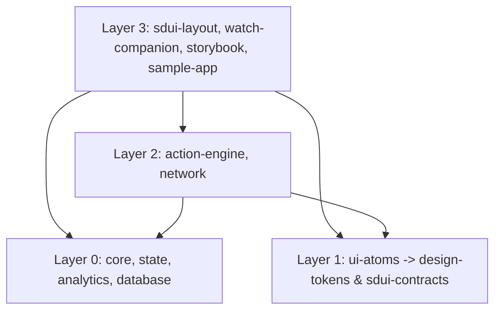

# Architecture Overview

`abeta-dev/kmp` enforces a strict **4-layer Clean Architecture** across `kmp/` and a **Clean Architecture** layout (`internal/handler` -> `internal/usecase` -> `internal/domain` <- `internal/infra`) inside `bff/`.

---

## Layer Topology

> Note: `sdui-layout` stays Room-free by default (opt-in Room 3 via `DatabaseKeyValueStore` in `io.github.abeta-dev:database`), and `watch-companion` is a headless Layer 3 module depending only on `core`, `state`, `analytics`, `sdui-contracts`, `action-engine`, and `network` (zero Compose UI or `ui-atoms`/`sdui-layout` dependencies).

### Supported Multiplatform Targets & Reference Host Glue (`v0.8.0`)

- **Headless / Contract Publishable Modules** (`core`, `state`, `analytics`, `database`, `sdui-contracts`, `action-engine`, `network`, `watch-companion`): native **`android` `.aar`** (`com.android.kotlin.multiplatform.library` `9.5.3`, `compileSdk = 37`, `minSdk = 24`), `jvm`, `iosArm64`, `iosSimulatorArm64`, `macosArm64`, `watchosArm64`, `watchosSimulatorArm64`, `watchosDeviceArm64`, and `wasmJs`.
- **Compose UI Publishable Modules** (`design-tokens`, `ui-atoms`, `sdui-layout`): native **`android` `.aar`** (`compileSdk = 37`, `minSdk = 24`), `jvm`, `iosArm64`, `iosSimulatorArm64`, `macosArm64`, and `wasmJs`.
- **`storybook`**: `jvm`, `iosArm64`, `iosSimulatorArm64`, `macosArm64`, and `wasmJs`; **`sample-app`**: `jvm` Desktop & `--headless` CLI.
- **Apple XCFrameworks**: `AbetaSduiKit.xcframework` (`sdui-layout`), `AbetaWatchKit.xcframework` (`watch-companion`), and `AbetaStorybookKit.xcframework` (`storybook`).
- **Native Android Actuals & Drop-in Host Glue (`kmp/platforms/`)**: Published Maven Central artifacts (`0.8.0`) include native `*-android` `.aar` binaries across all 11 libraries; Android & Wear OS apps call `AbetaAndroidContext.initialize(applicationContext)` once at startup. Optional host glue lives under `android/`, `wearos/`, `apple/` (4-product SwiftPM `Abeta-dev/kmp-spm` `0.8.0`), and `web/README.md`.

### Layer Responsibilities

- **Layer 0 (`core`, `state`, `analytics`, `database`)**:
  - `core`: `AppResult`, `AppError`, `DispatcherProvider`, `Clock`, `AppLogger`, `KeyValueStore`/`ObservableKeyValueStore`, `UuidGenerator`, `BackoffPolicy`, `SingleFlight`, `Debouncer`, `ClickBackpressureGuard`, `SensitiveDataRedactor`, `FieldValidators`, `AbetaAndroidContext`, `PlatformInfo`, `PlatformCapabilities`, native `androidMain` actuals, `HapticEngine`, `ClipboardPort`, `ExternalLauncherPort`, `SharePort`, `ConnectivityMonitor`, `PermissionPort`, `LocationPort` (`wasmJs` `navigator.geolocation`), `FilePickerPort` (`jvm` AWT, `macos` AppKit `NSOpenPanel`, `wasmJs` `<input type="file">`), `PushNotificationPort`, `AudioCapturePort` (`jvm` 16 kHz PCM w/ live RMS telemetry), `SpeechToTextPort`, `DesktopSystemPort` (native `macosMain` AppKit & `jvm`), `LocaleFormatter`, `DeepLinkParser`, `SecureKeyValueStore` (`AndroidKeyStore`, `AppleKeychain` w/ `NSLock`, JVM file AES-256-GCM, WasmJS `sessionStorage`), `BiometricAuthenticator` (`LAContext`). Zero project dependencies.
  - `state`: Thread-safe `SessionStore`, `DataStoreKeyValueStore`, `createDiskKeyValueStore`, native `androidMain` `SharedPreferences`/DataStore/file actuals, typed & observable `PreferenceStore`, `createSecurePersistentKeyValueStore(namespace)`, `FeatureFlagProvider`, and `OfflineMutationQueue`. Depends only on `core`.
  - `analytics`: `AnalyticsEvent`, `AnalyticsTracker`, `Composite`, `Logger`, `Recording`, `Sanitizing`, `Deduplicating`, `Enriching`, and `Buffered` trackers. Depends only on `core`.
  - `database`: Room 3 (`3.0.3`, schema **v2** w/ `MIGRATION_1_2`) KMP local SQLite engine (`AbetaDatabase`, `AbetaLocalDatabase`, `DatabaseKeyValueStore` opt-in `ObservableKeyValueStore` adapter, native `androidMain` Room 3 builder, `cached_screens` incl. `pageVersion`/`appVersion`, `offline_mutations`, `key_value_records`), `sqlite-bundled:2.7.1`, `sqlite-web:2.7.1` OPFS Web Worker, KSP (`2.3.14` incl. `kspAndroid`) codegen & committed schema JSON exports (`1.json` & `2.json`). Depends only on `core`.
- **Layer 1 (`design-tokens`, `sdui-contracts`, `ui-atoms`)**:
  - `design-tokens`: Owns all immutable design tokens plus `ResponsiveTokens.kt` (`ThemeTokens.adaptiveMetrics`). Zero project dependencies.
  - `sdui-contracts`: Pure `@Serializable` v1 wire DTOs (`PageResponse` w/ `page_version`, `app_version`, `etag`, `stream_spec`, `ScreenManifestResponse` w/ `sdui_schema_version`, `SnippetEnvelope` w/ `sticky` & `motion`, **23 `SnippetTypes`** incl. `composed_block` w/ **36 `ComposedNodeKind`s**, `custom_slot`, & `graph_canvas`, **29 Wire Atoms** incl. `MediaPagerAtom`, `CountdownAtom` w/ `expires_at_epoch_ms`, & 12 `ExtendedAtoms.kt` primitives, **6 `SnippetDeltaOp`s**, `AdaptiveContracts.kt`, `MotionContracts.kt` w/ **7 Ambient `MotionLoopEffect`s**, `FloatingCartSpec` nudges, `ActionRef`, `TrackingContract`, `SduiJson`). Zero `core`, Compose, or Ktor imports.
  - `ui-atoms`: **31 stateless Compose Multiplatform atoms** (incl. `UiMediaPager`, real ISO/IEC 18004 `UiQrCode`, `UiStepper`, `UiCountdown`, `UiRollingCounter`, & 12 extended atoms), `UiCelebrationOverlay`, `UiHapticFeedback.kt`, `MotionModifier.kt` + `MotionLoopModifiers.kt` (**7 Ambient `MotionLoopEffect`s**, `Modifier.pressBounce`, `Modifier.shakeOnError`) honoring `ThemeTokens.motion.reducedMotion`. Depends only on `design-tokens` and `sdui-contracts`.
- **Layer 2 (`action-engine`, `network`)**:
  - `action-engine`: OCP **18 `ActionTypes`**, `ActionDecoderRegistry`, `ActionRegistry`, depth & budget-guarded `DefaultActionDispatcher`, `ActionValidator`, and `ApiCallExecutor` port. Depends only on `core` and `sdui-contracts`.
  - `network`: Ktor `3.6.1` DIP client (`HttpTransport`, `KtorHttpTransport`, `HttpClientFactory`, `NetworkConfig` w/ `appVersion`) with HTTP/2 ALPN, Brotli (`br`), conditional `If-None-Match`/`304`, `SseTransport`/`KtorSseTransport`, `CsrfTokenProvider` + single `403` retry, bearer refresh, and validated `sha256/` `CertificatePinMatcher` for JVM/OkHttp and Apple Darwin `NSURLSession`. Depends only on `core`.
- **Layer 3 (`sdui-layout`, `watch-companion`, `storybook`, `sample-app`)**:
  - `sdui-layout`: Orchestrates `LayoutController` + SSE delta patching, `SduiLayoutViewModel` (`SavedState`), `PlatformBridgeBundle`, `PlatformBridgeOutcomeExecutor`, `AdaptiveScreenContainers.kt`, **23 snippet renderers** via `BuiltInSnippetModule` (incl. `ComposedBlock` w/ **36 `ComposedNodeKind`s**, `CustomSlot`, `GraphCanvas`), `SduiScreen`, `FloatingCartDockHost`, `UiCelebrationOverlay`, rich SDUI `ModalBottomSheet` & `AlertDialog`, `CachedScreenRepository` (`VERSION_GATED`, `304`, `/manifest`), `RemoteBffAnalyticsTracker`, `OfflineActionCoordinator`, `KtorImageRenderer`, `createSduiKoinModule`, `SduiHostedRoot`, iOS `createSduiViewController` + `AbetaSduiKit.xcframework`, macOS Cocoa `launchMacOsSduiWindow`.
  - `watch-companion`: Headless wearable module (`WatchGlanceModels.kt`, `WatchScreenMapper`, `RemoteWatchPageSource` w/ ETag/304 cache, `WatchRemoteApiCallExecutor`, `WatchCompanionController`, `createWatchCompanionModule`, `createAppleWatchCompanionHost`, `AbetaWatchKit.xcframework`).
  - `storybook`: Unpublished interactive Compose Multiplatform explorer featuring **20 stories across 5 categories** (`LIVE_DEMOS`, `FOUNDATIONS`, `ATOMS` — 8 stories covering all **31** atoms, `SNIPPETS` — `"All 23 Snippets"`, `PLAYGROUND`), including **Live 7-in-1 Super-App Demos**, `MotionAndStoreStory`, `ResponsiveAndBridgesStory` (incl. `Voice & Desktop OS Bridges`), `DiscoveryAndSearchStory`, **Animation & Nudges Lab**, **Atomic Snippet Crafter**, **End-to-End App Journeys**, and `LiveBffStory`, Desktop JVM, WasmJS, macOS `launchStorybookMacOsWindow`, `StorybookViewController` + `AbetaStorybookKit.xcframework`.
  - `sample-app`: Unpublished Compose Desktop & `--headless` / `--verticals` / `--bff-url` demo composition root featuring the **7-in-1 Super-App Showcase Launcher** (**Abeta Fresh**, **Abeta Bites**, **Abeta Pulse**, **Abeta Mart**, **Abeta Spark**, **Abeta Trade**, **Abeta Pay**) alongside core reference screens (`home`, `store-home`, `catalog`, `profile`, `form-demo`, `containers`, `watch-status`).

---

## Key Architectural Rules

1. **No upward imports**: Layer 1 must never import `core`, `action-engine`, `network`, or `sdui-layout`.
2. **No sibling coupling in Layer 2**: `action-engine` and `network` do not depend on each other; `sdui-layout` and `watch-companion` bridge them via `RemoteApiCallExecutor` / `WatchRemoteApiCallExecutor`.
3. **Host binds concretes**: Concrete analytics trackers, OS bridge ports (`PlatformBridgeBundle`), certificate pins, navigation listeners, and BFF base URLs are wired at the composition root (`sample-app`, `createSduiKoinModule`, `createWatchCompanionModule`, `kmp/platforms/*`, or consumer app).
4. **ABI, CodeGraph & Docs Hygiene**: All **11 publishable KMP library modules** (including Room 3 `database` and native `-android` `.aar` targets) validate binary compatibility via `apiCheck` (`kmp/<mod>/api/jvm/<mod>.api`), verify deterministic CodeGraph freshness via `./scripts/generate_codegraph.py --check`, and generate Dokka v2 HTML via `dokkaGenerateHtml`.

See `docs/architecture.md`, `docs/flows/README.md`, `docs/patterns/README.md`, `docs/codegraph/INDEX.md`, `docs/local-database-room3.md`, and `docs/publishing-and-hosting.md` in the repository for the complete dependency matrix, Mandatory Grounding guides, Room 3 database guide, and open-registry publishing playbook.
