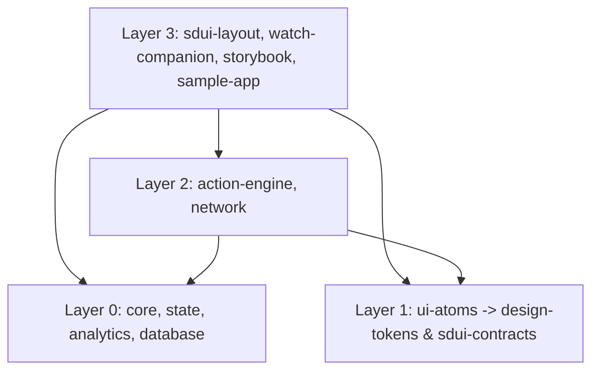

# Architecture Overview

`abeta-dev/kmp` enforces a strict **4-layer Clean Architecture** across `kmp/` and a **Clean Architecture** layout (`internal/handler` -> `internal/usecase` -> `internal/domain` <- `internal/infra`) inside `bff/`.

---

## Layer Topology

> Note: `watch-companion` is a headless Layer 3 module depending only on `core`, `state`, `analytics`, `database`, `sdui-contracts`, `action-engine`, and `network` (zero Compose UI or `ui-atoms`/`sdui-layout` dependencies).

### Supported Multiplatform Targets & Reference Host Glue

- **Headless / Contract Publishable Modules** (`core`, `state`, `analytics`, `database`, `sdui-contracts`, `action-engine`, `network`, `watch-companion`): `jvm`, `iosArm64`, `iosSimulatorArm64`, `macosArm64`, `watchosArm64`, `watchosSimulatorArm64`, `watchosDeviceArm64`, and `wasmJs`.
- **Compose UI Modules** (`design-tokens`, `ui-atoms`, `sdui-layout`) and **`storybook`**: `jvm`, `iosArm64`, `iosSimulatorArm64`, `macosArm64`, and `wasmJs`.
- **`sample-app`**: `jvm` Desktop & `--headless` CLI.
- **Apple XCFrameworks**: `AbetaSduiKit.xcframework` (`sdui-layout`), `AbetaWatchKit.xcframework` (`watch-companion`), and `AbetaStorybookKit.xcframework` (`storybook`).
- **Drop-in Host Glue (`kmp/platforms/`)**: `android/AndroidPlatformBridgeFactory.kt`, `android/AndroidDatabaseFactory.kt`, `wearos/WearCompanionHostActivity.kt`, `apple/AbetaAppleHosts.swift`, `apple/Package.template.swift`, `web/README.md`, and `README.md` (Android & Wear OS templates require an Android app module with `ANDROID_HOME` / Android SDK configured).

### Layer Responsibilities

- **Layer 0 (`core`, `state`, `analytics`, `database`)**:
  - `core`: `AppResult` (+ combinators), `AppError` (`ErrorCategory`, `isRetryable`, `TimeoutError`, `RateLimitError`, etc.), `DispatcherProvider`, `Clock` / `MutableClock` / `ElapsedTimer`, `AppLogger` / `RedactingAppLogger` / `CompositeAppLogger`, `KeyValueStore` / `ObservableKeyValueStore` / `NamespacedKeyValueStore`, `UuidGenerator`, `BackoffPolicy`, `SingleFlight`, `Debouncer`, `ClickBackpressureGuard`, `SensitiveDataRedactor`, `FieldValidators`, `PlatformInfo` (`PlatformKind.{WATCHOS, WEAR_OS, LINUX_NATIVE, WINDOWS_NATIVE}`), `PlatformCapabilities` / `currentPlatformCapabilities()`, `HapticEngine` / `HapticStyle`, `ClipboardPort`, `ExternalLauncherPort`, `SharePort` / `ShareRequest`, `ConnectivityMonitor` / `ConnectivityStatus`, `PermissionPort`, `LocationPort`, `FilePickerPort`, `PushNotificationPort`, `LocaleFormatter` (`formatCurrencyCents`, `currentLocaleTag`), `DeepLinkParser` / `DeepLinkTarget`, `SecureKeyValueStore` (`AppleKeychain` `SecItem*` w/ fallback, JVM AES-256-GCM + `Preferences`, WasmJS `sessionStorage`), `BiometricAuthenticator` (`LAContext` on Apple). Zero project dependencies.
  - `state`: Reactive `SessionStore` (`InMemorySessionStore`, `PersistentSessionStore`, `SessionLifecycleManager`), typed & observable `PreferenceStore` (`VersionedPreferenceEnvelope` backed by `multiplatform-settings`), `createSecurePersistentKeyValueStore(namespace)` in `SettingsKeyValueStore.kt`, `FeatureFlagProvider` (`LayeredFeatureFlagProvider`, `PersistentFeatureFlagStore`), and `OfflineMutationQueue`. Depends only on `core` (design tokens live in `design-tokens`).
  - `analytics`: `AnalyticsEvent`, `AnalyticsTracker`, `CompositeAnalyticsTracker`, `LoggerAnalyticsTracker`, `RecordingAnalyticsTracker`, `SanitizingAnalyticsTracker`, `DeduplicatingAnalyticsTracker`, `EnrichingAnalyticsTracker`, and `BufferedAnalyticsTracker`. Depends only on `core`.
  - `database`: Room 3 (`3.0.3`) KMP local SQLite engine (`AbetaDatabase`, `AbetaLocalDatabase`, `cached_screens`, `offline_mutations`, `key_value_records`), `androidx.sqlite:sqlite-bundled:2.7.1` on JVM/Android/Apple, `androidx.sqlite:sqlite-web:2.7.1` OPFS Web Worker on WasmJS, KSP (`2.3.14`) codegen & committed schema JSON exports under `kmp/database/schemas/`. Depends only on `core` (zero Compose UI or Ktor).
- **Layer 1 (`design-tokens`, `sdui-contracts`, `ui-atoms`)**:
  - `design-tokens`: Owns all immutable design tokens (`ColorTokens`, `DesignPalette`, `SpacingTokens`, `CornerRadiusTokens`, `StrokeWidthTokens`, `TypographyTokens`, `ElevationTokens`, `MotionTokens`, `OpacityTokens`, `SizingTokens`, `ThemePreset`, `ColorAccessibility`, `DesignTheme`, `ThemeTokens`, plus `ResponsiveTokens.kt`: `WindowWidthClass`, `WindowHeightClass`, `DeviceFormFactor`, `AdaptiveLayoutMetrics`, `resolveAdaptiveLayoutMetrics`, `LocalAdaptiveLayoutMetrics`, `ProvideAdaptiveLayoutMetrics`, exposed via `ThemeTokens.adaptiveMetrics`). Zero project dependencies.
  - `sdui-contracts`: Pure `@Serializable` v1 wire DTOs (`PageResponse` with `PaginationSpec`, `pullToRefresh`, `floatingCart` / `FloatingCartSpec` with free-delivery threshold nudges, and `adaptiveLayout` / `AdaptivePageSpec`; `SnippetEnvelope` with optional `motion`; **21 `SnippetTypes`** incl. `product_card`, `swipe_deck`, `search_bar`, `chip_group`, `nudge_bar`, `marquee_strip`, `order_tracker`, and **`composed_block`** with **29 `ComposedNodeKind`s**; **28 Wire Atoms** incl. `StepperAtom`, `CountdownAtom`, and 12 `ExtendedAtoms.kt` primitives; `AdaptiveContracts.kt`; `MotionContracts.kt` + `AtomEnums.kt` with **7 Ambient `MotionLoopEffect`s**, `FeedbackEffect`, `OsPermissionKind`, `ScreenLayoutMode`, `OverlayPresentation`; `LayoutConfig`, `ColorTokenRef`, `TypographyTokenRef`, `ActionRef`, `ValidationRuleContract`, `TrackingContract`, `SduiJson`; `TabItemSpec.title: String`). Zero `core`, Compose, or Ktor imports.
  - `ui-atoms`: **30 stateless Compose Multiplatform atoms** (`UiText`, `UiIcon`, `UiTag`, `UiButton`, `UiImage`, `UiTextField`, `UiDivider`, `UiSpacer`, `UiProgress`, `UiSurfaceCard`, `UiSwitch`, `UiCheckbox`, `UiSlider`, `UiAvatar`, `UiSkeleton`, animated `UiStepper`, live urgency `UiCountdown`, odometer `UiRollingCounter`, plus 12 extended atoms `UiRadioGroup`, `UiSelect`, `UiOtpInput`, `UiChip`, `UiSegmentedControl`, `UiRating`, `UiPrice`, `UiBadge`, `UiAlertBanner`, `UiStatTile`, `UiKeyValueRow`, `UiQrCode`), `UiCelebrationOverlay`, `UiHapticFeedback.kt`, `MotionModifier.kt` + `MotionLoopModifiers.kt` (`applyMotionSpec`, **7 Ambient `MotionLoopEffect`s**, `Modifier.pressBounce`, `Modifier.shakeOnError`) honoring `ThemeTokens.motion.reducedMotion`, `UiImageRenderer` / `LocalImageRenderer`, `LayoutConfigModifier`, `TokenResolvers`, plus `compose.uiTest` semantic tests (`UiAtomsComposeTest`, `ExtendedAtomsComposeTest`). Depends only on `design-tokens` and `sdui-contracts`.
- **Layer 2 (`action-engine`, `network`)**:
  - `action-engine`: OCP **18 `ActionTypes`** (adding `open_url` (`OpenUrlPayload`), `share` (`SharePayload`), `request_permission` (`RequestPermissionPayload`), `biometric_auth` (`BiometricAuthPayload`) alongside `trigger_feedback` (`TriggerFeedbackPayload`), plus `ActionOutcome.{OpenUrlRequested, ShareRequested, PermissionRequested, BiometricAuthRequested, FeedbackTriggered, OverlayRequested}`), `ActionDecoderRegistry`, `ActionRegistry`, `DefaultActionDispatcher`, `ActionValidator`, and `ApiCallExecutor` port. Depends only on `core` and `sdui-contracts`.
  - `network`: Ktor `3.6.1` DIP client (`HttpTransport`, `KtorHttpTransport`, `HttpClientFactory`, `NetworkConfig`) with HTTP/2 ALPN (`ktor-client-okhttp` on JVM, `Darwin` on Apple, `Js` on Wasm), Brotli (`br`) decompression (`org.brotli:dec`), bearer token refresh (`AuthTokenProvider`), and `CertificatePinMatcher` shared SPKI/cert pinning for JVM/OkHttp (`CertificatePinner`) and Apple Darwin `NSURLSession` (`PlatformHttpEngine.apple.kt`) across iOS, macOS, and watchOS. Depends only on `core`.
- **Layer 3 (`sdui-layout`, `watch-companion`, `storybook`, `sample-app`)**:
  - `sdui-layout`: Orchestrates `LayoutController` (`observeConnectivity`, `handleDeepLink`, `isOffline`, `errorShakeSequence`, `errorShakeTargetId`, `dismissFeedback()`, `collectAllEnvelopes`), `PlatformBridgeBundle`, `PlatformBridgeOutcomeExecutor`, `AdaptiveScreenContainers.kt` (`AdaptiveReadyViewport`, `SplitPaneBody`, `OfflineStatusBanner`), `SnippetRegistry` (**21 snippet renderers** via `BuiltInSnippetModule` incl. `NudgeBarSnippetRenderer`, `MarqueeStripSnippetRenderer`, `OrderTrackerSnippetRenderer`, and **`ComposedBlockSnippetRenderer`** Atomic Snippet Molding Engine with **29 `ComposedNodeKind`s**), `SduiScreen`, `FloatingCartDockHost` (free-delivery threshold nudge & unlock bounce), `UiCelebrationOverlay`, `OverlayHost` (`ModalBottomSheet` & `AlertDialog`), `CachedScreenRepository`, `OfflineActionCoordinator`, `KtorImageRenderer`, `createSduiKoinModule` (`platformBridges`, `certificatePins`), `SduiHostRoot.kt` (`SduiHostedRoot`), iOS `createSduiViewController` + `AbetaSduiKit.xcframework`, macOS Cocoa `launchMacOsSduiWindow` (`SduiMacOsWindow.kt`), and `SduiScreenComposeTest`.
  - `watch-companion`: Headless wearable module (`WatchGlanceModels.kt`, `WatchScreenMapper`, `RemoteWatchPageSource`, `WatchRemoteApiCallExecutor`, `WatchCompanionController`, `createWatchCompanionModule`, `createAppleWatchCompanionHost`, `AbetaWatchKit.xcframework`).
  - `storybook`: Unpublished interactive Compose Multiplatform explorer featuring **20 stories across 5 categories** (`LIVE_DEMOS`, `FOUNDATIONS`, `ATOMS` — 8 stories covering all 30 atoms, `SNIPPETS`, `PLAYGROUND`), including **Live 7-in-1 Super-App Demos** (`super-app-demos`), `"All 21 Snippets"`, `MotionAndStoreStory`, `ResponsiveAndBridgesStory`, `DiscoveryAndSearchStory`, **Animation & Nudges Lab** (`animation-nudges`), **Atomic Snippet Crafter** (`snippet-crafter`), **End-to-End App Journeys** (`e2e-journeys`), and `LiveBffStory`, responsive `CompactStoryStrip`/`StorySidebar` shell, `fontScale` controls, Desktop JVM, WasmJS, macOS `launchStorybookMacOsWindow`, `StorybookViewController` + `AbetaStorybookKit.xcframework`, and `StorybookComposeTest`.
  - `sample-app`: Unpublished Compose Desktop & `--headless` / `--verticals` / `--bff-url` demo composition root featuring the **7-in-1 Super-App Showcase Launcher** (**Abeta Fresh**, **Abeta Bites**, **Abeta Pulse**, **Abeta Mart**, **Abeta Spark**, **Abeta Trade**, **Abeta Pay**) alongside core screens (`home`, `store-home`, `catalog`, `profile`, `form-demo`, `containers`, `watch-status`), `CachedScreenRepository`, `OfflineActionCoordinator`, `KtorImageRenderer`, `PlatformBridgeBundle` + `observeConnectivity`, and `OfflineApiCallExecutor`.

---

## Key Architectural Rules

1. **No upward imports**: Layer 1 must never import `core`, `action-engine`, `network`, or `sdui-layout`.
2. **No sibling coupling in Layer 2**: `action-engine` and `network` do not depend on each other; `sdui-layout` and `watch-companion` bridge them via `RemoteApiCallExecutor` / `WatchRemoteApiCallExecutor`.
3. **Host binds concretes**: Concrete analytics trackers, OS bridge ports (`PlatformBridgeBundle`), certificate pins, navigation listeners, and BFF base URLs are wired at the composition root (`sample-app`, `createSduiKoinModule`, `createWatchCompanionModule`, `kmp/platforms/*`, or consumer app).
4. **ABI & Docs Hygiene**: All **11 publishable KMP library modules** (including Room 3 `database`) validate binary compatibility via `apiCheck` (`apiDump`) and generate Dokka v2 HTML via `dokkaGenerateHtml`.

See `docs/architecture.md`, `docs/local-database-room3.md`, and `docs/publishing-and-hosting.md` in the repository for the complete dependency matrix, Room 3 database guide, and open-registry publishing playbook.
